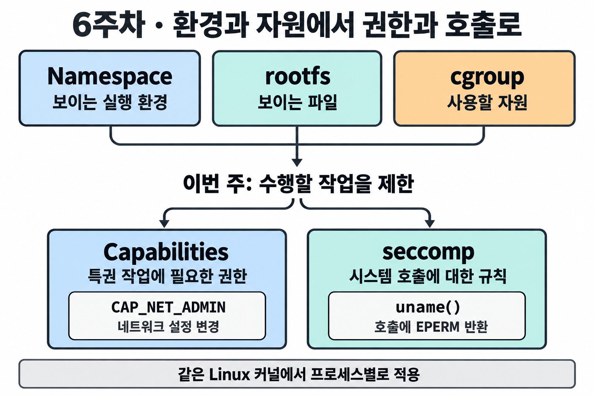
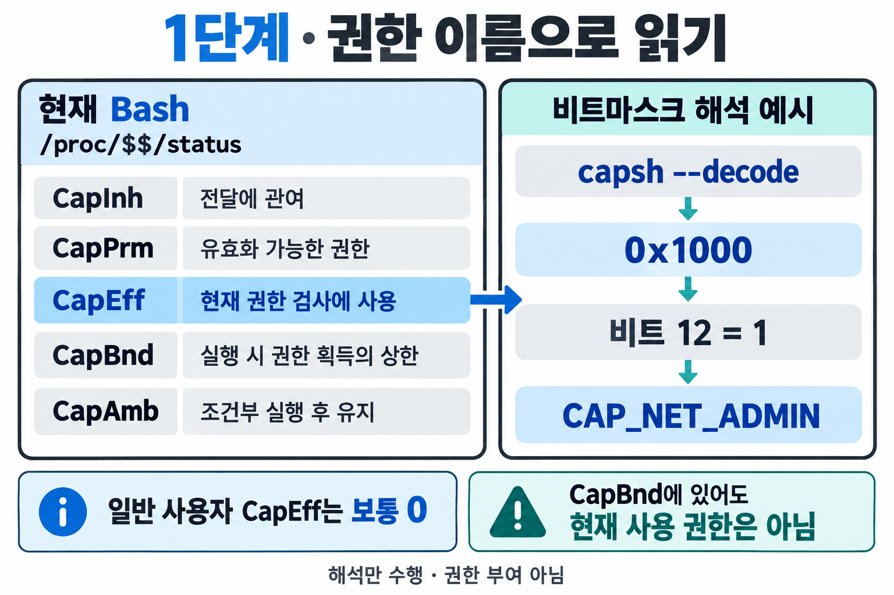
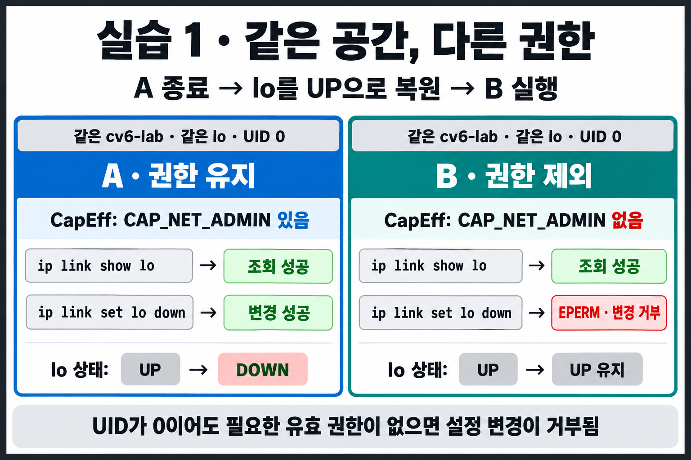
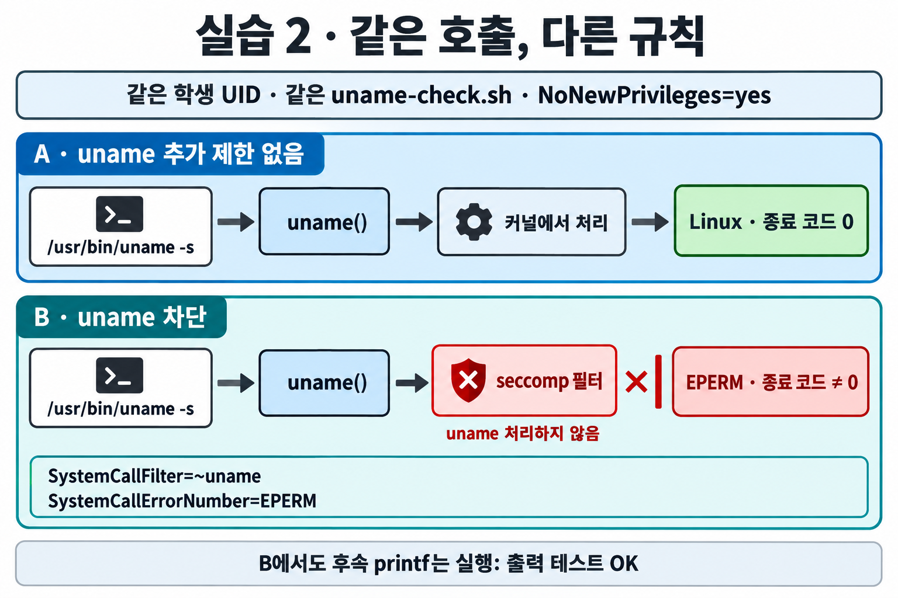
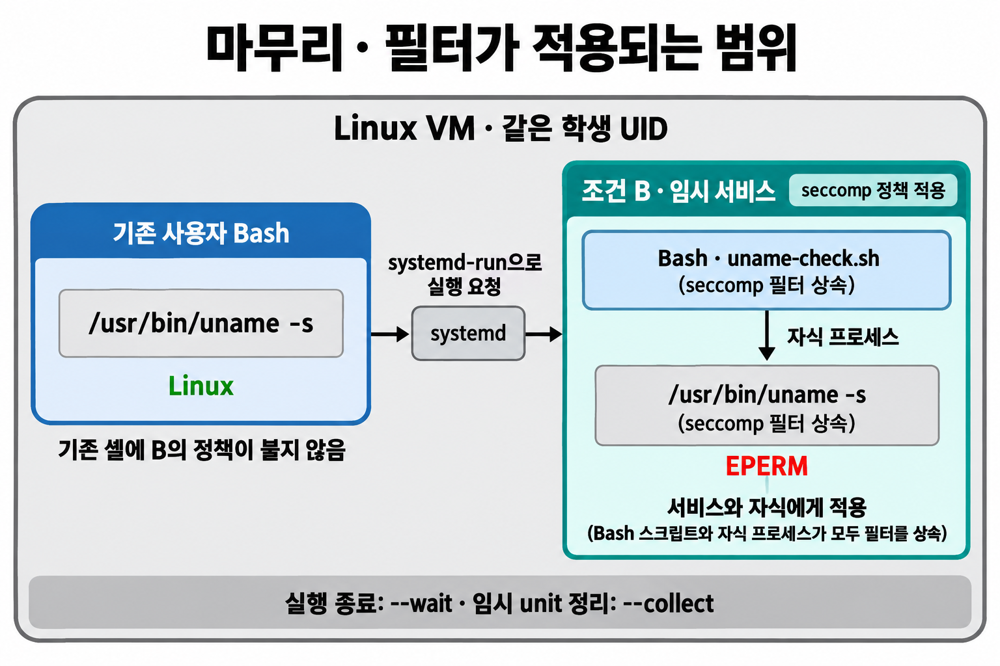

# 6주차 실습 - 프로세스가 할 수 있는 일을 제한하다

[전체 주차 목록](https://github.com/choong-syu/cloud-virtualization) · [5주차 실습](https://github.com/choong-syu/cloud-virtualization/blob/main/week05/README.md)


### 오늘 관찰할 구조



**그림 읽기:** 앞선 주차에서 다룬 실행 환경·파일·자원에 이번 주의 권한과 호출 제한을 더합니다. 아래 두 칸은 서로 다른 제한의 관점입니다. 모든 시스템 호출이 관리 Capability를 요구하거나, 두 기능을 항상 함께 설정해야 한다는 뜻은 아닙니다.

## 도입. 지난주에서 이어지는 질문

3주차에는 rootfs와 namespace로 프로세스가 보는 파일과 실행 환경을 살펴보았습니다.  
4주차에는 cgroup으로 CPU·메모리 사용량을 제한했고,  
5주차에는 Network namespace를 veth와 Linux Bridge로 연결했습니다.

이제 질문을 한 가지 더 추가합니다.

> **실행 환경과 자원을 나누었다면, 그 안의 프로세스는 어떤 작업까지 할 수 있어야 할까요?**

예를 들어 네트워크 상태를 확인하는 프로그램에는 인터페이스 조회가 필요합니다. 하지만 인터페이스를 끄거나 주소를 바꾸는 권한까지 필요하지는 않을 수 있습니다. 이번 실습에서는 **조회는 가능하게 두고 설정 변경 권한을 제한**해 봅니다. 이어서 관리 권한 없이도 사용할 수 있는 시스템 호출에 별도의 제한을 적용합니다.

---

## 0. 시작 전 준비

**준비 환경:** `sudo`를 사용할 수 있는 학생별 **Ubuntu Server 24.04 VM**과 일반 사용자 Bash입니다. PID 1은 `systemd`여야 합니다.

### 사용자와 VM 확인

**호스트 · 일반 사용자**

```bash
id -u
ps -p 1 -o comm=
```

**명령어 풀이**

- `id -u`: 현재 사용자의 UID를 출력합니다. `1000`처럼 **0이 아닌 값**이어야 합니다.
- `ps -p 1`: PID 1인 프로세스를 확인합니다.
- `-o comm=`: 프로세스의 명령 이름만 출력합니다. 여기서는 `systemd`가 보여야 합니다.

UID가 0이거나 PID 1이 `systemd`가 아니면, 수업에서 사용하는 VM의 일반 사용자 셸인지 먼저 확인합니다.

### 필요한 도구 확인

```bash
command -v ip
command -v capsh
command -v systemd-run
command -v strace
```

| 도구 | 이번 실습에서 하는 일 | Ubuntu 패키지 |
| --- | --- | --- |
| `ip` | Network namespace와 인터페이스 조회·설정 | `iproute2` |
| `capsh` | Capability 해석과 권한 조건을 적용한 셸 실행 | `libcap2-bin` |
| `systemd-run` | 설정을 적용한 임시 서비스 실행 | `systemd` |
| `strace` | 프로그램이 요청하는 시스템 호출 관찰 | `strace` |

`command -v`는 명령을 찾으면 경로를 출력합니다. `strace`는 명령 24의 짧은 선택 관찰에 사용합니다.

`ip`·`capsh`가 없거나 선택 관찰에 사용할 `strace`를 설치하려면 패키지 목록을 갱신합니다.

```bash
sudo apt update
```

아래에서 **빠진 도구에 해당하는 줄만** 실행합니다.

```bash
sudo apt install iproute2
sudo apt install libcap2-bin
sudo apt install strace
```

설치 후 `command -v`로 다시 확인합니다. `systemd-run`이 없다면 수업 VM 환경을 교수자와 확인합니다.

> `sudo`는 실습 공간 준비와 권한 조건을 가진 프로그램의 실행에 사용합니다. **권한 유지·제외 셸 안에서 비교하는 관찰 명령에는 임의로 `sudo`를 붙이지 않습니다.** 권한 오류가 이번 실습에서 확인할 결과일 수 있습니다.

---

## 1. 프로세스의 Capability를 눈으로 확인하기


이론에서 본 권한 정보는 실제 프로세스의 `/proc/<PID>/status`에서 읽을 수 있습니다. 먼저 지금 명령을 입력하고 있는 **일반 사용자 Bash**를 관찰합니다.

#### 01. (호스트 · 일반 사용자) 현재 셸의 Capability 집합 확인

```bash
grep '^Cap' /proc/$$/status
```

**명령어 풀이**

- `grep`: 조건에 맞는 행만 골라 보여 줍니다.
- `'^Cap'`: 행의 시작이 `Cap`인 것을 찾습니다. `^`는 행의 시작을 뜻합니다.
- `$$`: 현재 Bash의 PID입니다.
- `/proc/$$/status`: 그 Bash의 상태 정보입니다. 예를 들어 PID가 2400이라면 `/proc/2400/status`를 읽습니다.

다음 다섯 항목을 찾습니다. 값은 환경에 따라 달라지므로 자신의 출력을 기록합니다.

| 항목 | 이론에서 배운 의미 | 이번 실습의 관찰 포인트 |
| --- | --- | --- |
| `CapInh` | 다른 프로그램 실행 시 권한 전달에 관여하는 집합 | 다섯 집합 중 하나임을 확인 |
| `CapPrm` | 프로세스가 유효화할 수 있도록 허용된 권한 | 보유할 수 있는 권한 범위 |
| `CapEff` | 현재 특권 작업의 권한 검사에 사용되는 권한 | `CAP_NET_ADMIN`이 포함되는지 비교 |
| `CapBnd` | 프로그램 실행 시 획득 가능한 권한을 제한하는 집합 | 권한 제외 셸을 만들 때 사용하는 상한 |
| `CapAmb` | 특정 조건에서 다른 프로그램 실행 후에도 유지되는 권한 | 다섯 집합 중 하나임을 확인 |

일반 사용자 셸에서는 보통 `CapPrm`과 `CapEff`가 `0000000000000000`입니다. `CapBnd`에 0이 아닌 값이 있어도 **그 권한을 지금 모두 사용할 수 있다는 뜻은 아닙니다.** 현재 사용할 권한은 `CapEff`에서 확인합니다.

#### 02. (호스트 · 일반 사용자) 이론의 비트마스크 예시를 이름으로 해석

```bash
capsh --decode=0000000000001000
```

**예상 출력**

```text
0x0000000000001000=cap_net_admin
```

**명령어 풀이**

- `capsh --decode=값`: 16진수로 표현한 Capability 집합을 권한 이름으로 풀어 줍니다.
- `0000000000001000`은 10진수 1000이나 권한 개수가 아닙니다. **16진수 `0x1000`, 즉 비트 12가 1인 값**입니다.
- `CAP_NET_ADMIN`의 번호는 12이므로 이 비트가 해당 권한을 나타냅니다.
- 이 명령은 값을 해석할 뿐, 현재 프로세스에 권한을 부여하지 않습니다.

#### 03. (호스트 · 일반 사용자) 자신의 CapEff도 해석

```bash
capsh --decode="$(awk '/^CapEff:/ {print $2}' /proc/$$/status)"
```

**명령어 풀이**

- `awk '/^CapEff:/ {print $2}' ...`: `CapEff:` 행의 두 번째 칸, 즉 16진수 값만 읽습니다.
- `$(...)`: 안쪽 명령의 출력값을 바깥 명령에 전달합니다.
- 따라서 전체 명령은 **현재 셸의 `CapEff`를 읽어 이름으로 해석**합니다. 앞으로 A/B에서도 같은 명령을 사용합니다.

현재 `CapEff`가 모두 0이면 다음처럼 권한 이름 없이 끝날 수 있습니다.

```text
0x0000000000000000=
```



**그림 읽기 — 명령 01~03:** 왼쪽은 현재 Bash에서 읽는 항목이고 오른쪽은 명령 02의 예시 값을 해석한 결과입니다. 일반 사용자에게 `CAP_NET_ADMIN`이 있다는 뜻은 아닙니다. `CapBnd`와 현재 검사에 사용되는 `CapEff`를 구분하고, 자신의 값은 명령 03으로 해석합니다.

**현재 위치 - 명령 03까지:** UID와 Capability 집합을 구분하고, 16진수 권한 정보를 이름으로 읽는 방법을 확인했습니다.

---

## 2. 같은 네트워크 공간에서 권한이 있는 프로세스 실행하기


이제 5주차에서 배운 방식으로 새 Network namespace를 만들고, 그 안에서 `lo`의 상태를 조회하고 변경합니다. 실습 1의 **조건 A는 `CAP_NET_ADMIN`을 유지한 UID 0 셸**입니다.

`lo`는 자기 자신과 통신할 때 사용하는 loopback 인터페이스입니다. 이번에는 통신 연결을 구성하기보다 **상태 조회와 활성화 설정 변경에 필요한 권한이 다른지** 확인합니다.

#### 04. (호스트 · 일반 사용자) 기존 이름과 호스트의 네트워크 공간 확인

```bash
ip netns list
readlink /proc/$$/ns/net
```

**명령어 풀이**

- `ip netns list`: 이름을 붙여 관리하는 Network namespace 목록입니다.
- `readlink /proc/$$/ns/net`: 현재 Bash가 사용하는 Network namespace의 식별값입니다.
- `net:[숫자]`는 공간을 구분하는 값이며 IP 주소가 아닙니다.


#### 05. (호스트 · 일반 사용자) 실습용 Network namespace 생성

```bash
sudo ip netns add cv6-lab
```

**명령어 풀이**

- `ip netns add 이름`: 새 Network namespace를 만들고 이름을 붙입니다.
- `cv6-lab`: 이번 실습에서만 사용할 이름입니다.

생성 결과를 확인합니다.

```bash
ip netns list
```

`cv6-lab`이 보여야 합니다.

#### 06. (호스트에서 cv6-lab 설정) lo를 활성화하고 초기 상태 확인

```bash
sudo ip netns exec cv6-lab ip link set lo up
```

설정 후 조회합니다.

```bash
sudo ip netns exec cv6-lab ip link show lo
```

**명령어 풀이**

- `ip netns exec cv6-lab 명령`: 지정한 네트워크 공간을 사용하는 프로그램을 실행합니다. 5주차와 같은 사용법입니다.
- `ip link set lo up`: `lo`를 관리상 활성 상태로 설정합니다.
- `ip link show lo`: `lo`의 현재 상태를 조회합니다.

**예상 출력의 핵심 부분**

```text
1: lo: <LOOPBACK,UP,LOWER_UP> ... state UNKNOWN ...
```

꺾쇠 괄호 `<...>` 안의 **`UP`**을 확인합니다. `lo`에서는 `state UNKNOWN`이 보여도 설정 실패를 뜻하지 않습니다. 이번 비교에서는 **관리상 활성 상태인 `UP`의 유무**를 읽습니다.

#### 07. (호스트 → 권한 유지 셸) 조건 A의 새 Bash 실행

```bash
sudo ip netns exec cv6-lab capsh --inh= -- --noprofile --norc
```

이제 **권한 유지 셸 · UID 0**입니다. 이후 명령 12까지는 이 셸 안에서 실행합니다.

**명령어 풀이**

- `sudo`: 새 셸을 관리자 권한으로 시작할 수 있게 합니다.
- `ip netns exec cv6-lab`: 새 프로그램이 `cv6-lab`의 네트워크를 사용하게 합니다.
- `capsh`: Capability 조건을 설정하고 프로그램을 실행하는 도구입니다.
- `--inh=`: inheritable 집합을 비웁니다. A/B에 같은 조건으로 적용합니다.
- `--`: 뒤의 인자를 전달하여 새 Bash를 실행합니다.
- `--noprofile --norc`: Bash의 개인 설정 파일을 읽지 않게 하여 두 셸의 시작 조건을 맞춥니다.

프롬프트의 모양은 환경마다 다를 수 있습니다. 다음 명령으로 사용자와 공간을 직접 확인합니다.

#### 08. (권한 유지 셸 · UID 0) 사용자와 Network namespace 확인

```bash
id -u
readlink /proc/$$/ns/net
```

**확인할 내용**

- UID는 **0**입니다.
- Network namespace 식별값은 명령 04의 호스트 값과 다릅니다.
- 이 식별값을 **조건 A의 값**으로 기록합니다. 조건 B에서도 같은 값인지 비교할 예정입니다.

#### 09. (권한 유지 셸 · UID 0) 실제 권한 확인

```bash
grep '^Cap' /proc/$$/status
capsh --decode="$(awk '/^CapEff:/ {print $2}' /proc/$$/status)"
```

**확인:** 해석된 `CapEff` 목록에 `cap_net_admin`이 있어야 합니다. 전체 16진수 값이나 다른 권한 이름까지 예시와 같을 필요는 없습니다.

`CapPrm`과 `CapEff`가 같게 보여도 의미는 다릅니다. `CapPrm`은 유효화할 수 있는 권한 범위이고, `CapEff`는 현재 권한 검사에 사용하는 집합입니다.


#### 10. (권한 유지 셸 · UID 0) 변경 전 lo 상태 조회

```bash
ip link show lo
```

`UP`이 있는지 확인합니다. 여기부터 조회·변경 명령에는 `sudo`를 추가하지 않습니다.

#### 11. (권한 유지 셸 · UID 0) lo를 비활성화

```bash
ip link set lo down
```

**명령어 풀이**

- `down`: 해당 인터페이스를 관리상 비활성 상태로 바꿉니다.
- 이 작업에는 해당 네트워크 공간에 대한 `CAP_NET_ADMIN`이 필요합니다.
- 성공해도 별도 문장이 출력되지 않을 수 있습니다. 다음 조회로 결과를 확인합니다.

#### 12. (권한 유지 셸 · UID 0) 변경 결과 확인

```bash
ip link show lo
```

꺾쇠 괄호 안의 **`UP`이 사라졌는지** 확인합니다.

**현재 위치 - 명령 12까지:** 같은 프로세스 환경에서 상태 조회와 설정 변경이 모두 가능했습니다. 이 셸의 `CapEff`에는 필요한 네트워크 관리 권한이 있습니다.


#### 13. (권한 유지 셸 → 호스트) 조건 A 종료

```bash
exit
```

**호스트 · 일반 사용자**로 돌아온 다음 확인합니다.

```bash
id -u
```

처음의 학생 UID가 나와야 합니다. **셸을 종료해도 `cv6-lab`과 내려 둔 `lo`의 상태는 남습니다.** 다음 단계에서 같은 공간을 다시 사용합니다.

---

## 3. CAP_NET_ADMIN을 제외하고 같은 작업 반복하기


실습 1의 **조건 B도 UID 0**입니다. 같은 공간·같은 인터페이스를 사용하면서 `CAP_NET_ADMIN`을 제외합니다.

| 비교 조건 | 조건 A: 권한 유지 | 조건 B: 권한 제외 |
| --- | --- | --- |
| UID | 0 | 0 |
| Network namespace | `cv6-lab` | 같은 `cv6-lab` |
| 대상 | `lo` | 같은 `lo` |
| 시작 상태 | `UP` 있음 | `UP` 있음으로 복원 |
| 유효 `CAP_NET_ADMIN` | 있음 | 없음 |

#### 14. (호스트 · 일반 사용자) lo를 같은 초기 상태로 복원

```bash
sudo ip netns exec cv6-lab ip link set lo up
```

조회하여 `UP`을 확인합니다.

```bash
sudo ip netns exec cv6-lab ip link show lo
```

**왜 복원이 필요할까요?** A에서 이미 `lo`를 내렸습니다. B도 `UP` 상태에서 시작해야, 같은 변경 요청이 거부되어 상태가 유지되는지 비교할 수 있습니다. A/B 사이에 namespace를 삭제하거나 다시 만들지 않습니다.

#### 15. (호스트 → 권한 제외 셸) 조건 B의 새 Bash 실행

```bash
sudo ip netns exec cv6-lab capsh --drop=cap_net_admin --inh= -- --noprofile --norc
```

이제 **권한 제외 셸 · UID 0**입니다.

**명령어 풀이**

- A의 명령에 **`--drop=cap_net_admin`**을 추가했습니다.
- 이 옵션은 먼저 **bounding 집합에서 해당 권한을 제외**합니다.
- `--inh=`로 inheritable 집합을 비운 상태에서 새 Bash를 실행하면, 이 실습의 새 셸에서는 해당 권한이 `CapPrm`·`CapEff`에도 들어오지 않습니다.
- 옵션 이름만으로 결과를 가정하지 않고 다음 단계에서 새 셸의 실제 권한을 확인합니다.

#### 16. (권한 제외 셸 · UID 0) 같은 사용자와 같은 공간인지 확인

```bash
id -u
readlink /proc/$$/ns/net
```

**확인:** UID는 여전히 **0**이며, namespace 식별값은 명령 08에서 기록한 **조건 A의 값과 같아야** 합니다.

#### 17. (권한 제외 셸 · UID 0) CapEff에서 제외된 권한 확인

```bash
grep '^Cap' /proc/$$/status
capsh --decode="$(awk '/^CapEff:/ {print $2}' /proc/$$/status)"
```

**확인:** 해석된 목록에서 **`cap_net_admin`이 빠졌는지** 봅니다. 다른 Capability는 남아 있을 수 있습니다. 모든 권한을 없애는 실습은 아닙니다.

`CapPrm`, `CapEff`, `CapBnd`를 A의 기록과 비교합니다. 이 실습은 `CapEff`에서만 일시적으로 권한을 끄는 방식이 아니라, bounding 집합을 제한하고 새 프로그램을 실행하는 방식입니다.

#### 18. (권한 제외 셸 · UID 0) 상태 조회

```bash
ip link show lo
```

**예상 결과:** 조회는 성공하고 `UP`이 보입니다. 이 상태 조회에는 `CAP_NET_ADMIN`이 필요하지 않습니다.

#### 19. (권한 제외 셸 · UID 0) A와 같은 설정 변경 요청

```bash
ip link set lo down
```

**예상 결과**

```text
RTNETLINK answers: Operation not permitted
```

이번 단계의 권한 오류는 **관찰하려는 결과**입니다. UID가 0이어도 필요한 유효 권한이 없으면 이 관리 작업이 거부됩니다. 오류를 없애려고 `sudo`를 추가하거나 다른 셸에서 다시 실행하지 않습니다.

#### 20. (권한 제외 셸 · UID 0) 변경이 적용되지 않았는지 확인

```bash
ip link show lo
```

**확인:** `UP`이 그대로 남아 있어야 합니다. 오류 문구만 보지 말고 **실제 설정이 바뀌지 않았음**까지 확인합니다.



**그림 읽기 — 명령 07~20:** 좌우는 동시에 만든 두 namespace가 아니라 **같은 `cv6-lab`을 차례로 사용한 두 조건**입니다. A를 종료한 뒤 명령 14에서 `lo`를 다시 `UP`으로 복원했습니다. 두 조건 모두 조회는 성공하지만, B에서는 설정 변경이 거부되어 `UP`이 남습니다. 그림의 `DOWN`은 관리상 비활성 상태를 뜻하며, 실제 출력에서는 꺾쇠 괄호 안의 `UP` 유무로 확인합니다.

**현재 위치 - 명령 20까지:** UID와 네트워크 공간이 같아도 권한에 따라 결과가 달라졌습니다. 상태 조회는 가능하지만 설정 변경은 거부되었습니다.

#### 21. (권한 제외 셸 → 호스트) 조건 B 종료

```bash
exit
```

**호스트 · 일반 사용자**로 돌아온 뒤 확인합니다.

```bash
id -u
```

#### 22. (호스트 · 일반 사용자) 실습용 네트워크 공간 정리

권한 유지·제외 셸에서 모두 나온 상태에서 실행합니다.

```bash
sudo ip netns del cv6-lab
```

정리 결과를 확인합니다.

```bash
ip netns list
```

목록에서 `cv6-lab`이 사라져야 합니다. 다음 실습은 **호스트의 일반 사용자 셸**에서 진행합니다.

---

## 4. 일반 사용자도 시스템 호출을 사용한다


앞에서는 관리 작업에 필요한 특권을 제한했습니다. 그렇다면 **관리 권한이 없는 프로그램은 커널의 기능을 전혀 사용할 수 없을까요?** 일반 사용자로 시스템 정보를 조회해 봅니다.

#### 23. (호스트 · 일반 사용자) CapEff와 uname 결과 함께 확인

```bash
id -u
grep '^CapEff:' /proc/$$/status
uname -s
```

**예상 출력 예시**

```text
1000
CapEff: 0000000000000000
Linux
```

첫 줄은 자신의 학생 UID입니다. `uname -s`는 커널 이름을 출력하는 명령입니다.

**해석:** 유효한 관리 Capability가 없는 일반 사용자도 `uname()` 시스템 호출로 커널 이름을 조회할 수 있습니다. 모든 시스템 호출이 관리 Capability를 요구하는 것은 아닙니다. 따라서 프로그램이 사용하지 않아도 되는 호출까지 제한하려면 **호출 자체에 대한 규칙**이 필요합니다.

#### 24. (호스트 · 일반 사용자 · 선택 관찰) 명령 안에서 발생하는 시스템 호출 보기

```bash
strace -e trace=uname /usr/bin/uname -s
```

**명령어 풀이**

- `strace`: 프로그램이 요청하는 시스템 호출과 결과를 관찰합니다.
- `-e trace=uname`: 이번에는 `uname` 호출만 골라 표시합니다.
- `/usr/bin/uname -s`: 관찰할 프로그램과 옵션입니다.
- 여기의 `-e`는 **보여 줄 관찰 항목을 선택**합니다. 시스템 호출을 차단하는 설정이 아닙니다.

**예상 출력의 핵심 부분**

```text
uname({sysname="Linux", ...}) = 0
Linux
+++ exited with 0 +++
```

`...`는 설명을 위해 생략한 정보입니다. 첫 줄은 **시스템 호출과 반환값**, `Linux`는 **프로그램의 출력**, 마지막 줄은 **프로그램의 종료 상태**입니다.

**현재 위치 - 명령 24까지:** 터미널에 입력한 명령과 프로그램이 요청하는 시스템 호출을 구분했습니다. 다음에는 같은 `uname()` 호출에 제한을 적용합니다.

---

## 5. 같은 프로그램에 seccomp 규칙 적용하기


실습 2에서는 **확인용 스크립트 하나를 만들어 두 번 실행**합니다. 스크립트는 사용자와 권한·필터 상태를 보여 주고, `uname -s`를 실행한 뒤 그 종료 코드를 기록합니다.

| 비교 조건 | 조건 A | 조건 B |
| --- | --- | --- |
| 실행 사용자 | 현재 학생 UID | 같은 학생 UID |
| 실행할 내용 | `uname-check.sh` | 같은 파일 |
| `uname()`에 대한 추가 제한 | 없음 | `EPERM` 오류 반환 |

### 4주차의 systemd-run과 연결하기

4주차에는 `systemd-run --scope`로 프로세스 묶음의 자원 사용량을 관리했습니다. 이번에는 **systemd가 새 프로그램을 실행하면서 시스템 호출 정책을 적용하는 임시 service**를 사용합니다. 따라서 **이번 명령에는 `--scope`를 붙이지 않습니다.**

systemd는 제한 규칙을 설정하는 도구이며, 실제 시스템 호출을 검사하는 기능은 **Linux 커널의 seccomp**입니다.

#### 25. (호스트 · 일반 사용자) 확인용 스크립트 폴더 만들기

```bash
mkdir -p "$HOME/week06"
```

**명령어 풀이**

- `$HOME`: 현재 학생 계정의 홈 디렉터리입니다.
- `mkdir -p`: 폴더가 없으면 만들고, 이미 있으면 그대로 사용합니다.
- 이후 명령은 파일의 전체 경로를 사용하므로 작업 디렉터리를 옮길 필요가 없습니다.

#### 26. (호스트 · 일반 사용자) 두 조건에서 사용할 같은 스크립트 작성

아래는 **`cat`부터 마지막 `EOF`까지 전체를 한 번에 복사**합니다. 같은 이름의 이전 실습 파일이 있으면 아래 내용으로 갱신됩니다.

```bash
cat > "$HOME/week06/uname-check.sh" <<'EOF'
#!/bin/bash

printf '실행 UID: '
id -u

printf '\n[권한과 seccomp 상태]\n'
grep -E '^(CapPrm|CapEff|NoNewPrivs|Seccomp)' /proc/$$/status

printf '\n[uname -s 실행]\n'
/usr/bin/uname -s
cv6_rc=$?
printf 'uname 종료 코드: %s\n' "$cv6_rc"
printf '출력 테스트: OK\n'
EOF
```

**명령어 풀이**

- `cat > 파일 <<'EOF'`: 다음 줄부터 마지막 `EOF` 전까지의 내용을 파일에 씁니다.
- **`'EOF'`의 작은따옴표를 유지**합니다. 그래야 `$$`와 `$?`를 파일을 만드는 시점에 먼저 바꾸지 않고, 실제 스크립트를 실행할 때 해석합니다.
- `grep -E`: 여러 조건을 묶은 패턴을 사용합니다. `|`는 이 중 하나라는 뜻이며, `Seccomp`로 시작하는 `Seccomp:`·`Seccomp_filters:`도 함께 표시합니다.
- `/proc/$$/status`: 이번에는 **서비스 안에서 실행 중인 Bash**의 상태입니다.
- `$?`: 바로 앞 명령의 종료 코드입니다. `uname` 직후 `cv6_rc`에 저장합니다.
- `printf`: 관찰값을 일정한 형식으로 출력합니다. `%s` 자리에 뒤의 값이 들어가고 `\n`은 줄바꿈입니다.

스크립트의 내용을 확인합니다.

```bash
cat "$HOME/week06/uname-check.sh"
```

파일 안에 `$$`, `$?`, `$cv6_rc`가 그대로 있어야 합니다. 이후 `/bin/bash 파일경로`로 실행하므로 별도의 `chmod`는 필요하지 않습니다.

#### 27. (호스트 · 일반 사용자) 조건 A - uname 추가 제한 없이 실행

```bash
sudo systemd-run --quiet --wait --pipe --collect \
  --uid="$(id -u)" \
  -p NoNewPrivileges=yes \
  /bin/bash "$HOME/week06/uname-check.sh"
```

여러 줄 끝의 `\`는 하나의 명령을 다음 줄로 이어 쓴다는 뜻입니다. 블록 전체를 복사합니다.

**명령어 풀이**

| 부분 | 역할 |
| --- | --- |
| `sudo systemd-run` | systemd에 새 임시 서비스 실행을 요청 |
| `--quiet` | 서비스 실행 안내를 줄이고 관찰할 출력에 집중 |
| `--wait` | 실행한 프로그램이 끝날 때까지 대기 |
| `--pipe` | 프로그램의 출력과 오류를 현재 터미널에 표시 |
| `--collect` | 종료된 임시 unit이 정리되도록 설정 |
| `--uid="$(id -u)"` | 서비스를 현재 학생 UID로 실행 |
| `-p NoNewPrivileges=yes` | 실행 파일을 바꾸어 실행할 때 추가 특권을 얻지 못하게 설정 |
| `/bin/bash ...` | 만든 스크립트를 Bash로 실행 |

**`sudo`로 요청했지만 프로그램의 실행 UID는 학생 UID**입니다. `$(id -u)`와 `$HOME`은 `sudo` 실행 전에 현재 학생 셸에서 값으로 바뀝니다. 출력 첫 줄로 실제 실행 UID를 확인합니다.

`NoNewPrivileges`는 두 조건에 공통으로 적용합니다. 기존 권한을 모두 없애거나 `uname`을 차단하는 옵션은 아닙니다.

**일반적인 수업 VM의 예상 출력 예시**

```text
실행 UID: 1000

[권한과 seccomp 상태]
CapPrm: 0000000000000000
CapEff: 0000000000000000
NoNewPrivs: 1
Seccomp: 0
Seccomp_filters: 0

[uname -s 실행]
Linux
uname 종료 코드: 0
출력 테스트: OK
```

**확인할 내용**

- 실행 UID가 준비 단계의 학생 UID와 같습니다.
- `CapPrm`·`CapEff`를 기록합니다. 보통 둘 다 0입니다.
- `uname`은 `Linux`를 출력하고 종료 코드는 **0**입니다.
- `Seccomp`와 `Seccomp_filters`는 자신의 실제 값을 기록합니다.

이미 서비스 실행 환경에 다른 정책이 적용되어 있다면 A도 `Seccomp: 2`일 수 있습니다. **A의 이름은 ‘uname에 대한 추가 제한 없음’**입니다. A의 모드 숫자가 반드시 0이어야만 비교가 가능한 것은 아닙니다. 다만 A에서 `uname`이 성공해야 기준 결과가 성립합니다.


#### 28. (호스트 · 일반 사용자) 조건 B - uname 호출에 EPERM 반환

스크립트를 수정하지 않고 다음을 실행합니다. 조건 A에 **정책 두 줄**을 추가했습니다.

```bash
sudo systemd-run --quiet --wait --pipe --collect \
  --uid="$(id -u)" \
  -p NoNewPrivileges=yes \
  -p 'SystemCallFilter=~uname' \
  -p SystemCallErrorNumber=EPERM \
  /bin/bash "$HOME/week06/uname-check.sh"
```

**추가한 설정 풀이**

| 설정 | 의미 |
| --- | --- |
| `SystemCallFilter=~uname` | `uname` 시스템 호출을 차단 목록에 지정 |
| `SystemCallErrorNumber=EPERM` | 해당 호출을 처리하는 대신 권한 관련 오류 `EPERM`을 반환 |

`~`가 있으므로 **차단 목록 방식**입니다. `~`를 빼면 허용 목록 방식이 되어 비교 조건이 달라집니다. 이번 실습에서는 이론에서 제시한 두 설정을 그대로 사용합니다.

**예상 출력의 핵심 부분**

```text
실행 UID: 1000

[권한과 seccomp 상태]
CapPrm: 0000000000000000
CapEff: 0000000000000000
NoNewPrivs: 1
Seccomp: 2
...

[uname -s 실행]
uname: cannot get system name: Operation not permitted
uname 종료 코드: 1
출력 테스트: OK
```

`...`는 필터 개수 등 일부 행을 생략한 표시이며 실제 출력에 그대로 나오지 않습니다. `Seccomp_filters`의 숫자는 각자의 출력에서 읽습니다. 오류 문구의 언어·순서·종료 코드의 구체적인 값은 달라질 수 있으므로, **`uname`의 종료 코드가 0이 아닌가**를 확인합니다.



**그림 읽기 — 명령 27~28:** 명령어 `/usr/bin/uname -s`가 요청하는 시스템 호출은 `uname()`입니다. B에서는 커널의 seccomp 필터가 이 호출에 `EPERM`을 반환합니다. 프로그램 전체를 즉시 종료하는 정책이 아니므로 스크립트의 후속 `printf`는 실행됩니다. `출력 테스트: OK`와 별개로 **`uname 종료 코드`**를 비교합니다. A에는 다른 필터가 이미 있을 수 있으므로 A를 seccomp 완전 비활성 상태로 단정하지 않습니다.

### 필터 상태를 이론과 연결해서 읽기

| 관찰 항목 | 의미 | 이번 결과에서 읽을 내용 |
| --- | --- | --- |
| `Seccomp: 0` | seccomp 비활성 | 별도 필터가 없는 실행의 예 |
| `Seccomp: 1` | Strict 모드 | 이번 실습에서 사용하는 모드는 아님 |
| `Seccomp: 2` | Filter 모드 | B에서 규칙을 적용한 실행 상태 |
| `Seccomp_filters` | 프로세스에 적용된 필터 개수 | 실제 숫자를 기록하되 차단한 호출 수와 구분 |

**필터 하나에 여러 호출 규칙이 들어갈 수 있습니다.** `uname` 하나를 차단했다고 `Seccomp_filters`가 반드시 1이 되는 것은 아닙니다. 또한 `Seccomp: 2`만으로 어떤 호출이 차단되는지 알 수는 없습니다. **적용한 정책과 `uname`의 실행 결과를 함께 확인**해야 합니다.


## 6. 실습을 마치고 정리하기

#### 29. (호스트 · 일반 사용자) 현재 셸과 네트워크 정리 상태 확인

```bash
id -u
ip netns list
```

**확인:** 처음의 학생 UID이며, 이번에 만든 `cv6-lab`은 목록에 없어야 합니다.

seccomp 비교는 `--wait`로 각 실행의 종료를 기다렸고, `--collect`로 종료된 임시 서비스가 정리되도록 했습니다. 별도의 영구 서비스 설정 파일은 만들지 않았습니다. B의 필터는 해당 서비스 프로세스와 그 자식에게 적용되며, 이 명령을 요청한 학생의 기존 Bash에 붙인 정책이 아닙니다.

#### 30. (호스트 · 일반 사용자) 원래 셸에서 uname 다시 확인

```bash
uname -s
```

**예상 결과:** 명령 23에서처럼 `Linux`가 나옵니다. B의 서비스 안에서는 실패했지만, 기존 셸에서 실행한 새 프로그램에는 이번 B의 추가 정책이 적용되지 않았습니다.

`~/week06/uname-check.sh`는 다시 비교할 때 사용할 수 있도록 남겨 둡니다. 관찰표와 화면 기록을 보관합니다.



**그림 읽기 — 명령 29~30:** 오른쪽은 조건 B를 실행했을 때의 적용 범위를 되짚은 그림입니다. `systemd-run`의 화살표는 systemd에 보내는 실행 요청이며, 기존 Bash가 서비스의 직접 부모라는 뜻은 아닙니다. B의 Bash와 자식은 필터를 적용받지만, 왼쪽의 기존 셸에는 이번 정책이 붙지 않습니다. 명령 30 시점에는 B의 실행이 끝났으며 `cv6-lab`도 명령 22에서 삭제한 상태입니다.

**현재 위치 - 명령 30까지:** 네트워크 실습 자원과 임시 서비스의 실행을 마치고 일반 사용자 셸로 돌아왔습니다.

---


## 막혔을 때

### cv6-lab이 이미 존재함

**호스트 · 일반 사용자**에서 현재 이름과 그 공간을 사용하는 프로세스를 먼저 조회합니다.

```bash
ip netns list
sudo ip netns pids cv6-lab
```

`ip netns pids cv6-lab`은 그 공간을 사용하는 프로세스의 PID를 보여 줍니다. 자신의 이전 권한 유지·제외 셸이 열려 있으면 그 터미널에서 `exit`합니다. 자신이 만든 이번 실습 공간임을 확인한 뒤 명령 22로 정리하고, 명령 05부터 다시 시작합니다.

### 조건 A부터 설정 변경이 거부됨

명령 08~09를 다시 확인합니다. UID가 0인지, `cv6-lab`에 들어왔는지, 실제 `CapEff`에 `cap_net_admin`이 있는지를 봅니다. 일반 VM이 아닌 제한된 컨테이너 안에서는 `sudo`를 사용해도 필요한 권한을 얻지 못할 수 있습니다. **A의 기준 결과가 성립한 뒤** B와 비교합니다.

### 조건 B에서도 설정 변경이 성공함

명령 15에 `--drop=cap_net_admin`이 있는지, 새로 열린 셸에서 명령 17을 실행했는지 확인합니다. B의 `CapEff`에서 해당 권한이 빠져 있어야 합니다. 비교 명령에 `sudo`를 덧붙였거나 다른 셸에서 실행하지 않았는지도 확인합니다.

### A/B의 namespace 번호가 다르거나 B 시작부터 lo가 내려가 있음

- 번호가 다르면 A/B 사이에 `cv6-lab`을 삭제·재생성했거나 실행 위치가 달라졌는지 확인합니다.
- B 시작부터 `UP`이 없으면 명령 14의 초기 상태 복원이 빠졌는지 확인합니다.
- `state UNKNOWN`만 보고 실패로 판단하지 않습니다. 비교 대상은 `<...>` 안의 `UP`입니다.

### systemd-run에서 SystemCallFilter를 적용하지 못함

`ps -p 1 -o comm=`으로 PID 1이 `systemd`인지 확인합니다. 명령 27~28에 `--scope`를 추가하지 않았는지도 확인합니다. 이번 단계는 임시 service의 실행 환경 설정입니다.

### 스크립트가 없다는 오류가 나거나 UID가 0으로 나옴

**호스트 · 일반 사용자**에서 확인합니다.

```bash
id -u
ls -l "$HOME/week06/uname-check.sh"
```

명령 25~28을 같은 학생 계정으로 진행해야 합니다. UID 0 셸에서 실행했다면 일반 사용자로 돌아온 뒤 다시 진행합니다. 파일 내용의 `$$`나 `$?`가 숫자로 바뀌어 있으면 명령 26의 `<<'EOF'`를 포함하여 파일을 다시 작성합니다.

### 조건 B도 Linux를 출력함

명령 28의 정책 두 줄과 `~`를 확인합니다. B에서 출력된 `Seccomp`, UID, `uname` 종료 코드를 함께 봅니다. 셸 바깥에서 실행한 `uname` 결과와 혼동하지 않습니다. 정책이 정확해도 B의 필터가 적용되지 않으면 오류 출력과 전체 명령을 교수자에게 보여 줍니다.

### Seccomp_filters 숫자가 예상과 다름

필터 개수는 실행 환경에 따라 달라질 수 있습니다. 그 값은 차단한 호출의 개수가 아닙니다. B의 `Seccomp: 2`, 적용한 규칙, 실제 `uname` 실패를 함께 확인합니다. A에도 다른 필터가 있으면 모드가 이미 2일 수 있습니다.

### uname은 실패했는데 서비스 전체는 성공으로 보임

스크립트의 마지막 명령과 `uname`은 다릅니다. `uname` 직후 저장한 **`uname 종료 코드`**를 읽습니다. 마지막 `출력 테스트: OK`는 Bash의 후속 출력입니다.

### 선택 관찰에서 strace의 Operation not permitted가 나옴

수업 VM의 추적 정책 때문에 관찰이 제한될 수 있습니다. 명령 24는 선택 관찰이므로 해당 오류를 기록하고 명령 25로 진행할 수 있습니다. 명령 23의 `uname -s` 자체가 성공하는지는 구분해서 확인합니다.


