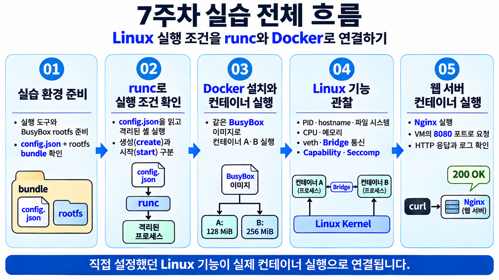
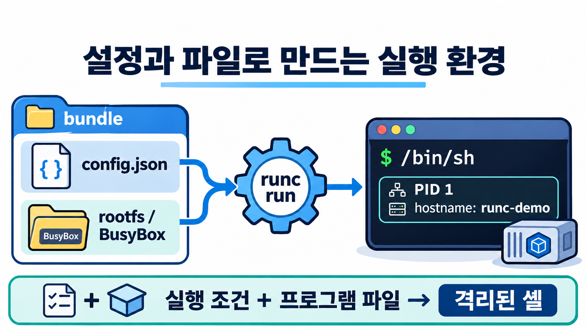
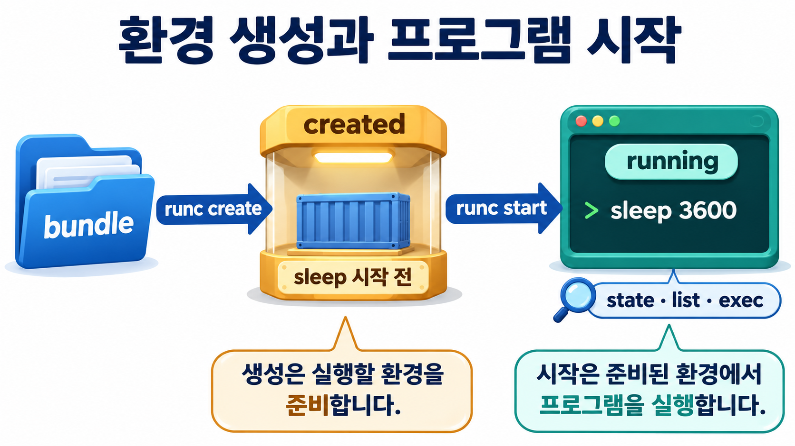
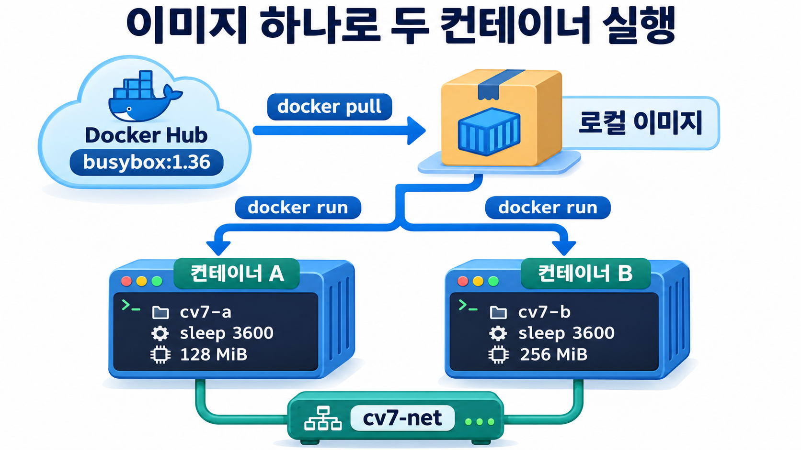
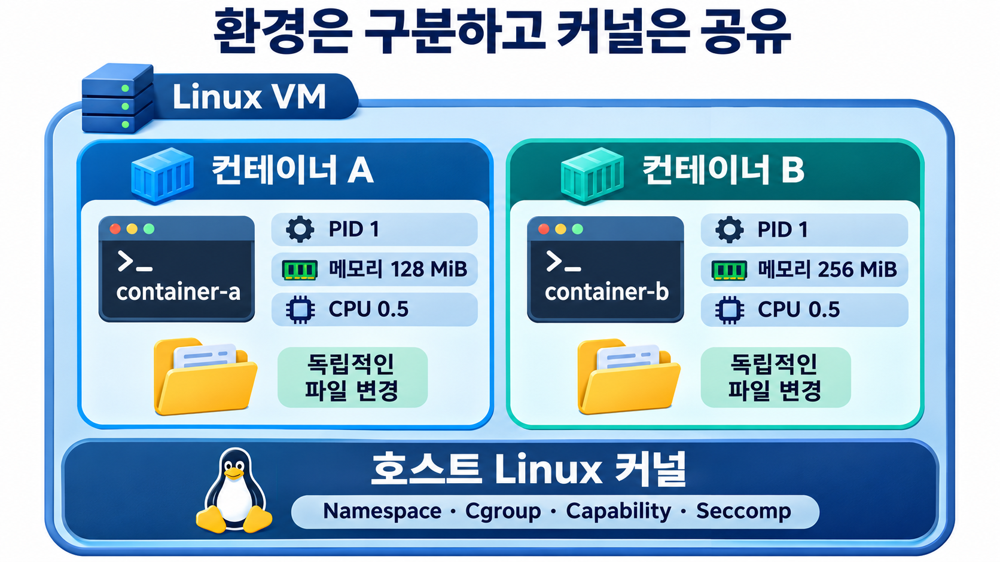
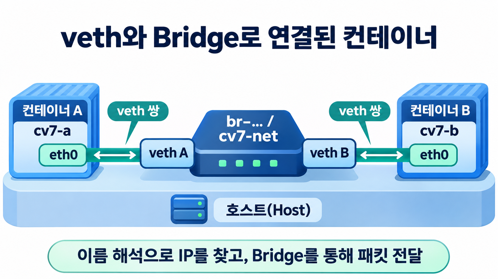
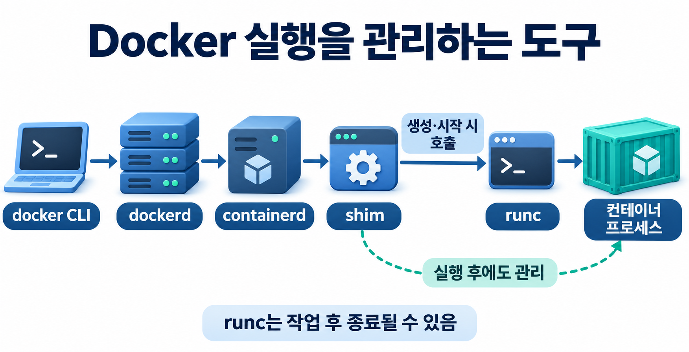
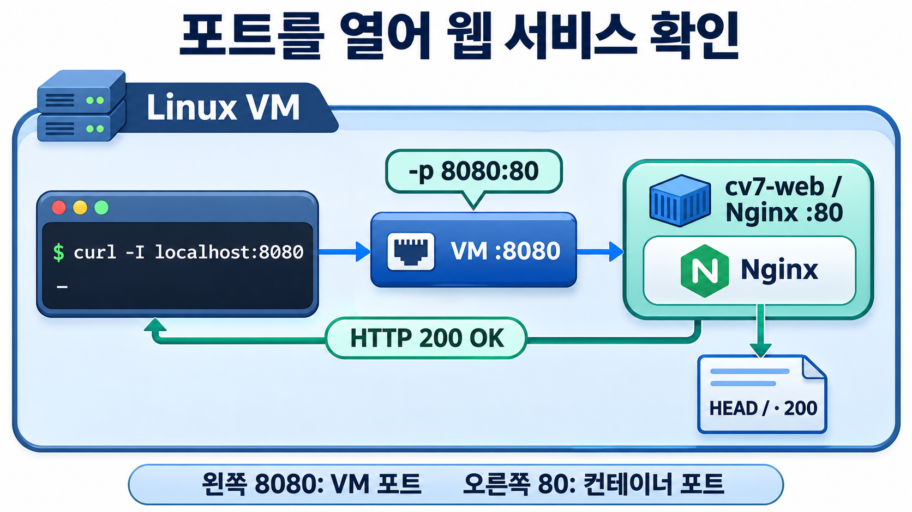

# 7주차 실습 — Linux 실행 조건을 runc와 Docker로 연결하다

[전체 주차 목록](https://github.com/choong-syu/cloud-virtualization) · [6주차 실습](https://github.com/choong-syu/cloud-virtualization/blob/main/week06/README.md)

2~6주차에는 프로세스가 보는 환경, 파일 시스템, 자원 한도, 네트워크, 권한과 시스템 호출을 직접 설정했습니다. 이번에는 **실행 조건을 전달하면 도구가 그 환경을 구성한다**는 것을 확인합니다.

**학습 목표:** 같은 Linux 기능을 `config.json`과 Docker 옵션으로 지정하고, 실제 프로세스와 커널 설정에서 결과를 확인합니다.

## 실습 전체 흐름



| 단계 | 확인할 질문 | 명령 |
| --- | --- | --- |
| 준비 | 필요한 파일과 실행 도구가 있는가? | 01~06 |
| 1 | 명령을 직접 조합하지 않아도 격리된 셸이 만들어지는가? | 07~21 |
| 2 | 컨테이너 생성과 프로그램 시작은 어떻게 다른가? | 22~30 |
| 3 | Docker로 같은 프로그램을 두 개 실행할 수 있는가? | 31~42 |
| 4 | Docker 컨테이너에서도 이전에 배운 Linux 기능을 찾을 수 있는가? | 43~59 |
| 5 | veth·Bridge와 런타임 관련 프로세스가 실제로 있는가? | 60~65 |
| 6 | 실행 프로그램을 웹 서버로 바꾸면 서비스가 되는가? | 66~68 |

**진행 시간 안내:** 설명·관찰을 포함해 약 75~90분을 배정합니다. 보안 상태 관찰은 시간이 부족하면 교수자 시연으로 진행할 수 있습니다. 실습은 웹 서버의 응답과 로그를 확인하며 마칩니다.

## 자료 준비

**호스트의 일반 사용자 Bash에서 실행**

<details>
<summary>curl 또는 HTTPS 인증서 준비가 필요한 경우</summary>

`curl`이 없거나 HTTPS 인증서 오류가 나면 아래 명령을 각각 실행합니다. HTTPS 다운로드가 정상적으로 되면 설치는 생략합니다.

```bash
sudo apt-get update
```

```bash
sudo apt-get install -y curl ca-certificates
```

</details>

자료를 저장할 폴더를 만들고 이동합니다. 여기서부터 명령 블록마다 연속 번호를 붙였습니다. 각 블록을 통째로 실행합니다.

**명령 01: 자료 폴더를 만들고 이동**

```bash
mkdir -p "$HOME/week07/configs" &&
  cd "$HOME/week07"
```

다운로드할 기본 주소를 `LAB_URL` 하나에 저장합니다.

**명령 02: 다운로드 기본 주소 저장**

```bash
LAB_URL=https://raw.githubusercontent.com/choong-syu/cloud-virtualization/main/week07
```

준비 스크립트와 설정 파일 두 개를 한 블록으로 받습니다. 블록 전체를 복사해 실행합니다. `&&`로 연결했으므로 앞 파일의 다운로드가 성공해야 다음 파일을 받습니다.

**명령 03: 준비 스크립트와 설정 파일 두 개 다운로드**

```bash
curl -fL \
  --connect-timeout 15 --max-time 60 --retry 1 \
  --resolve 'raw.githubusercontent.com:443:185.199.110.133' \
  -o prepare.sh \
  "$LAB_URL/prepare.sh" &&
curl -fL \
  --connect-timeout 15 --max-time 60 --retry 1 \
  --resolve 'raw.githubusercontent.com:443:185.199.110.133' \
  -o configs/shell.json \
  "$LAB_URL/configs/shell.json" &&
curl -fL \
  --connect-timeout 15 --max-time 60 --retry 1 \
  --resolve 'raw.githubusercontent.com:443:185.199.110.133' \
  -o configs/sleep-128.json \
  "$LAB_URL/configs/sleep-128.json"
```

**세 파일의 다운로드가 모두 성공한 뒤에만 명령 04로 진행합니다.** 오류가 나오면 다음 단계로 넘어가지 말고 연결 상태와 주소를 확인한 뒤 해당 파일을 다시 받습니다. 다운로드 명령을 다시 실행하면 같은 이름의 파일을 덮어쓰므로, 직접 수정한 파일은 먼저 별도로 보관합니다.

이 단계는 파일을 저장할 뿐 컨테이너를 실행하거나 Docker를 설치하지 않습니다. README와 그림은 지금 보고 있는 GitHub 화면에서 계속 읽습니다. [준비 스크립트](prepare.sh) · [설정 파일](configs/) · [교수자 안내](INSTRUCTOR.md)

```text
~/week07/
├── prepare.sh
└── configs/
    ├── shell.json
    └── sleep-128.json
```

### (호스트 Bash) 준비 파일 확인

**명령 04: 준비 파일 목록 확인**

```bash
ls
```

**확인:** `prepare.sh`와 `configs`가 보여야 합니다. 폴더가 없으면 교수자에게 배포 여부를 확인합니다. 다른 폴더에서 계속 진행하지 않습니다.

### (호스트 Bash) 도구와 rootfs 준비

**명령 05: 실습 도구 설치와 rootfs 준비**

```bash
bash prepare.sh
```

앞에 `sudo`를 붙이지 않습니다. 필요한 설치 단계에서만 스크립트가 sudo를 요청합니다.

**prepare.sh가 수행하는 작업**

1. **실행 조건 확인:** 일반 사용자로 실행했는지, Ubuntu 24.04·Cgroup v2 환경인지, 스크립트가 `~/week07`에 있는지 확인합니다.
2. **설정 파일 확인:** `configs/shell.json`과 `configs/sleep-128.json`이 있는지 확인합니다.
3. **설치 권한 확인과 도구 설치:** sudo 사용 가능 여부를 확인하고 패키지 목록을 갱신한 뒤 `runc`, `busybox-static`, `curl`, `iproute2`, `procps`, `util-linux`, `file`, `nano`, `libcap2-bin`을 설치합니다. `libcap2-bin`은 Capability 해석 도구 `capsh`를 제공합니다.
4. **필수 도구 확인:** JSON 검사에 쓸 Python 3가 있는지, BusyBox가 공유 라이브러리 없이 실행할 수 있는 정적 실행 파일인지 확인합니다.
5. **컨테이너용 파일 시스템(rootfs) 준비:** 기존 7주차 rootfs가 있으면 유지합니다. 없으면 3주차 rootfs를 복사하며, 둘 다 없으면 BusyBox와 기본 디렉터리·계정 파일로 새로 만듭니다. 3주차 원본은 변경하지 않습니다.
6. **디렉터리와 명령 연결 보완:** 필요한 디렉터리를 만들고 `/tmp` 권한을 설정하며, 누락된 기본 명령을 BusyBox에 연결합니다.
7. **rootfs 실행 확인:** rootfs 안의 BusyBox가 정적 파일인지 다시 확인하고, `chroot`로 셸을 실행해 `sleep`, `ps`, `hostname` 실행 파일을 확인합니다.
8. **JSON 문법 검사와 완료 안내:** 설정 파일 두 개의 JSON 문법을 검사하고 준비된 bundle 경로를 출력합니다.

**아직 하지 않는 일:** 컨테이너 실행, Docker 설치, 호스트 hostname 변경, 네트워크 생성.

**예상 출력의 마지막 부분**

```text
준비 완료: /home/자신의계정/week07/bundle
이 준비 단계는 Docker를 설치하지 않습니다. README의 실행 도구 확인 단계부터 진행하세요.
```

`STOP`이나 설치 오류가 나오면 다음 명령을 실행하지 말고 원인을 확인합니다.

### (호스트 Bash) 실행 도구 확인

**명령 06: runc 버전 확인**

```bash
runc --version
```

**새 용어 — 런타임(Runtime):** 이 실습에서는 컨테이너의 실행 환경을 구성하고 프로그램 실행을 담당하는 소프트웨어입니다. **runc**는 OCI 규격에 따라 컨테이너를 생성·실행하는 저수준 런타임입니다.

---

## 1. runc가 격리된 셸을 구성하게 하기

앞선 주차에서는 격리 환경을 명령으로 직접 만들었습니다. 이번에는 **실행 조건을 적은 설정 파일과 프로그램 파일 트리(rootfs)를 runc에 전달**합니다. runc가 그 조건에 맞는 환경을 구성하고 셸을 실행합니다.



**그림 1 · 설정과 파일이 실행 환경으로 이어지는 과정.** `config.json`은 실행 조건이고, rootfs는 실행할 프로그램이 있는 파일 트리입니다. 셸에 들어간 뒤 hostname·PID·파일 목록이 설정대로 보이는지 확인합니다.

### (호스트 Bash) bundle 디렉터리로 이동

**명령 07: bundle 디렉터리로 이동**

```bash
cd ~/week07/bundle
```

**명령 08: bundle 안의 파일 목록 확인**

```bash
ls
```

**예상 결과:** 처음에는 `rootfs` 디렉터리가 있습니다.

**새 용어 — Bundle(번들):** 컨테이너 실행 설정인 `config.json`과, 설정에서 참조하는 rootfs를 준비해 런타임에 전달하는 단위입니다. 이번 실습은 둘을 같은 디렉터리에 둡니다. rootfs의 실제 위치는 `root.path`로 지정합니다.

### (호스트 Bash) 기본 config.json 생성

**명령 09: 기본 컨테이너 설정 파일 생성**

```bash
runc spec
```

**명령 10: 생성된 config.json 확인**

```bash
ls
```

**예상 결과:** `config.json`과 `rootfs`가 함께 보입니다.

**확인:** `runc spec`이 만든 것은 설정 파일입니다. rootfs는 준비 단계에서 이미 만들었습니다. 이 명령이 프로그램 파일까지 내려받은 것은 아닙니다.

### (호스트 Bash) 기본 설정을 보관하고 수업용 설정 선택

**명령 11: 기본 설정 파일 사본 보관**

```bash
cp config.json config-default.json
```

**명령 12: 수업용 셸 설정 적용**

```bash
cp ../configs/shell.json config.json
```

`cp`는 파일을 복사합니다. 두 번째 명령은 **현재 bundle의 실행 설정**을 수업용 셸 설정으로 바꿉니다. 기본 설정 원본은 `config-default.json`으로 남깁니다.

긴 JSON을 직접 작성하는 대신 검토된 설정을 선택합니다. `runc spec`이 항상 이 수업용 설정을 생성한다는 뜻은 아닙니다.

### (호스트 Bash) 실행 조건 읽기

**명령 13: 설정 파일 앞부분 읽기**

```bash
head -n 16 config.json
```

`head -n 16`은 파일 앞의 16줄을 출력합니다. 다음 항목을 찾습니다.

| 항목 | 이번 값 | 의미 |
| --- | --- | --- |
| `hostname` | `runc-demo` | 내부에서 보일 호스트 이름 |
| `root.path` | `rootfs` | bundle 기준 사용할 파일 시스템 경로 |
| `process.args` | `["/bin/sh"]` | rootfs 안에서 실행할 셸 |
| `process.cwd` | `/` | 프로그램의 내부 시작 디렉터리 |
| `process.terminal` | `true` | 이번 셸에 터미널 사용 |

**JSON:** 이름과 값으로 설정을 표현하는 텍스트 형식입니다. JSON에는 실행할 명령의 순서가 아니라 실행 조건을 적습니다. 이 설정의 Namespace와 Mount 항목은 파일 뒷부분에 있습니다.

### (호스트 Bash → 컨테이너 sh) 격리된 셸 실행

**명령 14: 격리된 컨테이너 셸 실행**

```bash
sudo runc run cv7-shell
```

**예상 결과:** `runc-demo:/#` 프롬프트가 나타납니다. 이제부터 명령 19까지는 **컨테이너 안**입니다.

- `run`: 컨테이너를 생성하고 프로그램을 실행합니다.
- `cv7-shell`: runc에서 구분하기 위한 **컨테이너 식별자**입니다.
- 현재 디렉터리가 bundle이므로 `--bundle`을 생략했습니다.
- 식별자 `cv7-shell`과 hostname `runc-demo`는 서로 다른 값입니다.

### (컨테이너 sh) hostname 확인

**명령 15: 컨테이너의 hostname 확인**

```bash
hostname
```

**예상 결과**

```text
runc-demo
```

**연결:** 2주차에는 새 UTS Namespace를 만들고 직접 hostname을 설정했습니다. 이번에는 runc가 설정 파일을 읽어 적용했습니다.

### (컨테이너 sh) 현재 셸의 PID 확인

**명령 16: 컨테이너 안에서 현재 셸의 PID 확인**

```bash
echo $$
```

**예상 결과:** `1`

**연결:** 새 PID Namespace 안에서 처음 실행한 프로그램이 `/bin/sh`입니다.

### (컨테이너 sh) 프로세스 목록 확인

**명령 17: 컨테이너 내부 프로세스 목록 확인**

```bash
ps
```

**관찰:** PID 1의 `sh`와 관찰 명령 `ps`가 보입니다. 호스트 전체 프로세스 목록과 다릅니다. 정확한 다른 PID는 환경에 따라 달라도 됩니다.

### (컨테이너 sh) 파일 시스템 확인

**명령 18: 컨테이너 루트 디렉터리 목록 확인**

```bash
ls /
```

**명령 19: rootfs의 실습 안내 문구 확인**

```bash
cat /etc/lab-environment
```

**관찰:** 준비한 BusyBox rootfs의 디렉터리와 실습 안내 문구가 보입니다. 3주차 rootfs를 복사했다면 문구에 `week03`이 남아 있을 수 있습니다. 오류가 아니라 **같은 파일 트리를 재사용했다는 흔적**입니다.

### (컨테이너 sh → 호스트 Bash) 셸 종료

**명령 20: 컨테이너 셸을 종료하고 호스트로 복귀**

```bash
exit
```

**확인:** `자신의계정@VM이름` 형태의 호스트 프롬프트로 돌아와야 합니다.

### (호스트 Bash) runc 목록 확인

**명령 21: runc 컨테이너 목록 확인**

```bash
sudo runc list
```

**예상 결과:** `cv7-shell`이 없습니다. 이번처럼 포그라운드 `runc run`을 사용하면 주 프로그램 종료 후 해당 실행 상태가 정리됩니다. rootfs와 config.json 파일이 삭제되는 것은 아닙니다.

**현재 위치:** `unshare`, `mount`, `chroot`를 직접 입력하지 않았지만, 설정에 맞춘 환경에서 셸이 실행되었습니다.

---

## 2. 컨테이너 생성과 프로그램 시작 구분

**컨테이너의 환경을 만드는 것과 지정한 프로그램을 시작하는 것은 별도 단계**입니다. `runc create` 뒤에는 생성 상태를 확인하고, `runc start` 뒤에는 프로그램의 실행 상태와 실제 프로세스를 확인합니다.



**그림 2 · created와 running의 차이.** 생성 단계에서도 준비 프로세스의 PID가 표시될 수 있습니다. PID의 존재만으로 `sleep`이 시작됐다고 판단하지 않고, 상태 전이와 프로세스 목록을 함께 확인합니다.

이번에는 입력을 기다리는 셸 대신 한 시간 동안 기다리는 `sleep 3600`을 실행합니다. 관찰 시간을 확보하기 위해 한 시간으로 지정했습니다. 이 프로그램은 시간이 지나면 종료됩니다.

### (호스트 Bash) sleep·128 MiB 설정 선택

**명령 22: sleep 실행과 128 MiB 메모리 설정 적용**

```bash
cp ../configs/sleep-128.json config.json
```

**명령 23: 적용할 설정 파일 전체 읽기**

```bash
cat config.json
```

전체를 외우지 않고 다음 네 곳만 찾습니다.

| 항목 | 값 | 읽을 내용 |
| --- | --- | --- |
| `process.args` | `["/bin/sleep", "3600"]` | 실행 프로그램과 시간 |
| `process.terminal` | `false` | 터미널 입력이 필요 없는 프로그램 |
| `linux.resources.memory.limit` | `134217728` | 128 MiB를 바이트로 표현 |
| `linux.resources.cpu` | quota `50000`, period `100000` | CPU 0.5개 상당의 실행 시간 한도 |

1 MiB는 1,048,576바이트입니다. 따라서 128 MiB는 134,217,728바이트입니다.

### (호스트 Bash) 컨테이너 생성

**명령 24: runc 컨테이너 생성**

```bash
sudo runc create cv7-demo
```

### (호스트 Bash) 생성 상태 확인

**명령 25: 컨테이너의 created 상태 확인**

```bash
sudo runc state cv7-demo
```

**예상 결과:** `"status": "created"`

`pid`도 표시될 수 있습니다. 생성 단계에 내부 준비 프로세스가 있지만 **지정한 `sleep` 프로그램은 아직 시작되지 않은 상태**입니다. PID가 있다는 이유만으로 `sleep`이 실행 중이라고 판단하지 않습니다.

### (호스트 Bash) 프로그램 시작

**명령 26: 컨테이너 프로그램 시작**

```bash
sudo runc start cv7-demo
```

### (호스트 Bash) 실행 상태 확인

**명령 27: 컨테이너의 running 상태 확인**

```bash
sudo runc state cv7-demo
```

**예상 결과:** `"status": "running"`

`created → running`으로 바뀌었는지 기록합니다.

### (호스트 Bash) 실행 중인 컨테이너를 목록에서 확인

**명령 28: runc 목록에서 실행 중인 컨테이너 확인**

```bash
sudo runc list
```

**확인:** 목록의 `ID` 열에 `cv7-demo`가 보이고, 같은 행의 `STATUS`가 `running`인지 확인한 뒤 다음 명령으로 진행합니다.


### (호스트 Bash) 실행 환경에서 관찰 명령 실행

**명령 29: 컨테이너 안에서 sleep 프로세스 확인**

```bash
sudo runc exec cv7-demo ps
```

**예상 결과:** 내부 PID 1에 `sleep 3600`이 보입니다.

**`exec`:** 실행 중인 컨테이너 환경에서 추가 프로그램을 실행합니다. 기존 `sleep`을 다른 프로그램으로 교체하는 명령이 아닙니다.

### (호스트 Bash) 실제 메모리 한도 확인

**명령 30: runc 컨테이너의 실제 메모리 한도 확인**

```bash
sudo runc exec cv7-demo cat /sys/fs/cgroup/memory.max
```

**예상 결과**

```text
134217728
```

이번 설정에는 Cgroup Namespace와 Cgroup 파일 시스템 마운트가 포함되어 있습니다. 내부의 이 경로는 해당 컨테이너의 Cgroup 한도를 보여 줍니다. **JSON의 글자만 본 것이 아니라 커널에 적용된 한도를 읽었습니다.**

**현재 위치:** config.json에 정의한 조건으로 컨테이너를 생성하고 실행했습니다. 다음에는 Docker가 이미지 준비와 실행 관리를 함께 담당하게 합니다.

---

## 3. Docker를 설치하고 같은 프로그램 두 개 실행

Docker에서는 **이미지를 Pull해 준비한 뒤, 같은 이미지로 서로 다른 컨테이너를 실행**합니다. 이미지 목록은 내려받은 자료를, 컨테이너 목록은 실제 실행을 보여 줍니다. A와 B에는 같은 프로그램을 사용하되 이름과 메모리 한도를 다르게 지정합니다.



**그림 3 · 이미지 하나에서 두 실행 만들기.** Pull만으로 컨테이너가 시작되지는 않습니다. 이미지·네트워크·컨테이너를 차례로 만들고 각 목록에서 확인합니다. 네트워크 생성 전후에는 호스트의 Bridge 인터페이스 변화도 관찰합니다.

### (호스트 Bash) Docker 설치

**명령 31: Docker 설치**

```bash
sudo apt install -y docker.io
```

이 수업은 명령을 짧게 유지하고 앞서 설치한 runc와 함께 사용하기 위해 **Ubuntu가 제공하는 `docker.io` 패키지**를 사용합니다. Docker 회사 저장소의 `docker-ce` 설치 방식과 혼합하지 않습니다. Docker Desktop을 설치하는 과정도 아닙니다.

설치 출처: [Ubuntu Server의 Docker 안내](https://ubuntu.com/server/docs/how-to/containers/docker-for-system-admins/).

### (호스트 Bash) Docker 서비스 시작과 확인

**명령 32: Docker 서비스 시작**

```bash
sudo systemctl start docker
```

**명령 33: Docker 클라이언트와 서버 버전 확인**

```bash
sudo docker version
```

**확인:** `Client`와 `Server` 정보가 모두 나와야 합니다. 버전 번호는 업데이트 시점에 따라 달라집니다.

**새 용어 — Docker CLI / 데몬:** `docker` 명령은 요청을 보내는 클라이언트이며, `dockerd`는 요청을 받아 이미지·컨테이너·네트워크 등을 관리하는 서비스입니다. 서비스처럼 백그라운드에서 실행되는 프로그램을 데몬(daemon)이라고 부릅니다.

### (호스트 Bash) 사용할 이미지 준비

**명령 34: [BusyBox 이미지 Pull](https://hub.docker.com/_/busybox)**

```bash
sudo docker pull busybox:1.36
```

**새 용어 — 이미지(Image):** 컨테이너의 파일 시스템을 구성할 파일들과 기본 실행 설정을 담은 배포 단위입니다. 이미지를 내려받는 것과 프로세스를 실행하는 것은 다릅니다.

`1.36`은 이미지의 태그(tag)입니다. 이미지 버전을 구분하는 이름이며, 변경 불가능한 고유 식별자는 아닙니다.

### (호스트 Bash) Pull한 이미지 확인

**명령 35: 로컬 이미지 목록에서 BusyBox 확인**

```bash
sudo docker images
```

**확인:** 목록에서 `REPOSITORY`가 `busybox`이고 `TAG`가 `1.36`인 행을 찾습니다. 이미지가 VM에 저장되었음을 확인한 뒤 다음 명령으로 진행합니다. 아직 컨테이너를 실행한 것은 아닙니다.

### (호스트 Bash) 네트워크 생성 전 인터페이스 확인

**명령 36: 네트워크 생성 전 호스트 인터페이스와 IP 주소 확인**

```bash
ip address
```

**관찰:** 현재 인터페이스 이름과 `inet`에 표시된 IPv4 주소를 기록합니다. 네트워크 생성 후의 출력과 비교할 수 있도록 이 출력을 남겨 둡니다.

### (호스트 Bash) 두 컨테이너를 연결할 네트워크 생성

**명령 37: 컨테이너 연결용 Bridge 네트워크 생성**

```bash
sudo docker network create cv7-net
```

**예상 결과:** 긴 네트워크 ID 한 줄이 출력됩니다. 그대로 복사할 필요는 없습니다.

이번 명령은 기본 드라이버인 Bridge 네트워크를 만듭니다. 5주차에서 만든 Linux Bridge와 연결해 생각합니다. 같은 사용자 정의 네트워크에서는 컨테이너 이름으로도 상대를 찾을 수 있습니다.

### (호스트 Bash) 네트워크 생성 후 인터페이스 비교

**명령 38: 네트워크 생성 후 호스트 인터페이스와 IP 주소 확인**

```bash
ip address
```

**비교:** 명령 36의 출력과 나란히 보고 새로 생긴 `br-...` 형태의 Bridge 인터페이스를 찾습니다. 인터페이스 이름과 `inet`의 IPv4 주소를 기록합니다. 실제 이름과 주소는 환경마다 다르므로 예시 숫자에 맞추지 않습니다.

이번에 만든 `cv7-net`은 Docker의 네트워크 이름이며, 호스트에서는 별도의 `br-...` 인터페이스로 보입니다. 아직 컨테이너를 연결하지 않았으므로 컨테이너 연결용 veth는 이후 컨테이너 실행 단계에서 확인합니다.

### (호스트 Bash) 생성한 네트워크 확인

**명령 39: Docker 네트워크 목록에서 cv7-net 확인**

```bash
sudo docker network list
```

**확인:** 목록에서 `NAME`이 `cv7-net`이고 `DRIVER`가 `bridge`인 행을 찾습니다. 네트워크가 생성되었음을 확인한 뒤 다음 명령으로 진행합니다.

### (호스트 Bash) A 컨테이너 실행

아래 세 줄은 **하나의 명령**입니다. 블록 전체를 복사합니다. 줄 끝의 `\` 뒤에 공백을 덧붙이지 않습니다.

**명령 40: 128 MiB 한도의 A 컨테이너 실행**

```bash
sudo docker run -d --name cv7-a --hostname container-a \
  --network cv7-net --memory=128m --cpus=0.5 \
  busybox:1.36 sleep 3600
```

| 부분 | 의미 |
| --- | --- |
| `-d` | 백그라운드 실행 |
| `--name cv7-a` | Docker에서 사용할 이름 |
| `--hostname container-a` | 내부 호스트 이름 |
| `--network cv7-net` | 연결할 Docker 네트워크 |
| `--memory=128m` | 메모리 한도 128 MiB |
| `--cpus=0.5` | CPU 0.5개 상당의 실행 시간 한도 |
| `busybox:1.36` | 사용할 이미지 |
| `sleep 3600` | 실행할 프로그램과 인자 |

### (호스트 Bash) B 컨테이너 실행

**명령 41: 256 MiB 한도의 B 컨테이너 실행**

```bash
sudo docker run -d --name cv7-b --hostname container-b \
  --network cv7-net --memory=256m --cpus=0.5 \
  busybox:1.36 sleep 3600
```

**비교:** 이미지와 프로그램, CPU 조건은 같습니다. 이름·hostname·메모리 한도만 다릅니다.

### (호스트 Bash) 실행 목록 확인

**명령 42: 실행 중인 Docker 컨테이너 목록 확인**

```bash
sudo docker ps
```

**관찰:** `cv7-a`, `cv7-b`가 모두 실행 중이어야 합니다. 이미지 열은 둘 다 `busybox:1.36`입니다. 같은 이미지로 서로 다른 컨테이너 실행을 만들었습니다.

---

## 4. Docker가 적용한 Linux 기능 확인

A와 B는 **같은 호스트 커널에서 실행되는 프로세스**지만, 각자 보는 hostname·PID·파일 변경 내용은 구분됩니다. Cgroup은 사용할 자원의 한도를 정하고, Capability와 Seccomp는 권한과 시스템 호출을 제한합니다.



**그림 4 · 실행 환경은 구분되고 커널은 공유됨.** 내부 PID와 호스트 PID를 연결하고 커널 버전을 비교합니다. 파일 변경의 격리, 자원 한도와 실제 사용량의 차이, 유효 권한과 Seccomp 상태를 각각 확인합니다.

이제 새 기능을 직접 만들지 않습니다. **이전에 관찰했던 결과가 Docker 실행에도 있는지** 확인합니다. 아래 `docker exec` 명령은 호스트에서 입력합니다. 관찰 명령이 끝나면 같은 호스트 프롬프트로 돌아옵니다.

### (호스트 Bash) UTS Namespace: hostname 비교

**명령 43: A 컨테이너의 hostname 확인**

```bash
sudo docker exec cv7-a hostname
```

**명령 44: B 컨테이너의 hostname 확인**

```bash
sudo docker exec cv7-b hostname
```

**예상 결과:** 각각 `container-a`, `container-b`

### (호스트 Bash) PID Namespace: 내부 프로세스 확인

**명령 45: A 컨테이너의 내부 프로세스 확인**

```bash
sudo docker exec cv7-a ps
```

**예상 결과:** PID 1에서 `sleep 3600`이 실행 중이며, 관찰용 `ps`도 잠시 보입니다.

### (호스트 Bash) 같은 프로세스의 호스트 PID 저장과 확인

**명령 46: A 컨테이너 주 프로세스의 호스트 PID를 저장하고 출력**

```bash
PID=$(sudo docker inspect -f '{{.State.Pid}}' cv7-a) && echo "$PID"
```

**왜 이 작업을 하나요?**

앞의 컨테이너 내부 프로세스 목록에서는 `sleep 3600`이 **PID 1**로 보였습니다. 하지만 호스트에서 PID 1을 조회하면 컨테이너의 `sleep`이 아니라 호스트의 첫 프로세스가 나옵니다. PID Namespace가 다르면 **같은 프로세스를 가리키는 PID 숫자도 다르기 때문**입니다.

이 명령은 Docker가 관리하는 A 컨테이너의 정보를 통해 **컨테이너 내부 PID 1에 해당하는 프로세스의 호스트 PID**를 찾습니다. 여기서 주 프로세스는 컨테이너 실행 시 지정한 `sleep 3600`입니다. 예를 들어 컨테이너 안에서는 PID 1이지만 호스트에서는 PID 12345로 보일 수 있습니다. 12345는 설명용 예시이며 실제 출력값을 사용합니다.

찾은 번호를 `PID` 변수에 저장하면 다음 명령에서 숫자를 다시 입력하지 않고 `ps -p "$PID"`로 **호스트에서 같은 프로세스**를 조회할 수 있습니다. 이를 통해 컨테이너의 프로그램도 별도 VM에서 실행되는 것이 아니라 **현재 Linux VM의 커널이 관리하는 프로세스**임을 확인합니다.

| 명령 부분 | 하는 작업 |
| --- | --- |
| `sudo docker inspect ... cv7-a` | A 컨테이너의 상세 정보를 조회 |
| `-f '{{.State.Pid}}'` | 상세 정보 중 주 프로세스의 호스트 PID만 선택 |
| `$(...)` | 명령의 출력값을 가져옴 |
| `PID=...` | 가져온 값을 현재 호스트 셸의 변수에 저장 |
| `&& echo "$PID"` | 앞의 조회·저장이 성공하면 저장한 PID를 출력 |

**확인:** 0보다 큰 PID 숫자가 출력되어야 합니다. 0이 나오면 컨테이너가 실행 중인지 먼저 확인합니다. 컨테이너를 재시작하면 PID가 달라질 수 있으므로 다시 조회합니다. 다음 명령도 변수를 저장한 **같은 호스트 터미널**에서 실행합니다.

### (호스트 Bash) 호스트에서도 sleep 확인

**명령 47: 호스트에서 같은 sleep 프로세스 확인**

```bash
ps -p "$PID" -o pid,ppid,args
```

**관찰:** 내부에서는 PID 1이었던 `sleep`이 호스트에서는 다른 PID로 보입니다. **컨테이너의 프로그램도 이 VM의 커널이 관리하는 프로세스**입니다.

### (호스트 Bash) 커널 버전 비교

**명령 48: 호스트의 커널 버전 확인**

```bash
uname -r
```

**명령 49: A 컨테이너에서 커널 버전 확인**

```bash
sudo docker exec cv7-a uname -r
```

**예상 결과:** 두 커널 버전 문자열이 같습니다. 이 실습의 Docker Engine은 현재 Linux VM에서 직접 실행하므로, 컨테이너도 그 VM의 커널을 사용합니다.

### (호스트 Bash) A의 파일 시스템에 파일 생성

**명령 50: A 컨테이너에 파일 생성**

```bash
sudo docker exec cv7-a touch /tmp/week07-a
```

**명령 51: A 컨테이너에서 생성한 파일 확인**

```bash
sudo docker exec cv7-a ls /tmp/week07-a
```

**예상 결과:** `/tmp/week07-a`

### (호스트 Bash) 같은 이미지인 B에서도 보이는지 확인

**명령 52: B 컨테이너에 같은 파일이 있는지 확인**

```bash
sudo docker exec cv7-b ls /tmp/week07-a
```

**예상 결과:** `No such file or directory`

이 오류는 관찰하려는 정상 결과입니다. 같은 이미지를 사용해도 각 컨테이너의 변경 내용은 별도로 유지됩니다. 이번에는 공유 디렉터리를 연결하지 않았습니다.

### (호스트 Bash) A의 메모리 한도 확인

**명령 53: A 컨테이너의 메모리 한도 확인**

```bash
sudo docker exec cv7-a cat /sys/fs/cgroup/memory.max
```

**예상 결과:** `134217728`

### (호스트 Bash) B의 메모리 한도 확인

**명령 54: B 컨테이너의 메모리 한도 확인**

```bash
sudo docker exec cv7-b cat /sys/fs/cgroup/memory.max
```

**예상 결과:** `268435456`

**연결:** 4주차의 `MemoryMax`, 앞 단계 JSON의 `memory.limit`, Docker의 `--memory`가 모두 Cgroup 메모리 제한으로 이어집니다. 파일 이름과 값은 **Cgroup v2** 기준입니다.

### (호스트 Bash) CPU 한도 확인

**명령 55: A 컨테이너의 CPU 한도 확인**

```bash
sudo docker exec cv7-a cat /sys/fs/cgroup/cpu.max
```

**예상 결과**

```text
50000 100000
```

주기 100,000마이크로초 동안 CPU 실행 시간을 최대 50,000마이크로초 사용하도록 설정한 예입니다. 비율이 0.5입니다. 실제 CPU 사용량이 늘 50%라는 뜻은 아닙니다. `sleep`은 대부분 기다립니다.

### (호스트 Bash) 사용량과 한도를 함께 확인

**명령 56: A·B 컨테이너의 사용량과 한도 확인**

```bash
sudo docker stats --no-stream cv7-a cv7-b
```

**관찰:** `MEM USAGE / LIMIT`에서 A의 한도는 128 MiB, B의 한도는 256 MiB입니다. 실제 사용량은 그보다 작을 수 있습니다. `--no-stream`은 계속 갱신하지 않고 한 번만 보여 줍니다.

### (호스트 Bash) Capability 상태 확인

**명령 57: A 컨테이너의 Capability 상태 확인**

```bash
sudo docker exec cv7-a grep CapEff /proc/1/status
```

**관찰:** `CapEff`는 A 컨테이너의 PID 1 프로세스가 현재 유효하게 가진 Capability 집합을 16진수로 표시합니다. 출력에서 `CapEff:` 뒤의 값을 확인합니다.

**출력 예시**

```text
CapEff: 00000000a80425fb
```

### (호스트 Bash) Capability 값을 권한 이름으로 해석

**명령 58: CapEff 값을 capsh로 해석**

아래 `--decode=` 뒤에는 **명령 57에서 실제로 나온 16진수 값**을 넣습니다. 다음 명령은 위 출력 예시의 값을 사용한 것입니다. `CapEff:` 글자는 넣지 않습니다.

```bash
capsh --decode=00000000a80425fb
```

`capsh`는 **호스트에서 실행**합니다. 준비 스크립트가 설치하는 `libcap2-bin` 패키지에 포함되어 있습니다. 이전 준비 자료로 진행해 `capsh: command not found`가 나오면 호스트에서 `sudo apt-get install -y libcap2-bin`으로 설치한 뒤 다시 실행합니다. `--decode`는 값을 권한 이름으로 풀어 보여 줄 뿐, 컨테이너의 권한을 변경하지 않습니다.

**예시 값의 해석 결과**

```text
0x00000000a80425fb=cap_chown,cap_dac_override,cap_fowner,cap_fsetid,cap_kill,cap_setgid,cap_setuid,cap_setpcap,cap_net_bind_service,cap_net_raw,cap_sys_chroot,cap_mknod,cap_audit_write,cap_setfcap
```

**Docker 기본 권한과 비교:** [Docker 공식 문서 — 기본으로 허용되는 Linux Capability 목록](https://docs.docker.com/engine/containers/run/#runtime-privilege-and-linux-capabilities)을 열고, 기본으로 허용되며 제거할 수 있는 Capability 표와 자신의 결과를 비교합니다. `cap_chown`은 문서의 `CHOWN`, `cap_net_raw`는 `NET_RAW`처럼 `cap_` 접두사와 대소문자 표기가 다릅니다.

이번 A 컨테이너는 `--privileged`, `--cap-add`, `--cap-drop` 없이 실행했으므로 Docker의 기본 Capability 구성을 관찰합니다. 예시 결과에 있는 `CHOWN`, `NET_RAW`, `SYS_CHROOT` 등을 공식 표에서 찾아 의미를 읽고, `SYS_ADMIN`과 `NET_ADMIN`은 기본 목록에 없는지도 확인합니다. 실제 결과가 다르면 실행 옵션과 환경을 확인하며, 예시 값으로 바꿔 기록하지 않습니다.

**해석:** 컨테이너 안의 root라고 해서 모든 Capability를 갖는 것은 아닙니다. 또한 실제 작업의 허용 여부에는 Namespace, Seccomp, 파일 권한 등도 관여하므로 Capability 목록만으로 모든 작업의 성공을 판단하지 않습니다.

### (호스트 Bash) Seccomp 상태 확인

**명령 59: A 컨테이너의 Seccomp 상태 확인**

```bash
sudo docker exec cv7-a grep Seccomp /proc/1/status
```

**예상 결과의 핵심:** `Seccomp: 2`

필터 모드가 적용된 상태입니다. `Seccomp_filters`가 함께 나오면 필터 개수이지 차단한 시스템 호출 수가 아닙니다. **6주차에서 만든 uname 차단 규칙과 Docker 기본 규칙은 서로 다릅니다.** Docker 안에서 앞의 `uname`이 성공한 것과 모순되지 않습니다.

---

## 5. Docker가 만든 연결과 실행 도구 찾기

앞에서 만든 네트워크를 Linux 장치 수준에서 살펴봅니다. 컨테이너의 `eth0`는 veth 쌍을 통해 호스트의 Bridge에 연결됩니다. 이어 Docker가 사용하는 런타임과 관리 프로세스를 확인합니다.



**그림 5 · 컨테이너 사이의 패킷 경로.** `ping cv7-b`에서는 Docker의 이름 해석 기능으로 상대 IP를 찾고, 패킷은 veth와 Bridge를 거쳐 전달됩니다. 이름 해석과 패킷 전달은 서로 다른 역할입니다.



**그림 6 · Docker 실행 관리의 역할 개요.** 흐름은 개념도이며 프로세스 목록의 정렬 순서나 부모·자식 관계를 그대로 나타내지는 않습니다. `runc`는 생성·시작 작업 후 종료될 수 있고, shim과 컨테이너 프로세스는 계속 남을 수 있습니다.

### (호스트 Bash) 컨테이너 안의 네트워크 장치 확인

**명령 60: A 컨테이너의 네트워크 장치와 주소 확인**

```bash
sudo docker exec cv7-a ip addr
```

**관찰:** `lo`와 `eth0`, `eth0`에 부여된 IP 주소를 찾습니다. 5주차에서 직접 주소를 넣었던 장치와 연결해 봅니다.

### (호스트 Bash) 컨테이너 A에서 B로 통신

**명령 61: A 컨테이너에서 B로 통신 확인**

```bash
sudo docker exec cv7-a ping -c 2 cv7-b
```

**예상 결과:** B의 IP 주소와 두 번의 응답이 나타납니다.

같은 사용자 정의 Bridge 네트워크에서는 Docker의 이름 해석 기능으로 `cv7-b`를 찾을 수 있습니다. **이름을 IP로 찾는 기능**과 **veth·Bridge가 패킷을 전달하는 기능**은 구분합니다.

### (호스트 Bash) Linux Bridge와 연결 포트 확인

**명령 62: 호스트의 Linux Bridge 목록 확인**

```bash
ip -br link show type bridge
```

**명령 63: Bridge에 연결된 포트 확인**

```bash
bridge link
```

**관찰:** `docker0` 또는 `br-...` 형태의 Bridge와 `veth...` 포트가 보입니다. 이번 사용자 정의 네트워크는 보통 `br-...` 형태의 Bridge를 사용합니다. `bridge link`의 `master` 뒤에서 어느 Bridge에 연결되었는지 찾습니다.

이름과 번호는 실행마다 달라집니다. 다른 Docker 네트워크가 있다면 관련 장치도 함께 보입니다. **우리가 veth를 직접 생성하지 않았는데도 Docker가 연결을 준비했다**는 점을 확인합니다.

> runc는 이 실습의 Namespace와 파일 시스템을 구성했지만, 그 자체로 이미지 다운로드나 veth·Bridge·IP 연결까지 모두 준비하는 도구는 아닙니다. 앞의 runc 설정에는 분리된 Network Namespace가 있지만 외부 연결을 따로 구성하지 않았습니다.

### (호스트 Bash) 기본 런타임 확인

**명령 64: Docker 기본 런타임 확인**

```bash
sudo docker info | grep Runtime
```

**확인:** `Runtimes:`에서 사용 가능한 런타임 목록을 보고, `Default Runtime: runc`에서 기본 런타임이 `runc`인지 확인합니다. `grep Runtime`은 Docker 정보 중 `Runtime`이 포함된 줄만 출력합니다.

### (호스트 Bash) 관리 프로세스 확인

**명령 65: Docker와 containerd 관련 프로세스 확인**

```bash
pgrep -af 'dockerd|containerd'
```

**관찰:** `dockerd`, `containerd`, `containerd-shim-runc-v2`가 포함된 줄을 찾습니다. PID와 상세 경로는 달라도 됩니다.

| 새 용어 | 이 실습에서 이해할 역할 |
| --- | --- |
| containerd | 컨테이너 실행과 수명주기 등을 관리하는 서비스 |
| shim | 런타임 실행과 연결되어 컨테이너 프로세스의 종료·입출력 등을 관리하는 중간 프로세스 |
| runc | Linux 기능을 적용해 컨테이너를 생성하고 프로그램 실행을 시작하는 런타임 |

**주의할 해석:** 프로세스 목록은 한 시점의 상태입니다. 생성·시작을 마친 `runc` 명령 프로세스는 이미 종료되어 안 보일 수 있습니다. `sleep`이 살아 있는 동안 runc도 계속 목록에 있어야 하는 것은 아닙니다. 위 명령만으로 생성 순간의 호출 순서를 추적한 것도 아닙니다.

---

## 6. 프로그램을 웹 서버로 바꾸기

이번에는 실행 프로그램을 Nginx로 바꾸고 **VM의 8080번 포트로 들어온 요청을 컨테이너의 80번 포트에 전달**합니다. 포트 공개가 실제 요청과 응답으로 이어지는지 HTTP 헤더와 서버 로그를 함께 확인합니다.



**그림 7 · 포트 공개와 웹 요청 확인.** `8080:80`의 왼쪽은 VM 포트, 오른쪽은 컨테이너 포트입니다. 여기서 `localhost`는 명령을 실행하는 VM을 뜻합니다. 응답 코드와 같은 요청의 로그를 연결해 서비스 동작을 확인합니다.

이제 기다리는 `sleep` 대신 **Nginx 웹 서버**를 실행합니다. 같은 컨테이너 기술로 실제 서비스를 실행하는 단계입니다.

### (호스트 Bash) 웹 서버 컨테이너 실행

**명령 66: Nginx 웹 서버 컨테이너 실행**

```bash
sudo docker run -d --name cv7-web -p 8080:80 nginx:alpine
```

처음에는 이미지 다운로드가 진행됩니다. 완료 후 컨테이너 ID가 출력됩니다.

**새 용어 — 포트 공개(port publishing):** `-p 8080:80`은 VM의 8080번 포트로 들어온 요청을 컨테이너의 80번 포트로 전달하도록 설정합니다. 컨테이너 IP 주소를 외우지 않고 VM의 지정 포트로 접근할 수 있습니다.

### (호스트 Bash) VM 안에서 웹 응답 확인

**명령 67: 웹 서버의 HTTP 응답 헤더 확인**

```bash
curl -I http://localhost:8080
```

**예상 결과의 핵심**

```text
HTTP/1.1 200 OK
Server: nginx/...
```

`curl`은 HTTP 요청을 보냅니다. `-I`는 본문 대신 응답 헤더를 확인하는 옵션입니다. 여기의 `localhost`는 **현재 SSH로 들어온 VM 자신**입니다. 학생 PC의 브라우저에서 `localhost:8080`을 열면 다른 컴퓨터를 가리킵니다.

브라우저 관찰은 교수자가 별도로 안내한 VM 접속 URL이 있을 때 추가합니다. SSH 게이트웨이를 통해 접속할 수 있다는 사실만으로 VM의 사설 IP와 8080 포트가 학생 PC에서 직접 열리는 것은 아닙니다. 이 실습의 필수 성공 기준은 VM 안에서 받은 `200 OK`입니다.

### (호스트 Bash) 웹 서버 로그 확인

**명령 68: 웹 서버의 최근 로그 확인**

```bash
sudo docker logs --tail 5 cv7-web
```

**관찰:** 앞에서 보낸 `HEAD /` 요청과 응답 코드 `200`이 있는지 찾습니다. 시작 로그가 함께 나타날 수 있습니다. `--tail 5`는 마지막 다섯 줄만 보여 줍니다.

---

## 관찰 기록

예상 출력이 아니라 **자신의 VM에서 관찰한 값**을 기록합니다. 비교 항목은 양쪽 값을 함께 쓰고, 실행하지 못한 항목은 오류나 미확인 이유를 남깁니다.

| 구분 | 기록할 질문 | 내가 관찰한 값 또는 결과 |
| --- | --- | --- |
| runc 셸 | 컨테이너 내부 hostname과 현재 셸의 PID는? | |
| runc 실행 상태 | `create` 직후와 `start` 이후의 상태는? `runc list`에서 확인한 ID와 상태는? | |
| 이미지 | Pull한 이미지의 저장소 이름과 태그는? | |
| 네트워크 생성 전후 | `ip address` 출력에 새로 나타난 Bridge 인터페이스 이름과 IPv4 주소는? | |
| 네트워크 목록 | `cv7-net`의 드라이버는? | |
| PID 비교 | Docker A의 주 프로세스는 내부에서 PID 몇 번이며, 호스트에서는 PID 몇 번인가? 호스트의 `ps`에서 확인한 실행 명령은? | |
| 커널 비교 | 호스트와 Docker A에서 각각 출력한 커널 버전은? 두 값은 같은가? | |
| 파일 시스템 | A에서 만든 `/tmp/week07-a`를 A와 B에서 각각 조회한 결과는? | |
| 메모리 한도 | A/B의 `memory.max` 값은 각각 몇 바이트이며, 몇 MiB인가? | |
| 메모리 사용량 | `docker stats`에서 A/B의 실제 메모리 사용량과 한도는 각각 얼마인가? 사용량과 한도는 같은가? | |
| CPU 한도 | A의 `cpu.max`에 나온 두 값은? 두 값의 비율은 CPU 몇 개에 해당하는가? | |
| Capability | A의 `CapEff` 값과 `capsh`로 해석한 권한 중 3개는? 해석된 전체 목록을 Docker 공식 기본 목록과 비교한 결과는? | |
| Seccomp | A의 `Seccomp` 값은 무엇이며 어떤 상태를 뜻하는가? | |
| 컨테이너 통신 | A에서 B로 ping이 성공했는가? 출력에 나타난 B의 IP 주소는? | |
| Bridge·veth | 관찰한 veth 이름 하나와 `bridge link`의 `master`에 표시된 Bridge 이름은? | |
| 런타임·관리 프로세스 | Docker의 기본 런타임은? `pgrep` 출력에서 관찰한 관리 프로세스 이름은? | |
| 웹 서비스 | 웹 서버의 HTTP 응답 코드는? 웹 로그에서 같은 `HEAD /` 요청과 응답 코드를 확인했는가? | |

### 관찰 결과 해석

**이번 실습의 컨테이너가 별도 VM이 아니라 호스트의 프로세스라는 근거를 두 가지 쓰세요.** 내부·호스트 PID 비교와 커널 버전 비교에서 얻은 실제 관찰값을 근거로 설명합니다.

1. 근거 1:
2. 근거 2:

## 이번 실습에서 확인한 것

1. runc는 config.json에 적은 조건에 따라 Linux 실행 환경을 구성합니다.
2. 컨테이너 생성(create)과 프로그램 시작(start)은 구분되며, created와 running 상태로 확인할 수 있습니다.
3. Docker는 이미지 준비, 실행 요청, 네트워크 구성과 관리 등을 더 편리하게 제공합니다.
4. Docker로 실행한 프로그램도 Linux 프로세스이며, Namespace·Cgroup·권한·필터 등의 상태를 관찰할 수 있습니다.
5. 같은 이미지로 실행해도 컨테이너별 hostname, 자원 한도, 파일 변경 내용은 달라질 수 있습니다.

## 참고 자료

- [runc 공식 사용 안내](https://github.com/opencontainers/runc)
- [OCI Runtime Specification — Linux 설정](https://github.com/opencontainers/runtime-spec/blob/main/config-linux.md)
- [Docker 실행 옵션](https://docs.docker.com/engine/containers/run/)
- [Docker Bridge 네트워크](https://docs.docker.com/engine/network/drivers/bridge/)
- [Docker 자원 관찰](https://docs.docker.com/engine/containers/runmetrics/)
- [Docker 기본 Seccomp 정책](https://docs.docker.com/engine/security/seccomp/)
