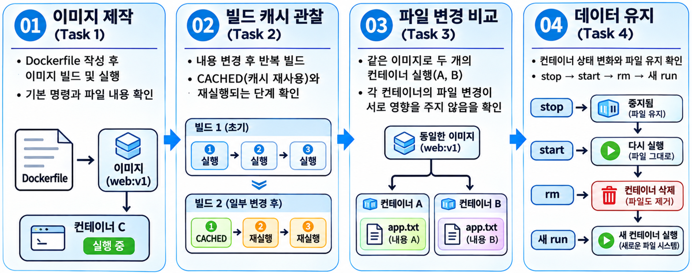
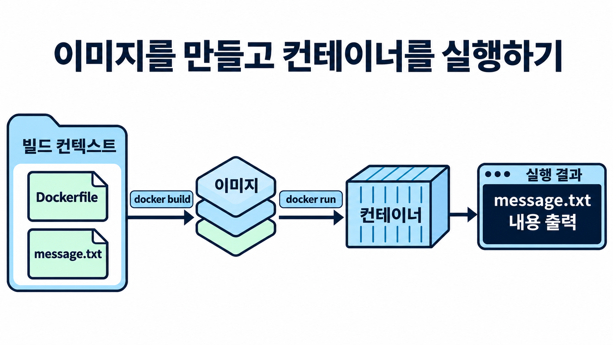
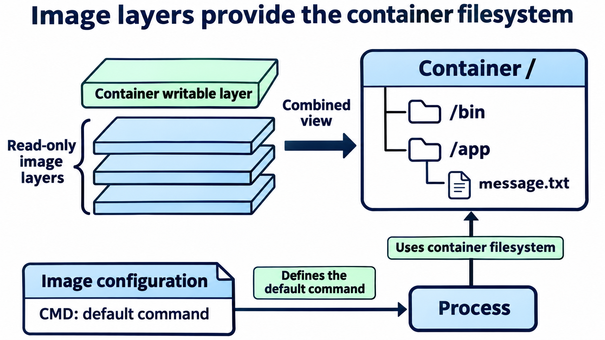
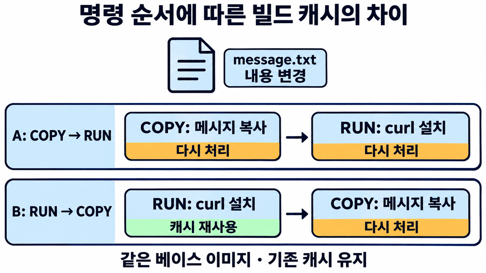
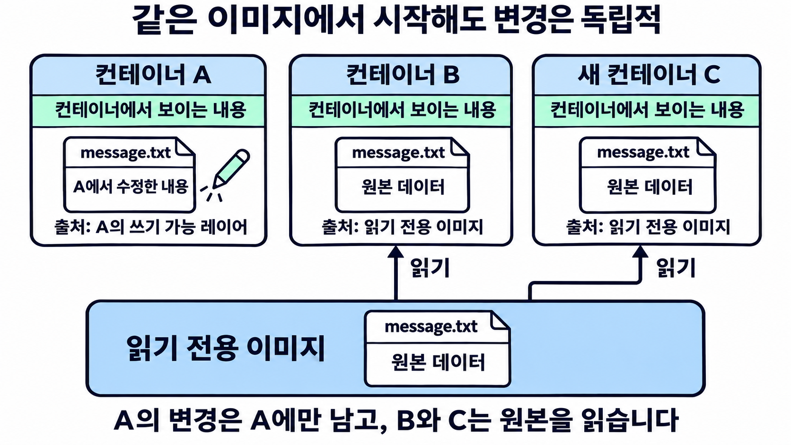
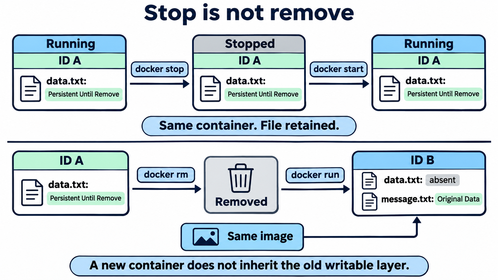

# 8주차 실습 — Docker 이미지로 실행 파일시스템을 만들다

[전체 주차 목록](../README.md) · [7주차 실습](../week07/README.md)

7주차에는 `config.json`과 `rootfs/`를 준비해 runc로 컨테이너를 실행했습니다. 이번에는 **Dockerfile로 실행에 필요한 파일을 이미지에 담고, 그 이미지에서 만든 컨테이너의 파일 변경을 비교**합니다.

**학습 목표:** 이미지 제작 방법, 레이어와 실행 설정, 빌드 캐시, 컨테이너별 쓰기 공간과 파일 수명주기를 실제 출력으로 설명합니다.

## 실습 전체 흐름



이미지 제작 → 빌드 캐시 관찰 → 파일 변경 비교 → 데이터 유지 확인 순서로 진행합니다. 그림의 `web:v1`과 `app.txt`는 개념 설명용 예시이며, 실제 실습에서는 아래 명령에 제시된 이미지 이름과 파일명을 사용합니다. Task 4의 파일 유지·삭제 비교는 컨테이너 내부의 쓰기 공간을 대상으로 합니다.

| 구간 | 확인할 질문 | 예상 시간 |
| --- | --- | ---: |
| 준비 | Buildx 설치와 MTU 설정·통신 확인을 마쳤는가? | 10~15분 |
| Task 1 | Dockerfile의 파일과 CMD는 언제 사용되는가? | 15분 |
| 연결 관찰 | 이미지 레이어가 7주차의 rootfs와 어떻게 연결되는가? | 10분 |
| Task 2 | 입력 파일과 명령 순서가 캐시에 어떤 영향을 주는가? | 20분 |
| Task 3 | A의 파일 변경이 B와 원본 이미지에도 반영되는가? | 15분 |
| Task 4 | 중지·재시작과 삭제·재생성의 차이는 무엇인가? | 10분 |

설명과 기록을 포함해 약 80~95분이며 다운로드 시간은 별도입니다. `.dockerignore` 관찰은 Task 1에서 함께 진행합니다.

## 시작 전에

- 학생별 Ubuntu 24.04 VM에 SSH로 접속합니다. **이 문서의 모든 명령은 VM의 일반 사용자 Bash에서 실행**합니다. PC의 PowerShell이나 `sudo -i`로 들어간 root 셸에서 시작하지 않습니다.
- 7주차의 Ubuntu `docker.io` 설치를 이어 씁니다. Docker 회사 저장소의 패키지와 혼합 설치하지 않습니다.
- Git 설치·저장소 복제·별도 파일 다운로드가 필요 없습니다. 아래 파일 생성 블록을 직접 복사합니다.
- **코드 블록 하나씩 복사해 위에서 아래 순서로 실행**합니다. 명령 번호 01~48은 학습 단계이며, 한 번호 안에 여러 복사 블록이 있을 수 있습니다. 같은 VM의 같은 Bash 터미널을 계속 사용해 현재 폴더를 유지합니다. 설명에서 의도한 오류를 제외하고 오류가 발생하면 해결한 뒤 다음 블록으로 진행합니다.
- `cat > 파일 <<'EOF'` 블록은 마지막 `EOF`까지 한 번에 복사합니다. 마지막 `EOF`는 들여쓰기 없이 단독 줄입니다. `>` 프롬프트가 계속 나오면 아직 입력이 끝나지 않은 것이므로 `Ctrl+C` 후 블록 전체를 다시 붙여 넣습니다.
- `sudo docker exec … sh -c '… > 파일'`의 따옴표를 유지합니다. 여기의 `>`는 컨테이너 안에서 처리합니다.
- 파일 생성 명령은 같은 이름의 기존 파일을 덮어씁니다. 재수강 시 기존 `~/week08-task*` 작업은 먼저 별도 보관합니다. 기존 7주차 자원은 삭제하지 않습니다.

### Buildx 설치와 실행 도구 확인

7주차에 Docker Engine은 설치했지만 **Buildx는 아직 설치하지 않은 상태**로 가정합니다. 아래 설치 명령부터 순서대로 실행합니다. Ubuntu의 `docker.io`를 사용하므로 Buildx도 Ubuntu 패키지인 `docker-buildx`로 설치합니다.

**명령 01: Docker 확인 후 Buildx 설치 — 호스트 Bash**

현재 사용자 이름을 확인합니다.

```bash
id -un
```

현재 작업 폴더를 확인합니다.

```bash
pwd
```

Docker의 Client·Server 연결을 확인합니다.

```bash
sudo docker version
```

`docker: command not found`가 나오거나 `Server` 연결에 실패하면 아래의 **「Docker 명령이 없거나 Docker 서버에 연결되지 않을 때」**를 펼쳐 먼저 해결합니다. Client·Server가 모두 확인되기 전에는 Buildx 설치로 넘어가지 않습니다.

Client·Server 정보가 정상적으로 표시되면 패키지 목록을 갱신합니다.

```bash
sudo apt-get update
```

Buildx를 설치합니다. 설치가 완료될 때까지 기다립니다.

```bash
sudo apt-get install -y docker-buildx
```

Buildx 버전이 표시되는지 확인합니다.

```bash
sudo docker buildx version
```

**확인:** Docker의 `Client`·`Server` 정보가 표시되고, 패키지 설치가 완료된 뒤 마지막 버전 확인 명령에서 Buildx 버전이 나와야 합니다. 이 실습의 빌드 명령은 Buildx를 사용합니다. 설치 오류가 나오면 다음 단계로 넘어가지 않습니다. 이미 Buildx가 설치된 VM에서도 같은 설치 명령을 실행할 수 있습니다.

<details>
<summary>Docker 명령이 없거나 Docker 서버에 연결되지 않을 때</summary>

7주차의 Docker 설치 또는 서비스 시작을 완료하지 못한 경우에만 진행합니다. Docker가 정상이라면 위 명령 01의 Buildx 설치로 준비가 완료됩니다.

Ubuntu 패키지 목록을 갱신합니다.

```bash
sudo apt-get update
```

누락된 Docker Engine을 설치합니다.

```bash
sudo apt-get install -y docker.io
```

Docker 서비스를 시작합니다.

```bash
sudo systemctl start docker
```

Docker의 Client·Server가 정상 연결되는지 확인합니다.

```bash
sudo docker version
```

Docker가 정상 연결되면 명령 01로 돌아가 Buildx 설치와 버전 확인까지 완료합니다. Docker 회사 저장소에서 설치된 VM이라면 위 패키지를 혼합하지 말고 교수자에게 설치 방식을 확인합니다. `permission denied`가 나면 문서의 `sudo`를 빠뜨리지 않았는지 봅니다.
</details>

**이후 명령은 확인이 모두 끝난 다음 진행합니다.**

**명령 02: 기존 실습 자원과 폴더 확인 — 호스트 Bash**

기존 8주차 컨테이너를 확인합니다.

```bash
sudo docker ps -a --filter name=cv8- --format 'table {{.Names}}\t{{.Status}}'
```

기존 8주차 이미지 태그를 확인합니다.

```bash
sudo docker image ls --filter 'reference=cv8-*'
```

기존 실습 폴더를 확인합니다. 폴더가 없으면 출력이 없어도 정상입니다.

```bash
ls -d "$HOME"/week08-task* 2>/dev/null || true
```

첫 실습이면 목록에 8주차 자원이 없습니다. 이미 있다면 아래 **재실행 안내**를 먼저 읽습니다. `cv7-*` 자원이 보여도 이번 실습에서 지우지 않습니다.

**명령 03: 베이스 이미지 준비 — 호스트 Bash**

BusyBox 이미지를 먼저 다운로드합니다.

```bash
sudo docker pull busybox:1.36
```

다운로드가 완료되면 Alpine 이미지를 다운로드합니다.

```bash
sudo docker pull alpine:3.23
```

두 다운로드가 모두 성공해야 진행합니다. 최초 실행에는 네트워크가 필요합니다. 태그는 업데이트될 수 있으므로 이미지 ID·크기·digest를 예시 숫자에 맞추지 않습니다. 같은 수업의 캐시 비교 도중에는 다시 pull하거나 캐시를 삭제하지 않습니다.

### Docker 네트워크 MTU 사전 설정

**설정 이유:** 컨테이너의 패키지 다운로드가 중간에 멈추지 않도록 Docker 기본 브리지의 MTU를 VM의 외부 통신 인터페이스에 맞춥니다. 이 준비는 Task 1을 시작하기 전에 한 번 진행합니다.

Docker 재시작 뒤 기존 실행 상태를 복구할 수 있도록, 현재 실행 중인 컨테이너 이름을 저장합니다.

```bash
sudo docker ps --format '{{.Names}}' > "$HOME/week08-running-before-mtu.txt"
```

저장한 목록을 확인합니다. **Docker 재시작 중에는 이 컨테이너들의 서비스가 잠시 중단될 수 있습니다.**

```bash
cat "$HOME/week08-running-before-mtu.txt"
```

아래 스크립트가 외부 통신 인터페이스의 실제 MTU를 자동으로 읽고, 기존 Docker 설정을 백업한 뒤 `mtu` 항목을 추가·수정합니다. 마지막 `PY`까지 한 번에 복사합니다. 다른 설정은 유지하며, 설정 검증이 실패하면 기존 파일을 교체하지 않습니다.

```bash
sudo python3 - <<'PY'
import json
import os
import shutil
import stat
import subprocess
import tempfile
import time
from pathlib import Path

route = json.loads(subprocess.check_output(
    ["ip", "-j", "-4", "route", "get", "1.1.1.1"], text=True))[0]
iface = route["dev"]
mtu = int(Path(f"/sys/class/net/{iface}/mtu").read_text())
config = Path("/etc/docker/daemon.json")
settings = json.loads(config.read_text()) if config.exists() else {}
if not isinstance(settings, dict):
    raise SystemExit("daemon.json은 JSON 객체여야 합니다. 기존 설정을 확인하세요.")
config.parent.mkdir(parents=True, exist_ok=True)
mode = stat.S_IMODE(config.stat().st_mode) if config.exists() else 0o644
if config.exists():
    backup = config.with_name(f"daemon.json.before-mtu-{time.time_ns()}")
    shutil.copy2(config, backup)
    print(f"기존 설정 백업: {backup}", flush=True)
settings["mtu"] = mtu
with tempfile.NamedTemporaryFile(mode="w", dir=config.parent,
                                 prefix=".mtu-", suffix=".json", delete=False) as f:
    json.dump(settings, f, indent=2)
    f.write("\n")
    candidate = Path(f.name)
try:
    subprocess.run(["dockerd", "--validate", f"--config-file={candidate}"], check=True)
    os.chmod(candidate, mode)
    os.replace(candidate, config)
    print(f"설정 저장 완료: {iface}의 MTU {mtu} 적용")
finally:
    candidate.unlink(missing_ok=True)
PY
```

`configuration OK`와 `설정 저장 완료`가 표시되면, 출력된 인터페이스 이름과 MTU 값을 확인한 뒤 Docker를 재시작합니다. 예를 들어 `ens3의 MTU 1442 적용`으로 표시될 수 있으며, 이후 확인은 이 출력값을 기준으로 합니다. 오류가 나오면 재시작하지 말고 해당 오류부터 확인합니다.

```bash
sudo systemctl restart docker
```

Docker 서비스가 `active`인지 확인합니다. 재시작에 실패했다면 다음 단계로 진행하지 않습니다. 이 경우 사전 설정을 처음부터 반복해 실행 중인 컨테이너 목록을 덮어쓰지 말고, 저장한 목록을 유지한 채 오류를 해결합니다.

```bash
sudo systemctl is-active docker
```

앞서 실행 중이었던 컨테이너만 다시 시작합니다. 목록이 비어 있으면 실행하지 않고 넘어갑니다.

```bash
xargs -r sudo docker start < "$HOME/week08-running-before-mtu.txt"
```

실행 상태를 확인합니다. 앞서 저장한 목록의 컨테이너가 모두 표시되고 상태가 `Up`인지 비교합니다. 목록이 비어 있었다면 컨테이너가 표시되지 않아도 정상입니다.

```bash
sudo docker ps
```

새 컨테이너의 네트워크 인터페이스 MTU가 앞서 `설정 저장 완료`에 표시된 값과 같은지 확인합니다. 설정 출력이 `1442`였다면 아래 결과도 `1442`여야 합니다.

```bash
sudo docker run --rm alpine:3.23 cat /sys/class/net/eth0/mtu
```

마지막으로 빌드 중 패키지 설치가 완료되는지 확인합니다. 아래는 하나의 빌드 명령이므로 마지막 `EOF`까지 함께 복사합니다. **`--no-cache`는 이 준비 확인에서만 사용**하고, 이후 캐시 비교 실습에는 추가하지 않습니다.

```bash
sudo docker build --no-cache --progress=plain -t cv8-mtu-check:verify - <<'EOF'
FROM alpine:3.23
RUN apk add --no-cache curl && curl --version
EOF
```

curl 버전 출력과 빌드 완료를 확인한 뒤, 준비 확인용 이미지 태그를 삭제합니다.

```bash
sudo docker image rm cv8-mtu-check:verify
```

확인이 모두 끝나면 Task 1로 진행합니다. [Docker 기본 브리지 설정 참고](https://docs.docker.com/engine/network/drivers/bridge/#configure-the-default-bridge-network)

---

## Task 1. Dockerfile로 이미지를 만들고 실행하기



**그림 읽기:** `build`는 파일과 실행 설정을 이미지에 저장합니다. `run`은 이미지의 기본 CMD를 실행합니다. 그림은 개념도이며, 실제 출력은 아래 두 줄 메시지로 확인합니다.

**명령 04: 프로젝트 폴더 생성과 이동 — 호스트 Bash**

Task 1 프로젝트 폴더를 만듭니다.

```bash
mkdir -p "$HOME/week08-task1"
```

만든 폴더로 이동합니다.

```bash
cd "$HOME/week08-task1"
```

현재 경로를 확인합니다.

```bash
pwd
```

예상 경로는 `/home/자신의계정/week08-task1`입니다. 호스트의 프로젝트 폴더이며, 컨테이너 내부 `/app`과는 다른 위치입니다.

**명령 05: 이미지에 포함할 원본 파일 작성 — 호스트 Bash**

메시지 파일을 만듭니다. 아래 블록은 마지막 EOF까지 한 번에 복사합니다.

```bash
cat > message.txt <<'EOF'
Cloud Virtualization - Week 08
Docker Image Build Practice
EOF
```

작성한 파일의 내용을 확인합니다.

```bash
cat message.txt
```

위 두 줄이 그대로 보여야 합니다.

**명령 06: Dockerfile 작성 — 호스트 Bash**

Dockerfile을 만듭니다. 아래 블록은 마지막 EOF까지 한 번에 복사합니다.

```bash
cat > Dockerfile <<'EOF'
FROM busybox:1.36
RUN mkdir -p /app
COPY message.txt /app/message.txt
CMD ["cat", "/app/message.txt"]
EOF
```

작성한 Dockerfile의 내용을 확인합니다.

```bash
cat Dockerfile
```

| 명령 | 이번 역할 |
| --- | --- |
| `FROM` | 실행 도구와 파일이 포함된 베이스 이미지 선택 |
| `RUN` | **빌드 중** `/app` 디렉터리 생성 |
| `COPY` | 컨텍스트의 `message.txt`를 이미지 안에 복사 |
| `CMD` | **컨테이너 시작 시** 사용할 기본 명령 기록 |

CMD의 `cat`은 빌드 도중 실행되지 않습니다. `COPY`의 원본은 호스트 컨텍스트 기준, 대상 `/app/message.txt`는 이미지 내부 경로입니다.

**명령 07: v1 이미지 빌드 — 호스트 Bash**

Task 1 프로젝트 폴더로 이동합니다.

```bash
cd "$HOME/week08-task1"
```

현재 폴더를 빌드 컨텍스트로 사용해 v1 이미지를 만듭니다.

```bash
sudo docker build --progress=plain -t cv8-task1:v1 .
```

`-t`는 이미지 이름·태그를 지정하며, 마지막 `.`은 현재 폴더를 **빌드 컨텍스트**로 사용한다는 뜻입니다. Dockerfile을 읽고 `RUN`, `COPY`, 이미지 내보내기 단계가 완료되는지 봅니다. `FINISHED`·`DONE`과 단계 번호는 버전마다 달라질 수 있습니다.

**명령 08: 이미지와 기본 CMD 확인 — 호스트 Bash**

생성한 이미지 태그를 확인합니다.

```bash
sudo docker image ls cv8-task1
```

이미지에 저장된 기본 CMD를 확인합니다.

```bash
sudo docker image inspect cv8-task1:v1 --format '{{json .Config.Cmd}}'
```

CMD 예상값은 `["cat","/app/message.txt"]`입니다. 아직 `cv8-task1-run` 컨테이너는 없습니다. 이미지 빌드와 컨테이너 실행은 구분합니다.

**명령 09: 기본 CMD로 컨테이너 실행 — 호스트 Bash**

```bash
sudo docker run --name cv8-task1-run cv8-task1:v1
```

**예상 출력**

```text
Cloud Virtualization - Week 08
Docker Image Build Practice
```

파일 출력 후 호스트 프롬프트로 돌아옵니다. 주 프로그램 `cat`이 일을 마치고 정상 종료한 것입니다.

**명령 10: 종료 상태와 로그 확인 — 호스트 Bash**

컨테이너의 종료 상태를 확인합니다.

```bash
sudo docker ps -a --filter name=cv8-task1-run
```

컨테이너가 남긴 출력 로그를 확인합니다.

```bash
sudo docker logs cv8-task1-run
```

`Exited (0)`와 같은 두 줄 메시지를 확인합니다. 계속 실행되지 않는 것이 오류는 아닙니다. `docker logs`는 컨테이너의 표준 출력·표준 오류 기록을 조회합니다.

**명령 11: 종료 컨테이너 삭제 후 일회성 실행 — 호스트 Bash**

종료된 컨테이너를 삭제합니다.

```bash
sudo docker rm cv8-task1-run
```

같은 이미지로 일회성 컨테이너를 실행합니다.

```bash
sudo docker run --rm cv8-task1:v1
```

`--rm`은 이 실행이 종료되면 컨테이너를 자동 삭제합니다. 이미지 `cv8-task1:v1`은 유지됩니다.

### 같은 컨텍스트에서 .dockerignore 관찰

원본 Dockerfile은 필요한 파일 하나만 COPY합니다. 여기서는 **폴더 전체를 복사하는 별도 Dockerfile**을 만들어 제외 규칙을 확인합니다. 앞의 Dockerfile과 v1 이미지를 수정하지 않습니다.

**명령 12: 컨텍스트 제외 규칙과 비교용 Dockerfile 작성 — 호스트 Bash**

Task 1 프로젝트 폴더로 이동합니다.

```bash
cd "$HOME/week08-task1"
```

제외 규칙을 확인할 임시 파일을 만듭니다.

```bash
printf 'This file stays on the host.\n' > scratch.tmp
```

.dockerignore를 작성합니다. 아래 블록은 마지막 EOF까지 한 번에 복사합니다.

```bash
cat > .dockerignore <<'EOF'
*.tmp
EOF
```

비교용 Dockerfile.context를 작성합니다. 아래 블록은 마지막 EOF까지 한 번에 복사합니다.

```bash
cat > Dockerfile.context <<'EOF'
FROM busybox:1.36
COPY . /context/
CMD ["ls", "-la", "/context"]
EOF
```

`*.tmp`는 컨텍스트에서 제외할 파일 패턴입니다. `.dockerignore`는 이미지에서 나중에 파일을 지우는 명령이 아니라, 빌드에 전달할 입력을 제한합니다.

**명령 13: 컨텍스트 제외 결과 확인 — 호스트 Bash**

비교용 Dockerfile로 이미지를 빌드합니다.

```bash
sudo docker build --progress=plain -f Dockerfile.context -t cv8-context:v1 .
```

컨테이너에서 /context의 파일 목록을 확인합니다.

```bash
sudo docker run --rm cv8-context:v1
```

호스트에 scratch.tmp가 남아 있는지 확인합니다.

```bash
ls -l scratch.tmp
```

컨테이너의 `/context`에는 `message.txt`가 있고 `scratch.tmp`는 없어야 합니다. 호스트 파일 확인 명령인 `ls`에는 `scratch.tmp`가 남아 있습니다. Dockerfile·ignore 파일 자체의 표시 여부는 빌더에 따라 달라질 수 있으므로 성공 기준으로 삼지 않습니다.

`-f`는 사용할 Dockerfile을 선택할 뿐 컨텍스트를 바꾸지 않습니다. 마지막 `.`은 여전히 `~/week08-task1`입니다.

---

## 연결 관찰. 이미지 레이어와 7주차의 rootfs



**그림 읽기:** 이미지는 rootfs를 구성할 파일과 변경 사항을 레이어로 제공합니다. 실행 시 컨테이너별 쓰기 공간과 결합된 파일시스템이 프로세스의 `/`로 보입니다. CMD는 어떤 프로그램을 시작할지 정하는 이미지 설정입니다. 그림은 `/proc` 등의 추가 마운트를 생략한 개념도입니다.

**명령 14: 이미지 제작 이력과 파일시스템 레이어 확인 — 호스트 Bash**

이미지 제작 이력을 확인합니다.

```bash
sudo docker history --no-trunc cv8-task1:v1
```

파일시스템 레이어 목록을 확인합니다.

```bash
sudo docker image inspect cv8-task1:v1 --format '{{json .RootFS.Layers}}'
```

파일시스템과 구분되는 기본 실행 설정을 확인합니다.

```bash
sudo docker image inspect cv8-task1:v1 --format '{{json .Config.Cmd}}'
```

**관찰:** history에서 제작 명령을 찾고, inspect에서는 레이어 식별값 목록과 CMD를 따로 읽습니다. `RootFS.Layers`는 압축 해제된 파일시스템 변경 내용의 식별값(DiffID) 목록이며 호스트 디렉터리 목록이 아닙니다.

**history의 행 수를 파일시스템 레이어 수로 세지 않습니다.** CMD처럼 설정만 기록하는 이력도 있습니다. RUN도 실제 파일 변경이 없는 경우가 있으므로 Dockerfile 한 줄과 파일시스템 레이어를 무조건 일대일로 연결하지 않습니다.

**명령 15: 이미지로 구성된 컨테이너의 / 확인 — 호스트 Bash**

이미지로 실행한 컨테이너의 루트 디렉터리 목록을 확인합니다.

```bash
sudo docker run --rm cv8-task1:v1 ls /
```

같은 이미지로 일회성 컨테이너를 실행해 메시지 파일을 읽습니다.

```bash
sudo docker run --rm cv8-task1:v1 cat /app/message.txt
```

`/bin` 등 베이스 이미지의 파일과 `/app/message.txt`를 함께 봅니다. 이미지 이름 뒤의 `ls /`와 `cat /app/message.txt`가 각 실행의 기본 CMD를 대체합니다. 두 명령은 같은 이미지에서 별도의 일회성 컨테이너를 실행합니다. 이미지의 `.Config.Cmd` 자체를 수정한 것은 아닙니다.

7주차에는 rootfs 디렉터리를 직접 준비했습니다. 이번에는 Docker가 이미지로 실행 파일시스템을 준비했습니다. **Docker 이미지 그 자체가 실행 중인 rootfs인 것은 아닙니다.** 내부 저장소 경로를 추측하거나 `/var/lib/docker` 파일을 직접 수정하지 않습니다.

---

## Task 2. 빌드 캐시와 명령 순서 비교



**그림 읽기:** A는 COPY 뒤에 설치하고, B는 설치 뒤에 COPY합니다. 메시지만 바꾸면 A의 설치 단계는 다시 처리되고 B의 설치 단계는 재사용될 수 있습니다. 다른 빌드 입력과 베이스 이미지가 같고 기존 캐시가 남아 있어야 합니다.

**명령 16: 아무것도 바꾸지 않고 다시 빌드 — 호스트 Bash**

Task 1 프로젝트 폴더로 이동합니다.

```bash
cd "$HOME/week08-task1"
```

입력을 바꾸지 않은 상태로 다시 빌드합니다.

```bash
sudo docker build --progress=plain -t cv8-task1:v1 .
```

`RUN mkdir -p /app`, `COPY message.txt …` 단계의 `CACHED`를 찾습니다. 컨텍스트 읽기·이미지 내보내기까지 모든 행이 CACHED여야 하는 것은 아닙니다. 속도 대신 **해당 명령 단계의 표시**를 기록합니다.

**명령 17: COPY의 입력 파일만 변경 — 호스트 Bash**

메시지 파일의 내용을 바꿉니다. 아래 블록은 마지막 EOF까지 한 번에 복사합니다.

```bash
cat > message.txt <<'EOF'
Cloud Virtualization - Week 08
Docker Build Cache Practice
Version 2
EOF
```

Dockerfile은 수정하지 않습니다. 파일의 실제 내용을 바꾸며, 변경 결과는 명령 19의 v1·v2 실행 출력으로 확인합니다. 수정 시간만 바꾸는 `touch`로 대신하지 않습니다.

**명령 18: 새 태그 v2로 빌드 — 호스트 Bash**

```bash
sudo docker build --progress=plain -t cv8-task1:v2 .
```

예상: `RUN mkdir`는 CACHED, 변경한 파일을 읽는 COPY는 다시 처리됩니다. CMD는 실행 기본값이며 이때 메시지를 출력하지 않습니다.

**명령 19: v1과 v2의 출력 비교 — 호스트 Bash**

v1 이미지의 출력부터 확인합니다.

```bash
sudo docker run --rm cv8-task1:v1
```

이어서 v2 이미지의 출력을 확인하고 비교합니다.

```bash
sudo docker run --rm cv8-task1:v2
```

두 출력의 첫 줄은 `Cloud Virtualization - Week 08`로 같습니다. v1의 둘째 줄은 `Docker Image Build Practice`이고, v2는 둘째 줄이 `Docker Build Cache Practice`로 바뀌고 셋째 줄 `Version 2`가 추가됩니다.

**이유:** `COPY`는 빌드할 때의 호스트 파일 내용을 이미지에 복사합니다. 호스트 파일과 이미지의 파일이 실시간으로 동기화되는 것은 아닙니다. 이번에는 바뀐 내용을 **새 태그 `v2`**로 빌드했으므로 `v1`에서 읽는 파일은 이전 내용 그대로입니다. 비교를 마칠 때까지 `v1` 태그로 다시 빌드하지 않습니다.

**명령 20: 명령 순서 비교용 파일 두 개 작성 — 호스트 Bash**

Task 2 프로젝트 폴더를 만듭니다.

```bash
mkdir -p "$HOME/week08-task2"
```

만든 폴더로 이동합니다.

```bash
cd "$HOME/week08-task2"
```

두 빌드에서 사용할 메시지 파일을 만듭니다.

```bash
printf 'Version 1\n' > message.txt
```

COPY 후 RUN을 수행하는 Dockerfile.a를 작성합니다. 아래 블록은 마지막 EOF까지 한 번에 복사합니다.

```bash
cat > Dockerfile.a <<'EOF'
FROM alpine:3.23
COPY message.txt /app/message.txt
RUN apk add --no-cache curl
EOF
```

RUN 후 COPY를 수행하는 Dockerfile.b를 작성합니다. 아래 블록은 마지막 EOF까지 한 번에 복사합니다.

```bash
cat > Dockerfile.b <<'EOF'
FROM alpine:3.23
RUN apk add --no-cache curl
COPY message.txt /app/message.txt
EOF
```

두 파일의 차이는 COPY와 RUN의 순서뿐입니다. `apk`는 Alpine의 패키지 관리 도구입니다. **`apk add --no-cache`는 패키지 인덱스 캐시 처리 옵션이며 Docker 빌드 캐시를 끄는 옵션이 아닙니다.** 이번 비교에는 `docker build --no-cache`를 넣지 않습니다.

**명령 21: A 최초 빌드 — 호스트 Bash**

```bash
sudo docker build --progress=plain -f Dockerfile.a -t cv8-order-a:v1 .
```

패키지 서버에서 curl과 의존성을 받습니다. 실패하면 다음 단계로 넘어가지 말고 네트워크 연결을 해결한 뒤 다시 실행합니다.

**명령 22: B 최초 빌드 — 호스트 Bash**

```bash
sudo docker build --progress=plain -f Dockerfile.b -t cv8-order-b:v1 .
```

A/B 모두 성공해야 재빌드 비교가 가능합니다.

**명령 23: 두 빌드가 공유하는 메시지 변경 — 호스트 Bash**

공통 메시지를 Version 2로 바꿉니다.

```bash
printf 'Version 2\n' > message.txt
```

파일 이름과 두 Dockerfile은 그대로 두고 메시지만 바꿉니다. 변경 결과는 재빌드 후 명령 26의 A·B 실행 출력으로 확인합니다.

**명령 24: A를 v2로 재빌드 — 호스트 Bash**

```bash
sudo docker build --progress=plain -f Dockerfile.a -t cv8-order-a:v2 .
```

COPY와 그 다음 `RUN apk add …`가 다시 처리되는지 봅니다.

**명령 25: B를 v2로 재빌드 — 호스트 Bash**

```bash
sudo docker build --progress=plain -f Dockerfile.b -t cv8-order-b:v2 .
```

앞쪽 `RUN apk add …`는 CACHED, 뒤쪽 COPY는 다시 처리되는지 봅니다.

| 조건 | COPY message.txt | RUN apk add |
| --- | --- | --- |
| A: COPY → RUN | 변경 입력 반영 | 앞 단계가 바뀌어 다시 처리 |
| B: RUN → COPY | 변경 입력 반영 | 기존 결과 재사용 가능 |

이미 같은 v2를 빌드했다면 A도 CACHED일 수 있습니다. 재관찰하려면 메시지를 `Version 3`처럼 **새 내용**으로 바꾸고 A/B를 같은 조건으로 다시 빌드합니다. 기존 제출용 v1·v2는 먼저 기록합니다.

**명령 26: 두 이미지의 결과 확인 — 호스트 Bash**

A 이미지의 메시지를 확인합니다.

```bash
sudo docker run --rm cv8-order-a:v2 cat /app/message.txt
```

A 이미지에 설치된 curl 버전을 확인합니다.

```bash
sudo docker run --rm cv8-order-a:v2 curl --version
```

B 이미지의 메시지를 확인합니다.

```bash
sudo docker run --rm cv8-order-b:v2 cat /app/message.txt
```

B 이미지에 설치된 curl 버전을 확인합니다.

```bash
sudo docker run --rm cv8-order-b:v2 curl --version
```

A와 B 각각에서 Version 2와 curl 버전을 따로 확인합니다. 각 확인 명령은 실행 후 자동 삭제되는 일회성 컨테이너를 사용합니다. 출력 기능이 같더라도 빌드 시 재사용할 수 있는 단계는 달라집니다. 외부 저장소의 패키지 상태까지 고정한 실험은 아니므로 이미지 ID·정확한 크기가 같다고 기대하지 않습니다.

---

## Task 3. 같은 이미지에서 만든 A와 B의 파일 변경 비교



**그림 읽기:** 이미지의 파일은 공통 출발점이며 쓰기 가능 레이어는 컨테이너마다 다릅니다. 그림의 파일 내용은 각 컨테이너에서 보이는 결합된 파일시스템을 뜻합니다. B와 새 실행의 원본 파일이 쓰기 레이어에 복사되었다는 뜻은 아닙니다. A의 변경·생성·삭제가 B와 새 실행에 영향을 주는지 비교합니다. **볼륨과 Bind Mount를 연결하지 않은 조건**입니다.

그림의 ‘원본 데이터’와 ‘A에서 수정한 내용’은 아래 실제 출력인 `Original Data`와 `Modified by Container A`의 의미를 한글로 표현한 것입니다.

**명령 27: 오래 실행되는 이미지의 파일 작성 — 호스트 Bash**

Task 3 프로젝트 폴더를 만듭니다.

```bash
mkdir -p "$HOME/week08-task3"
```

만든 폴더로 이동합니다.

```bash
cd "$HOME/week08-task3"
```

이미지에 넣을 원본 메시지 파일을 만듭니다.

```bash
printf 'Original Data\n' > message.txt
```

파일 관찰용 Dockerfile을 작성합니다. 아래 블록은 마지막 EOF까지 한 번에 복사합니다.

```bash
cat > Dockerfile <<'EOF'
FROM busybox:1.36
RUN mkdir -p /app
COPY message.txt /app/message.txt
CMD ["sleep", "3600"]
EOF
```

Task 1의 cat은 바로 종료됐습니다. 이번에는 파일 관찰을 위해 `sleep 3600`으로 약 한 시간 실행 상태를 유지합니다.

**명령 28: 파일 관찰용 이미지 빌드 — 호스트 Bash**

```bash
sudo docker build --progress=plain -t cv8-file:v1 .
```

기본 CMD는 sleep이지만 이미지 안에는 `/app/message.txt`가 들어 있습니다.

**명령 29: 같은 이미지로 A와 B 실행 — 호스트 Bash**

컨테이너 A를 실행합니다.

```bash
sudo docker run -d --name cv8-a cv8-file:v1
```

같은 이미지로 컨테이너 B를 실행합니다.

```bash
sudo docker run -d --name cv8-b cv8-file:v1
```

두 컨테이너가 실행 중인지 확인합니다.

```bash
sudo docker ps --filter name=cv8-
```

A/B의 이름과 ID는 다르고 이미지 태그는 같습니다. `-d`는 백그라운드 실행입니다. 이름 충돌이 나오면 아래 재실행 안내를 확인합니다.

**명령 30: 변경 전 A와 B의 파일 확인 — 호스트 Bash**

변경 전 A의 파일을 읽습니다.

```bash
sudo docker exec cv8-a cat /app/message.txt
```

변경 전 B의 파일을 읽습니다.

```bash
sudo docker exec cv8-b cat /app/message.txt
```

둘 다 `Original Data`입니다. `exec`는 실행 중인 컨테이너에서 추가 명령을 실행합니다. 한 시간 이상 지나 종료되었다면 `sudo docker start cv8-a cv8-b` 후 계속합니다.

**명령 31: A의 파일만 변경 — 호스트 Bash**

```bash
sudo docker exec cv8-a sh -c 'echo "Modified by Container A" > /app/message.txt'
```

호스트 파일을 수정하는 명령이 아닙니다. A 내부에서 셸이 파일을 덮어씁니다.

**명령 32: A·B·새 컨테이너의 출력 비교 — 호스트 Bash**

A의 수정된 내용을 확인합니다.

```bash
sudo docker exec cv8-a cat /app/message.txt
```

B의 파일 내용을 확인합니다.

```bash
sudo docker exec cv8-b cat /app/message.txt
```

새 일회성 컨테이너에서 이미지의 원본 내용을 확인합니다.

```bash
sudo docker run --rm cv8-file:v1 cat /app/message.txt
```

순서대로 `Modified by Container A`, `Original Data`, `Original Data`입니다. 새 컨테이너의 cat은 기본 sleep CMD를 대체한 일회성 실행입니다. 원본 이미지가 바뀌지 않았음을 확인합니다.

**명령 33: A에 새 파일 생성 — 호스트 Bash**

A 안에 새 파일을 만듭니다.

```bash
sudo docker exec cv8-a sh -c 'echo "New File in A" > /app/new.txt'
```

A에서 새 파일의 내용을 읽습니다.

```bash
sudo docker exec cv8-a cat /app/new.txt
```

`New File in A`가 출력됩니다.

**명령 34: B에서 새 파일 유무 확인 — 호스트 Bash**

```bash
sudo docker exec cv8-b ls /app/new.txt
```

**의도한 결과:** `No such file or directory`와 0이 아닌 종료 코드입니다. A에만 생성했기 때문입니다. 파일을 B에 복사해 오류를 없애지 않습니다.

**명령 35: A에서 기존 파일 삭제 — 호스트 Bash**

```bash
sudo docker exec cv8-a rm /app/message.txt
```

앞에서 A가 수정한 파일을 이제 삭제합니다.

**명령 36: A에서 삭제 결과 확인 — 호스트 Bash**

```bash
sudo docker exec cv8-a ls /app/message.txt
```

**의도한 결과:** 파일 없음 오류입니다. 이미지의 하위 원본이 A 안에서 다시 보이면 안 됩니다.

**명령 37: B와 새 실행의 원본 확인 — 호스트 Bash**

B에 원본 파일이 남아 있는지 확인합니다.

```bash
sudo docker exec cv8-b cat /app/message.txt
```

새 일회성 컨테이너에서도 원본 파일을 확인합니다.

```bash
sudo docker run --rm cv8-file:v1 cat /app/message.txt
```

둘 다 Original Data를 출력합니다. A에서 삭제해도 B와 이미지의 원본 파일은 유지됩니다.

**명령 38: A의 파일 변경 목록 확인 — 호스트 Bash**

```bash
sudo docker diff cv8-a
```

`A /app/new.txt`, `D /app/message.txt`, `C /app` 등을 찾습니다. A는 추가(Added), C는 변경(Changed), D는 삭제(Deleted)입니다. 디렉터리나 시스템 관련 다른 변경도 나타날 수 있습니다.

**해석의 범위:** 컨테이너별 변경의 독립성은 관찰했습니다. 이 명령이 디스크상의 실제 copy-up 호출이나 whiteout 파일을 직접 추적한 것은 아닙니다. OverlayFS의 CoW·삭제 가림은 이 현상을 설명하는 구현 원리이며 저장 방식은 Docker 설정에 따라 다릅니다.

---

## Task 4. 중지·재시작과 삭제·재생성 비교



**그림 읽기:** 이미지에 있던 `message.txt`와 실행 후 만든 `data.txt`를 구분합니다. 같은 컨테이너를 다시 시작하는 경우와 같은 이미지로 새 컨테이너를 만드는 경우는 다릅니다.

그림의 ‘삭제 전까지 유지’는 실제 출력 `Persistent Until Remove`의 의미입니다. 명령어와 파일명은 실습에서 사용하는 표기를 그대로 유지했습니다.

**명령 39: 수명주기 관찰용 컨테이너 생성 — 호스트 Bash**

```bash
sudo docker run -d --name cv8-lifecycle cv8-file:v1
```

A/B 실험과 별개인 새 컨테이너입니다.

**명령 40: 실행 중 데이터 생성과 ID 기록 — 호스트 Bash**

실행 중인 컨테이너 안에 data.txt를 만듭니다.

```bash
sudo docker exec cv8-lifecycle sh -c 'echo "Persistent Until Remove" > /app/data.txt'
```

생성한 파일 내용을 확인합니다.

```bash
sudo docker exec cv8-lifecycle cat /app/data.txt
```

현재 컨테이너 ID를 기록합니다.

```bash
sudo docker inspect cv8-lifecycle --format '{{.Id}}'
```

메시지와 현재 컨테이너 ID를 기록합니다. `data.txt`는 Dockerfile에 COPY하지 않은 런타임 파일입니다.

**명령 41: 컨테이너 중지와 상태 확인 — 호스트 Bash**

컨테이너를 중지합니다. 명령이 끝날 때까지 기다립니다.

```bash
sudo docker stop cv8-lifecycle
```

중지 상태를 확인합니다.

```bash
sudo docker ps -a --filter name=cv8-lifecycle
```

Exited 상태를 확인합니다. 신호 처리에 따라 종료 코드는 달라질 수 있습니다. 중지 중에는 exec로 파일을 읽을 수 없으므로 먼저 start해야 합니다.

**명령 42: 같은 컨테이너 재시작과 파일 확인 — 호스트 Bash**

같은 컨테이너를 다시 시작합니다.

```bash
sudo docker start cv8-lifecycle
```

ID가 앞서 기록한 값과 같은지 확인합니다.

```bash
sudo docker inspect cv8-lifecycle --format '{{.Id}}'
```

실행 후 만든 data.txt가 유지되는지 확인합니다.

```bash
sudo docker exec cv8-lifecycle cat /app/data.txt
```

ID가 같고 `Persistent Until Remove`가 유지됩니다. 프로세스 중지는 쓰기 레이어 삭제가 아닙니다.

**명령 43: 기록 후 컨테이너 삭제 — 호스트 Bash**

현재 컨테이너를 중지합니다.

```bash
sudo docker stop cv8-lifecycle
```

중지한 컨테이너를 삭제합니다.

```bash
sudo docker rm cv8-lifecycle
```

삭제한 컨테이너가 목록에서 사라졌는지 확인합니다.

```bash
sudo docker ps -a --filter name=cv8-lifecycle
```

삭제한 컨테이너가 목록에서 사라졌는지 확인합니다. `cv8-file:v1` 이미지는 남아 있으며, 다음 명령에서 이 이미지로 새 컨테이너를 실행합니다. 이 단계 전에 관찰값을 기록합니다.

**명령 44: 같은 이미지로 새 컨테이너 생성 — 호스트 Bash**

같은 이미지로 새 컨테이너를 만듭니다.

```bash
sudo docker run -d --name cv8-lifecycle-new cv8-file:v1
```

새 컨테이너 ID를 확인하고 이전 ID와 비교합니다.

```bash
sudo docker inspect cv8-lifecycle-new --format '{{.Id}}'
```

이전과 다른 ID입니다. 컨테이너 이름을 재사용하더라도 새 run은 새 컨테이너를 만듭니다.

**명령 45: 새 컨테이너의 런타임 파일 확인 — 호스트 Bash**

```bash
sudo docker exec cv8-lifecycle-new ls /app/data.txt
```

**의도한 결과:** 파일 없음 오류입니다. 이전 컨테이너의 쓰기 레이어를 이어받지 않았습니다.

**명령 46: 이미지의 원본 파일 확인 — 호스트 Bash**

```bash
sudo docker exec cv8-lifecycle-new cat /app/message.txt
```

`Original Data`는 남아 있습니다. 이미지에 포함한 파일과 컨테이너 실행 후 만든 파일의 수명주기가 다릅니다. 볼륨·Bind Mount의 외부 데이터 수명주기는 이번 실험 대상이 아닙니다.

---

## 관찰 기록

예상값을 복사하지 말고 실제 출력과 이유를 한 문장씩 기록합니다. 오류가 난 경우 오류 내용과 실행 위치도 함께 적습니다.

| 항목 | 기록할 질문 | 나의 관찰 |
| --- | --- | --- |
| Dockerfile | RUN과 CMD는 각각 언제 사용됐는가? | |
| 실행 | cat 컨테이너가 Exited (0)인 이유는? | |
| 컨텍스트 | scratch.tmp는 호스트와 이미지 중 어디에 있는가? | |
| rootfs 연결 | /app/message.txt는 어떤 과정을 통해 컨테이너의 / 아래에 보이는가? | |
| 레이어·설정 | RootFS.Layers와 Config.Cmd는 무엇을 각각 설명하는가? | |
| 캐시 | 입력 불변 때와 메시지 변경 때 CACHED인 단계는? | |
| 순서 비교 | A/B의 설치 단계 재사용 결과와 그 이유는? | |
| 파일 수정 | A·B·새 컨테이너의 message.txt 내용은? | |
| 파일 생성·삭제 | A의 new.txt와 삭제한 message.txt가 B에 영향을 줬는가? | |
| diff | A/C/D에서 실제 관찰한 경로는? 직접 copy-up을 본 것인가? | |
| stop/start | ID와 data.txt는 유지됐는가? | |
| rm/run | ID·data.txt·message.txt는 각각 어떻게 됐는가? | |

## 실습 자원 정리

먼저 결과를 기록합니다. 아래는 이번 문서의 실습을 끝까지 수행한 경우의 정리입니다. 호스트의 프로젝트 파일은 복습용으로 남깁니다.

**명령 47: 8주차 컨테이너만 확인하고 삭제 — 호스트 Bash**

삭제할 8주차 컨테이너 목록을 먼저 확인합니다.

```bash
sudo docker ps -a --filter name=cv8-
```

아래 이름의 실습 컨테이너를 삭제합니다.

```bash
sudo docker rm -f cv8-a cv8-b cv8-lifecycle-new
```

`rm -f`는 실행 중인 컨테이너도 중지·삭제합니다. 중간에 멈춘 경우 목록을 보고 직접 만든 `cv8-task1-run`, `cv8-lifecycle`만 필요에 따라 추가 정리합니다. 존재하지 않는 이름의 오류는 다른 컨테이너를 삭제하라는 뜻이 아닙니다.

**명령 48: 이번에 빌드한 이미지 태그 삭제 — 호스트 Bash**

이번에 빌드한 이미지 태그를 삭제합니다. 역슬래시로 이어진 줄들은 한 명령이므로 아래 블록 전체를 복사합니다.

```bash
sudo docker image rm \
  cv8-task1:v1 cv8-task1:v2 cv8-context:v1 \
  cv8-order-a:v1 cv8-order-a:v2 \
  cv8-order-b:v1 cv8-order-b:v2 cv8-file:v1
```

남은 8주차 컨테이너가 있는지 확인합니다.

```bash
sudo docker ps -a --filter name=cv8-
```

남은 8주차 이미지 태그가 있는지 확인합니다.

```bash
sudo docker image ls --filter 'reference=cv8-*'
```

이미지를 사용하는 컨테이너가 남아 있으면 그 컨테이너를 먼저 확인합니다. `-f`로 이미지 삭제를 강제하거나 `docker system prune`으로 다른 주차까지 지우지 않습니다. 베이스 이미지와 빌드 캐시는 남아도 정상이며 호스트의 `~/week08-task1`~`task3` 폴더도 남습니다.

## 막혔을 때와 재실행

| 상황 | 확인·조치 |
| --- | --- |
| Dockerfile 또는 COPY 파일을 못 찾음 | `pwd`, `ls -la`로 현재 task 폴더와 파일명을 확인합니다. `Dockerfile`의 대소문자와 마지막 `.`을 확인합니다. |
| 빌드 오류가 나거나 파일 출력이 예상과 다름 | 해당 task 폴더에서 `cat message.txt`, `cat Dockerfile`, `cat Dockerfile.a`, `cat Dockerfile.b` 중 확인할 파일에 해당하는 명령만 실행해 작성 내용을 점검합니다. |
| `unknown command: docker buildx` | 명령 01의 `sudo apt-get update`와 `sudo apt-get install -y docker-buildx`가 성공했는지 확인한 뒤 버전 확인을 다시 실행합니다. |
| `unknown flag: --progress` 또는 legacy builder 경고 | Buildx 설치와 `sudo docker buildx version` 확인을 먼저 완료한 뒤 원래 빌드 명령을 다시 실행합니다. `--progress`만 지워서 다음 단계로 넘어가지 않습니다. |
| 빌드 로그가 예시와 다름 | `--progress=plain`과 Buildx를 확인합니다. 단계 번호·소요 시간 대신 RUN/COPY의 CACHED 표시를 봅니다. |
| Docker Hub 또는 apk 다운로드 실패 | 인터넷·DNS·프록시·속도 제한 오류를 확인합니다. 성공하기 전 다음 단계로 가지 않습니다. 패키지 서버 문제로 A 설치가 실패한 결과를 캐시 비교 결과로 쓰지 않습니다. |
| 컨테이너 이름이 이미 존재함 | `sudo docker ps -a --filter name=cv8-`로 상태를 확인합니다. 실습 중인 A/B는 start/exec로 이어갑니다. 처음부터 반복할 때만 필요한 결과를 저장하고 해당 이름을 명시해 `sudo docker rm -f 이름`으로 정리합니다. |
| A의 원본 파일을 못 찾음 | Task 3의 삭제 단계 이후에는 정상입니다. 비교를 다시 시작하려면 기존 A/B를 정리하고 같은 이미지로 새 A/B를 만듭니다. |
| container is not running | `sudo docker ps -a --filter name=cv8-` 확인 후 해당 실습 컨테이너를 `sudo docker start 이름`으로 재시작합니다. Task 1의 cat은 바로 종료되므로 exec 대상으로 쓰지 않습니다. |
| SSH가 끊어짐 | 다시 접속하면 호스트 Bash입니다. 해당 task 폴더로 cd한 뒤 파일·컨테이너 상태를 조회하고 이어갑니다. 원본 파일 작성 단계부터 무조건 다시 실행하지 않습니다. |
| A도 재빌드에서 CACHED | 이미 동일한 새 메시지로 빌드했을 수 있습니다. 메시지를 새로운 값으로 바꿔 A/B를 같은 조건으로 다시 비교합니다. |

처음부터 반복할 때는 위 정리 명령으로 **자신의 cv8 자원만** 정리하고, 기존 task 폴더의 수정 파일을 별도 보관한 뒤 Task 1부터 진행합니다. 캐시를 지우지 않아도 실습은 가능합니다. 첫 빌드도 CACHED일 수 있으므로 새 메시지를 쓴 전후의 차이를 관찰합니다.

교안의 Nginx 예제를 별도로 실행했다면 본인이 만든 `cv8-web`도 확인 후 정리합니다. 7주차의 `cv7-web`·`cv7-net`은 이번 정리 대상이 아닙니다.

## 참고 자료

- [Dockerfile 명령과 컨텍스트](https://docs.docker.com/reference/dockerfile/)
- [빌드 컨텍스트와 .dockerignore](https://docs.docker.com/build/concepts/context/)
- [빌드 캐시 무효화](https://docs.docker.com/build/cache/invalidation/)
- [이미지 레이어와 컨테이너의 쓰기 레이어](https://docs.docker.com/engine/storage/drivers/)
- [docker container diff](https://docs.docker.com/reference/cli/docker/container/diff/)
- [OCI Runtime Bundle](https://github.com/opencontainers/runtime-spec/blob/main/bundle.md)

그림은 이 실습의 흐름을 설명하기 위해 AI로 생성한 개념도입니다. 실제 출력·저장 경로·레이어 개수는 실제 명령 결과를 기준으로 확인합니다.
