# 9주차 실습 — Docker 애플리케이션 이미지 제작과 배포

[전체 주차 목록](../README.md) · [8주차 실습](../week08/README.md)

8주차에는 Dockerfile로 이미지를 만들고 이미지 레이어와 컨테이너의 쓰기 공간을 관찰했습니다. 이번에는 프로그램의 실행 위치·설정·인자를 이미지에 정의하고, Docker Hub를 통해 다른 컴퓨터에 배포합니다.

학습 목표: WORKDIR, ARG, ENV, ENTRYPOINT, CMD, EXPOSE의 역할을 실제 출력으로 구분하고, 이미지의 태그·digest와 컨테이너 업데이트 동작을 설명합니다.

교안의 Server Report 예제를 완성합니다. 이 프로그램은 예제 CSV를 읽어 서버 목록을 출력합니다. 실제 서버를 조사하거나 접속하는 모니터링 도구는 아닙니다.

## 실습 전체 흐름

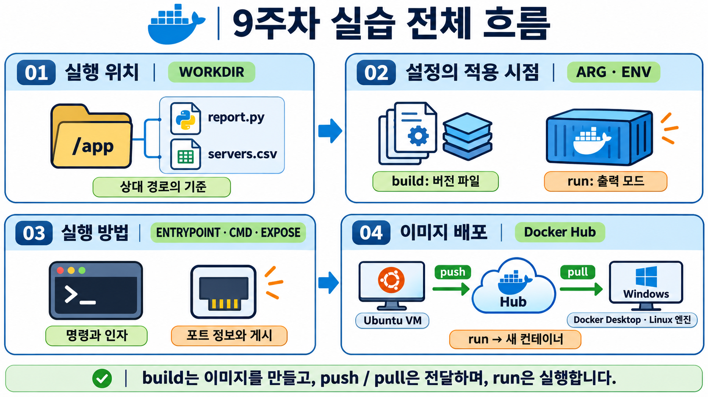

그림 읽기: build는 파일과 기본 실행 설정을 저장합니다. push/pull은 이미지를 전달하고, run은 선택한 이미지로 새 컨테이너를 만들어 프로그램을 실행합니다. EXPOSE 실험만 별도의 작은 웹 서버를 사용합니다.

| 구간 | 확인할 질문 | 예상 시간 |
| --- | --- | ---: |
| 준비 | Docker·Buildx와 실행 위치가 준비되었는가? | 5~10분 |
| Task 1 | 프로그램 경로가 절대 경로여도 데이터 파일을 못 찾을 수 있는가? | 15분 |
| Task 2 | 빌드할 때 결정할 값과 실행할 때 결정할 값은 무엇인가? | 15분 |
| Task 3 | 기본 실행 명령·인자와 실제 포트 게시는 어떻게 정하는가? | 20분 |
| 연결 관찰 | 태그를 바꾸면 기존 컨테이너도 바뀌는가? | 10분 |
| Task 4 | 같은 이미지를 다른 컴퓨터에서 어떻게 실행하는가? | 25~30분 |
| 기록·정리 | 관찰을 교안의 개념으로 설명할 수 있는가? | 10분 |

약 100~110분입니다. 최초 다운로드, Docker Desktop 설치·재부팅, Docker Hub 가입 시간은 별도입니다. 수업 시간이 짧으면 Task 4를 이어지는 실습이나 과제로 진행합니다.

### 실행 도구와 베이스 이미지 준비

명령 01: Docker와 Buildx 확인 — 호스트 Bash

```bash
sudo docker version
```

```bash
sudo docker buildx version
```

Docker의 Client·Server 정보와 Buildx 버전이 표시되어야 합니다.

<details>
<summary>Docker·Buildx가 없는 새 Ubuntu 24.04 VM인 경우</summary>

수업에서 사용하는 Ubuntu 패키지로 설치합니다. Docker 회사 저장소의 Docker CE를 이미 설치했다면 아래 패키지와 혼합하지 않습니다.

```bash
sudo apt-get update
```

```bash
sudo apt-get install -y docker.io docker-buildx curl
```

```bash
sudo systemctl start docker
```

설치 후 명령 01을 다시 확인합니다. Docker가 이미 정상이라면 서비스를 재시작할 필요가 없습니다.
</details>

명령 02: Docker 실행

다음 명령으로 Docker를 실행합니다. 이미 실행 중이면 상태 메시지만 표시합니다.

```bash
if systemctl is-active --quiet docker; then
  echo "Docker 실행 중"
else
  sudo systemctl start docker && echo "Docker 시작 완료"
fi
```

Docker가 실행 중이면 메시지를 표시하고, 중지되어 있으면 시작합니다. 오류가 나오면 위 설치 안내를 확인한 뒤 진행합니다.

명령 03: 이미지와 통신 도구 준비 — 호스트 Bash

```bash
sudo docker pull python:3.12-slim
```

```bash
curl --version
```

curl만 없다면 `sudo apt-get install -y curl`로 설치합니다.

명령 04: 이번 주차 작업 폴더 준비 — 호스트 Bash

```bash
mkdir -p "$HOME/week09-report" "$HOME/week09-web"
cd "$HOME/week09-report"
pwd
```

작업 경로가 `/home/자신의계정/week09-report`인지 확인합니다.

## Task 1. WORKDIR로 프로그램과 데이터의 기준 경로 맞추기

교안 연결: 「WORKDIR」. Python 파일을 찾는 경로와 프로그램이 CSV를 찾는 경로가 항상 같은 것은 아닙니다.

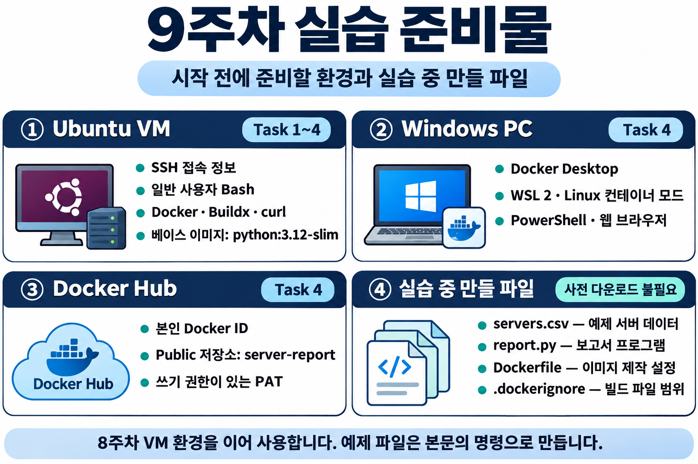

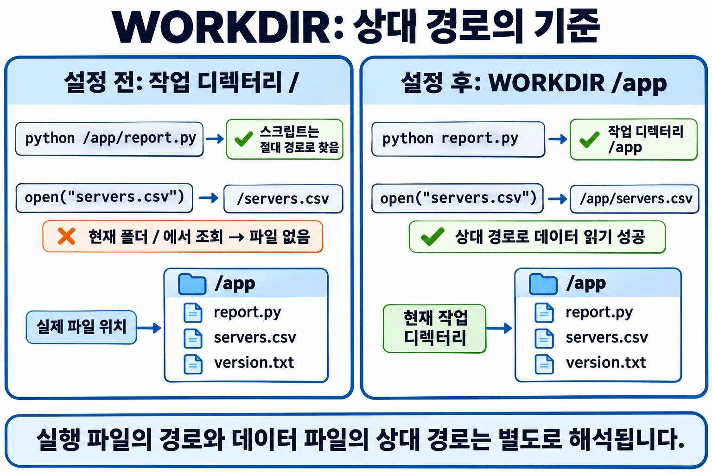

그림 읽기: `python /app/report.py`의 절대 경로는 프로그램을 찾는 위치만 지정합니다. 프로그램이 상대 경로 `servers.csv`를 읽을 때는 현재 작업 디렉터리를 기준으로 찾으므로, 이 예제에서는 `WORKDIR /app`으로 기준을 맞춥니다. 호스트의 빌드 컨텍스트와 컨테이너 내부 `/app`은 서로 다른 위치입니다.

명령 05: 예제 서버 데이터 생성 — 호스트 Bash

```bash
cat > servers.csv <<'EOF'
name,status,cpu,memory
web-01,running,25,40
api-01,running,60,55
db-01,stopped,0,0
cache-01,running,10,20
batch-01,running,80,70
EOF
```

CPU와 메모리는 비교용 가상 값이며 백분율로 출력합니다.

명령 06: Server Report 프로그램 생성 — 호스트 Bash

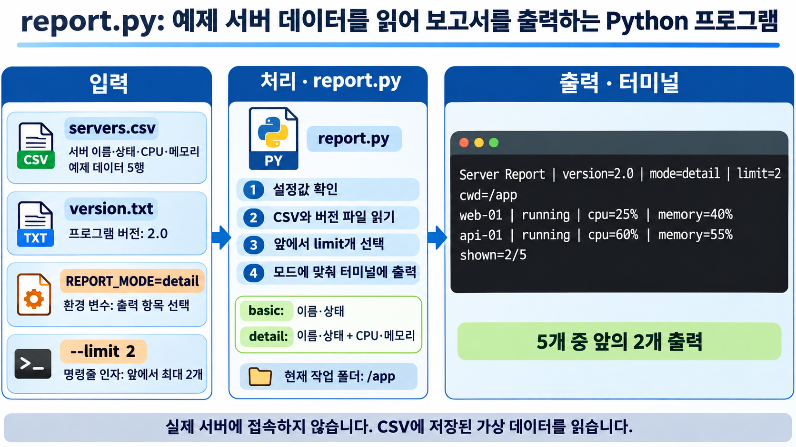

그림 읽기: `report.py`는 예제 서버 목록을 읽어 터미널에 보고서를 출력하는 Python 프로그램입니다. 입력은 `servers.csv`, `version.txt`, 환경 변수 `REPORT_MODE`, 인자 `--limit`입니다. 그림은 버전 2.0·detail 모드·2개 출력의 예시이며, 버전 파일은 뒤의 Dockerfile에서 만듭니다. `basic`은 이름과 상태를, `detail`은 CPU·메모리 값까지 표시합니다. 실제 서버에 접속하거나 측정하지 않습니다.

```bash
cat > report.py <<'EOF'
import argparse
import csv
import os
from pathlib import Path

parser = argparse.ArgumentParser(description="Print a sample server report")
parser.add_argument("--limit", type=int, default=2)
args = parser.parse_args()
if args.limit < 1:
    parser.error("--limit must be at least 1")

mode = os.environ.get("REPORT_MODE", "basic")
if mode not in {"basic", "detail"}:
    parser.error("REPORT_MODE must be basic or detail")

# Relative paths deliberately demonstrate the role of WORKDIR.
with open("servers.csv", newline="", encoding="utf-8") as source:
    servers = list(csv.DictReader(source))
version = Path("version.txt").read_text(encoding="utf-8").strip()
selected = servers[:args.limit]

print(f"Server Report | version={version} | mode={mode} | limit={args.limit}")
print(f"cwd={Path.cwd()}")
for server in selected:
    line = f"{server['name']} | {server['status']}"
    if mode == "detail":
        line += f" | cpu={server['cpu']}% | memory={server['memory']}%"
    print(line)
print(f"shown={len(selected)}/{len(servers)}")
EOF
```

프로그램이 실행 시 읽는 것은 `servers.csv`, `version.txt`, 환경 변수 `REPORT_MODE`, 명령줄 인자 `--limit`입니다. 별도 pip 패키지는 필요하지 않습니다.

먼저 실행해 보기 — 호스트 Bash

이미지를 만들기 전에 프로그램의 입력과 출력을 확인합니다. 현재 `~/week09-report` 폴더에서 실행합니다. 미리보기용 버전 파일을 만듭니다.

```bash
echo "1.0" > version.txt
```

아래 예시는 Ubuntu VM의 Python으로 직접 실행합니다. 출력의 `cwd`는 현재 작업 폴더이며, 아래의 `student44` 부분은 본인의 VM 계정에 따라 달라집니다.

예시 1: 옵션 없이 실행 — 기본 모드로 서버 2개 출력

```bash
python3 report.py
```

`python3: command not found`처럼 Python을 찾을 수 없다는 오류가 나오면 아래 명령으로 설치한 뒤, `python3 report.py`를 다시 실행합니다.

```bash
sudo apt-get install -y python3
```

```text
Server Report | version=1.0 | mode=basic | limit=2
cwd=/home/student44/week09-report
web-01 | running
api-01 | running
shown=2/5
```

예시 2: `--limit 3` — 출력할 서버 수 변경

```bash
python3 report.py --limit 3
```

```text
Server Report | version=1.0 | mode=basic | limit=3
cwd=/home/student44/week09-report
web-01 | running
api-01 | running
db-01 | stopped
shown=3/5
```

예시 3: `REPORT_MODE=detail` — CPU·메모리 값까지 출력

```bash
REPORT_MODE=detail python3 report.py --limit 3
```

```text
Server Report | version=1.0 | mode=detail | limit=3
cwd=/home/student44/week09-report
web-01 | running | cpu=25% | memory=40%
api-01 | running | cpu=60% | memory=55%
db-01 | stopped | cpu=0% | memory=0%
shown=3/5
```

`--limit 3`은 `report.py` 뒤에 쓰는 명령줄 인자입니다. `REPORT_MODE=detail`은 명령 앞에 써서 해당 실행에만 환경 변수를 전달합니다. 뒤의 실습에서는 프로그램을 Docker 이미지에 넣고 실행합니다.

여기서 만든 `version.txt`는 미리보기용입니다. 다음 단계의 `.dockerignore`로 빌드 컨텍스트에서 제외하며, 이미지 안의 버전 파일은 Dockerfile의 RUN으로 새로 만듭니다.

명령 07: 빌드 컨텍스트 범위 지정 — 호스트 Bash

`.dockerignore`는 빌드 컨텍스트에 포함하지 않을 파일과 디렉터리를 지정하여, Docker 빌드 과정에서 불필요한 파일이 전달되거나 사용되지 않도록 하는 설정 파일입니다.

```bash
cat > .dockerignore <<'EOF'
*
!report.py
!servers.csv
EOF
```

8주차의 `.dockerignore`를 복습합니다. `*`로 모든 파일을 제외한 뒤, `!`로 `report.py`와 `servers.csv`만 다시 포함합니다. 빌드에 사용하는 Dockerfile과 `.dockerignore`는 제외 목록에 있어도 Docker가 빌더에 전달하므로 별도로 예외 처리할 필요가 없습니다. 인증 정보는 이 폴더 밖에 두며 `COPY`도 필요한 파일만 지정합니다.

명령 08: WORKDIR가 없는 이미지 제작 — 호스트 Bash

※ `COPY` 명령은 이미지 내부에 목적지 디렉터리(`/app/`)가 없으면 자동으로 생성한 후 파일을 복사함.

`COPY`와 `RUN`은 이미지 빌드 시 처리되며, `CMD`는 컨테이너 시작 시 실행할 기본 명령을 지정함.

```bash
cat > Dockerfile.no-workdir <<'EOF'
FROM python:3.12-slim
COPY report.py servers.csv /app/
RUN echo "1.0" > /app/version.txt
CMD ["python", "/app/report.py"]
EOF
```

```bash
sudo docker build -f Dockerfile.no-workdir -t cv9-report:no-workdir .
```

명령 09: 의도한 경로 오류와 실행 시 복구 관찰 — 호스트 Bash

```bash
sudo docker run --rm cv9-report:no-workdir
```

예상 오류: `FileNotFoundError`와 `servers.csv`가 나타납니다. Python은 `/app/report.py`를 찾았지만, 현재 작업 디렉터리가 `/`여서 상대 경로 `servers.csv`를 찾지 못합니다. 의도한 오류이므로 CSV 내용을 바꾸지 않습니다.

```bash
sudo docker run --rm -w /app cv9-report:no-workdir
```

이번에는 버전 1.0, basic 모드, 서버 2개가 출력됩니다. `-w`는 이 컨테이너의 작업 디렉터리만 바꿉니다.

명령 10: WORKDIR를 이미지 기본 설정에 기록 — 호스트 Bash

```bash
cat > Dockerfile <<'EOF'
FROM python:3.12-slim
WORKDIR /app
COPY report.py servers.csv ./
RUN echo "1.0" > version.txt
CMD ["python", "report.py"]
EOF
```

```bash
sudo docker build -t cv9-report:workdir .
```

```bash
sudo docker run --rm cv9-report:workdir
```

예상 출력:

```text
Server Report | version=1.0 | mode=basic | limit=2
cwd=/app
web-01 | running
api-01 | running
shown=2/5
```

```bash
sudo docker image inspect cv9-report:workdir --format '{{.Config.WorkingDir}}'
```

관찰: `/app`이 기록되어 있고 `-w` 없이도 실행됩니다. WORKDIR는 디렉터리가 없으면 만들고, 이후 RUN·COPY 목적지 및 컨테이너 실행의 기준이 됩니다. COPY의 원본 `report.py`는 호스트의 빌드 컨텍스트에서 찾고, 목적지 `./`가 이미지의 `/app/`를 뜻합니다. [WORKDIR 공식 설명](https://docs.docker.com/reference/dockerfile/#workdir)

## Task 2. ARG와 ENV의 적용 시점 비교하기

교안 연결: 「ARG」, 「ENV」, 「ARG와 ENV」. 버전 파일의 내용은 빌드할 때 정하고, 보고서 모드는 컨테이너를 생성할 때 정합니다.

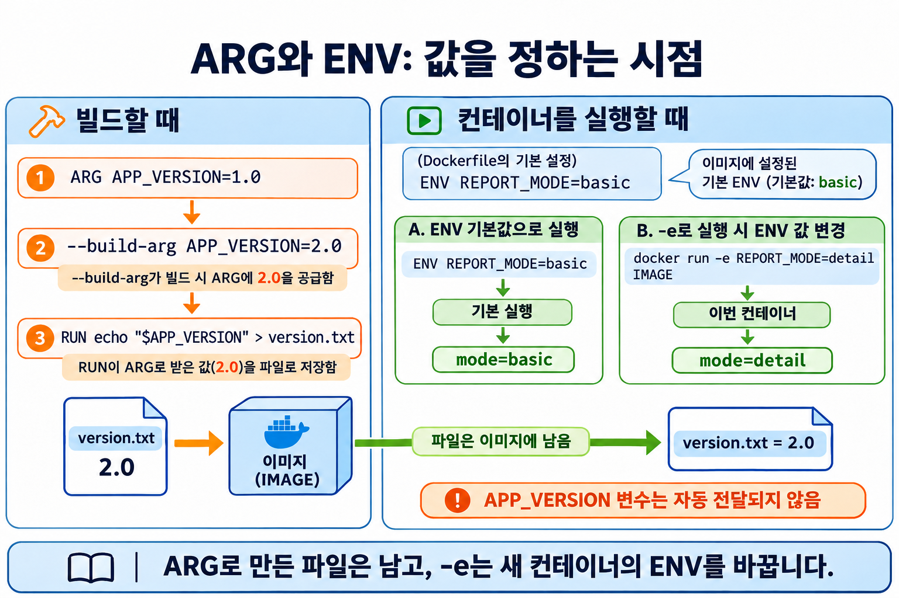

그림 읽기: `APP_VERSION`은 빌드 중 `RUN`이 `version.txt`를 만드는 데 쓰고, `REPORT_MODE`는 컨테이너 실행 시 프로그램이 읽습니다. ARG 변수가 런타임 환경에 자동 전달되지는 않아도 그 값으로 만든 파일은 남습니다. `-e`로 실행 환경을 바꾸어도 이미 만들어진 버전 파일이나 원본 이미지 설정은 바뀌지 않습니다.

명령 11: 빌드 버전과 실행 모드를 가진 Dockerfile 작성 — 호스트 Bash

```bash
cat > Dockerfile <<'EOF'
FROM python:3.12-slim
WORKDIR /app
ARG APP_VERSION=1.0
RUN echo "$APP_VERSION" > version.txt
COPY report.py servers.csv ./
ENV REPORT_MODE=basic
CMD ["python", "report.py"]
EOF
```

`RUN`은 빌드 도중 실행되어 파일에 값을 남깁니다. `CMD`는 빌드 도중 실행되지 않고 컨테이너 실행의 기본값으로 기록됩니다.

명령 12: 같은 Dockerfile로 두 버전 빌드 — 호스트 Bash

```bash
sudo docker build --progress=plain -t cv9-report:cmd-v1 .
```

```bash
sudo docker build --progress=plain --build-arg APP_VERSION=2.0 -t cv9-report:cmd-v2 .
```

첫 번째는 ARG 기본값 1.0, 두 번째는 전달한 2.0을 사용합니다. `-t`는 이미지 이름표이고 `--build-arg`는 빌드에 전달하는 값입니다. `:v2`라는 이름만 붙인다고 파일 속 버전이 2.0으로 바뀌지 않습니다.

명령 13: 파일에 남은 버전 확인 — 호스트 Bash

```bash
sudo docker run --rm cv9-report:cmd-v1
```

```bash
sudo docker run --rm cv9-report:cmd-v2
```

첫 줄의 `version=1.0`과 `version=2.0`을 비교합니다. 둘 다 `mode=basic`입니다.

명령 14: ARG는 실행 환경 변수로 자동 전달되지 않음 확인 — 호스트 Bash

```bash
sudo docker run --rm cv9-report:cmd-v2 sh -c '
  printf "ARG at runtime=%s\n" "$APP_VERSION"
  printf "ENV at runtime=%s\n" "$REPORT_MODE"
  printf "version file="
  cat version.txt
'
```

예상 출력:

```text
ARG at runtime=
ENV at runtime=basic
version file=2.0
```

`APP_VERSION`이라는 환경 변수는 없지만, 빌드할 때 그 값으로 만든 파일은 남았습니다. 이미지 뒤의 `sh ...`가 현재 이미지의 CMD 전체를 대체했습니다.

명령 15: 동일한 이미지의 실행 모드만 변경 — 호스트 Bash

```bash
sudo docker run --rm -e REPORT_MODE=detail cv9-report:cmd-v2
```

```text
Server Report | version=2.0 | mode=detail | limit=2
cwd=/app
web-01 | running | cpu=25% | memory=40%
api-01 | running | cpu=60% | memory=55%
shown=2/5
```

```bash
sudo docker run --rm cv9-report:cmd-v2
```

다시 basic 모드로 실행됩니다. `-e`는 새 컨테이너의 값이며 원본 이미지의 ENV를 수정하지 않았습니다.

```bash
sudo docker run --rm -e APP_VERSION=9.9 cv9-report:cmd-v2
```

여전히 `version=2.0`입니다. 실행 환경 변수를 추가해도 이미 빌드된 `version.txt`는 바뀌지 않습니다. 프로그램은 버전 환경 변수가 아니라 버전 파일을 읽습니다.

명령 16: 이미지의 실행 환경 변수 확인 — 호스트 Bash

```bash
sudo docker image inspect cv9-report:cmd-v2 --format '{{json .Config.Env}}'
```

`docker image inspect`는 이미지에 저장된 설정 정보를 조회합니다. `--format '{{json .Config.Env}}'`는 그중 실행 환경 변수 목록(`.Config.Env`)만 JSON 형식으로 출력합니다. 출력에는 `REPORT_MODE=basic`이 있지만 `APP_VERSION`은 없습니다. `ENV`는 컨테이너의 실행 환경 변수 기본값으로 저장되지만, `ARG`는 자동으로 저장되지 않기 때문입니다. 베이스 이미지에서 물려받은 다른 환경 변수도 함께 표시될 수 있습니다.

## Task 3. ENTRYPOINT·CMD와 EXPOSE 관찰하기

교안 연결: 「ENTRYPOINT」, 「CMD와 ENTRYPOINT」, 「EXPOSE」. 실행 프로그램, 기본 인자, 포트 정보는 이미지의 실행 설정입니다.

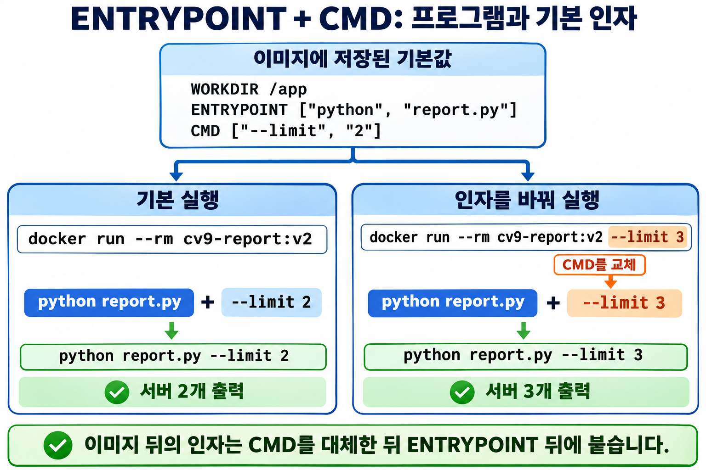

그림 읽기: 아래 최종 Dockerfile의 exec form에서는 `ENTRYPOINT`가 `python report.py`를, `CMD`가 기본 인자 `--limit 2`를 정합니다. 이미지 뒤에 `--limit 3`을 쓰면 기존 CMD를 대체한 뒤 ENTRYPOINT에 붙습니다. 인자가 누적되는 것이 아니며, `-e` 같은 Docker 옵션은 이미지 이름 앞에 둡니다.

명령 17: CMD만 있는 이미지의 명령 교체 — 호스트 Bash

```bash
sudo docker run --rm cv9-report:cmd-v2 python report.py --limit 3
```

서버 3개가 나옵니다. CMD 전체를 대체하므로 `python report.py`도 다시 썼습니다. 이 이미지 뒤에 `--limit 3`만 쓰면 Docker가 `--limit`을 실행 파일로 해석하여 실패합니다.

명령 18: 실행 프로그램과 기본 인자를 나누어 최종 이미지 제작 — 호스트 Bash

```bash
cat > Dockerfile <<'EOF'
FROM python:3.12-slim
WORKDIR /app
ARG APP_VERSION=1.0
RUN echo "$APP_VERSION" > version.txt
COPY report.py servers.csv ./
ENV REPORT_MODE=basic
ENTRYPOINT ["python", "report.py"]
CMD ["--limit", "2"]
EOF
```

```bash
sudo docker build -t cv9-report:v1 .
```

```bash
sudo docker build --build-arg APP_VERSION=2.0 -t cv9-report:v2 .
```

이제 교안의 Server Report Dockerfile이 완성되었습니다. `ENTRYPOINT`와 `CMD`를 모두 JSON 배열 형태(exec form)로 명시했습니다. 베이스 이미지에서 상속한 CMD는 새 ENTRYPOINT 선언으로 초기화될 수 있으므로, 함께 사용할 CMD도 현재 Dockerfile에 명시합니다. 같은 Dockerfile에 직접 적은 CMD가 ENTRYPOINT보다 앞에 있다는 이유만으로 항상 무효가 되는 것은 아닙니다. [두 명령의 상호 작용](https://docs.docker.com/reference/dockerfile/#understand-how-cmd-and-entrypoint-interact)

명령 19: 이미지에 저장된 기본값 확인 — 호스트 Bash

```bash
sudo docker image inspect cv9-report:v2 --format 'WORKDIR={{.Config.WorkingDir}} ENTRYPOINT={{json .Config.Entrypoint}} CMD={{json .Config.Cmd}}'
```

```text
WORKDIR=/app ENTRYPOINT=["python","report.py"] CMD=["--limit","2"]
```

명령 20: 기본 인자와 실행 시 인자 비교 — 호스트 Bash

```bash
sudo docker run --rm cv9-report:v2
```

```bash
sudo docker run --rm cv9-report:v2 --limit 3
```

| 실행 조건 | 컨테이너가 실행하는 명령 | 관찰 |
| --- | --- | --- |
| 이미지 뒤에 인자 없음 | `python report.py --limit 2` | basic, 2개 |
| 이미지 뒤에 `--limit 3` | `python report.py --limit 3` | basic, 3개 |

명령 17에서는 CMD 전체를 교체하므로 `python report.py`까지 다시 썼습니다. 지금은 ENTRYPOINT에 실행 프로그램이 지정되어 있으므로 이미지 이름 뒤에 `--limit 3`만 전달합니다. 이 인자는 기존 CMD의 `--limit 2`를 대체한 다음 ENTRYPOINT 뒤에 붙습니다.

명령 21: 기본 실행 프로그램을 잠시 바꾸기 — 호스트 Bash

```bash
sudo docker run --rm --entrypoint python cv9-report:v2 --version
```

```bash
sudo docker run --rm --entrypoint ls cv9-report:v2 -l /app
```

Python 버전과 `/app`의 파일 목록이 나옵니다. `--entrypoint` 뒤에는 실행 파일 하나를 쓰고, 필요한 인자는 이미지 이름 뒤에 둡니다.

```bash
sudo docker image inspect cv9-report:v2 --format '{{json .Config.Entrypoint}} {{json .Config.Cmd}}'
```

원본 설정은 여전히 `["python","report.py"] ["--limit","2"]`입니다. 실행 시 재정의는 새 컨테이너에만 적용됩니다.

### 작은 웹 서버로 EXPOSE와 -p 구분하기

Server Report는 실행하고 종료하는 프로그램이므로 포트가 필요하지 않습니다. 웹 실험에서는 Python 표준 라이브러리의 HTTP 서버를 사용합니다. 네트워크의 상세 구조는 10주차에 다룹니다.

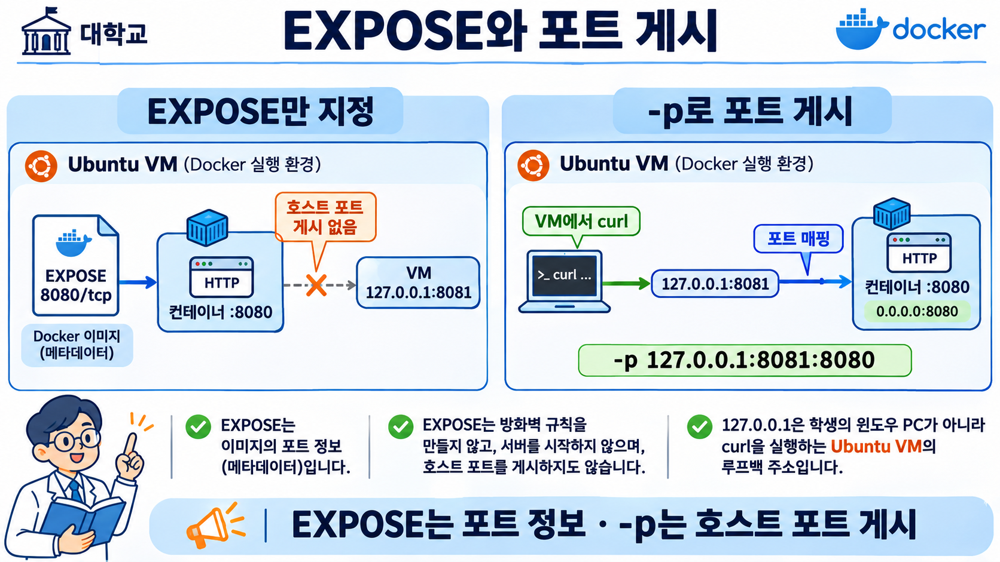

그림 읽기: `EXPOSE 8080/tcp`는 이미지의 포트 정보이고, `-p 127.0.0.1:8081:8080`은 VM의 8081 포트를 컨테이너의 8080 포트에 게시합니다. 그림의 `127.0.0.1`은 SSH로 접속한 VM 자신이며 PC의 루프백 주소와 다릅니다. EXPOSE만으로 호스트 포트가 게시되지 않지만, EXPOSE가 통신을 차단하는 방화벽이라는 뜻은 아닙니다.

명령 22: 웹 서버 이미지 작성 — 호스트 Bash

```bash
cd "$HOME/week09-web"
printf 'Hello from week09\n' > index.html
cat > Dockerfile <<'EOF'
FROM python:3.12-slim
WORKDIR /app
COPY index.html ./
EXPOSE 8080/tcp
CMD ["python", "-m", "http.server", "8080", "--bind", "0.0.0.0"]
EOF
```

이 CMD는 컨테이너 시작 시 Python의 `http.server` 모듈(`-m`)로 현재 폴더(`/app`)의 파일을 제공하는 웹 서버를 실행합니다. `8080`은 컨테이너 내부 포트이며, `--bind 0.0.0.0`은 컨테이너의 모든 네트워크 인터페이스에서 요청을 받도록 합니다. 호스트에서 접속하려면 뒤의 실습처럼 `-p`로 포트를 게시해야 합니다.

```bash
sudo docker build -t cv9-web:v1 .
```

명령 23: EXPOSE만 있는 컨테이너 실행 — 호스트 Bash

```bash
sudo docker image inspect cv9-web:v1 --format '{{json .Config.ExposedPorts}}'
```

```bash
sudo docker run -d --name cv9-web-unpublished cv9-web:v1
```

```bash
sudo docker port cv9-web-unpublished
```

`docker port <컨테이너 이름>`은 해당 컨테이너의 포트가 호스트의 어떤 IP 주소와 포트에 연결되어 있는지 조회합니다. 포트를 새로 연결하는 명령이 아니라, `-p` 등으로 게시한 포트 매핑을 확인하는 명령입니다.

이미지 설정에는 `{"8080/tcp":{}}`가 있지만 `docker port`에는 출력이 없습니다. `EXPOSE`만으로 호스트 포트가 게시되지 않았습니다. 이것이 컨테이너 IP로도 절대 통신할 수 없다는 뜻은 아닙니다. EXPOSE는 방화벽 규칙이 아닙니다.

명령 24: 호스트 포트를 게시한 두 번째 컨테이너 실행 — 호스트 Bash

```bash
sudo docker run -d --name cv9-web-published -p 127.0.0.1:8081:8080 cv9-web:v1
```

```bash
sudo docker port cv9-web-published
```

예상 출력: `8080/tcp -> 127.0.0.1:8081`.

```bash
curl http://127.0.0.1:8081/
```

예상 출력: `Hello from week09`. 웹 서버가 아직 시작되지 않아 접속 오류가 나오면 잠시 후 같은 명령을 다시 실행합니다.

EXPOSE는 TCP가 기본값이며 UDP는 `EXPOSE 53/udp`처럼 별도로 선언합니다. `-p`는 EXPOSE가 없는 이미지에도 사용할 수 있고, `-P`는 노출된 포트를 임의의 호스트 포트에 게시하는 별도 옵션입니다. 이번 실습에서는 비교가 쉬운 `-p`를 사용합니다.

## 연결 관찰. 태그를 바꾸면 기존 컨테이너도 바뀔까?

확인할 내용: 태그는 이미지의 이름표입니다. 이름표가 새 이미지를 가리켜도, 이미 만든 컨테이너는 이전 이미지를 계속 사용합니다.

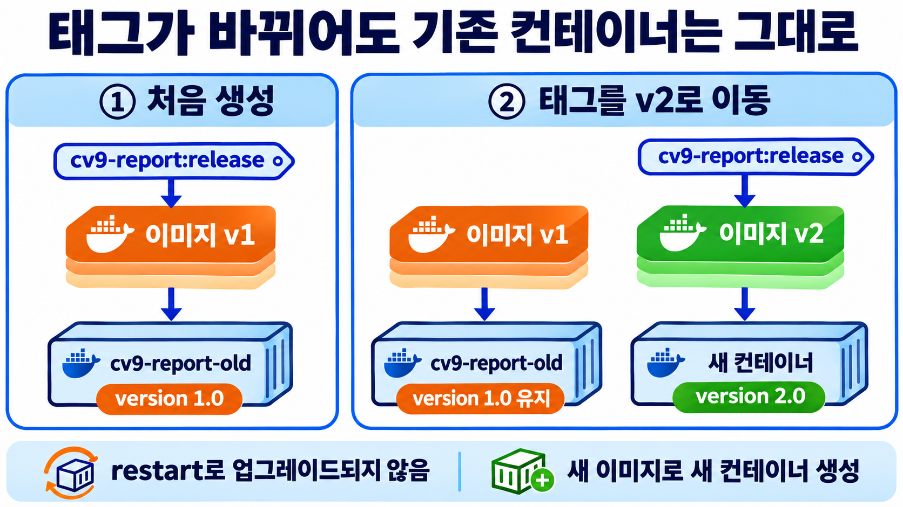

앞에서 만든 `cv9-report:v1`에는 버전 1.0이, `cv9-report:v2`에는 버전 2.0이 들어 있습니다. 두 이미지에 `release`라는 이름표를 번갈아 붙여 비교합니다.

명령 25: 버전 1.0으로 컨테이너 만들고 실행 — 호스트 Bash

`release`가 v1을 가리키게 한 뒤, `cv9-report-old`라는 컨테이너를 만들어 실행합니다.

```bash
sudo docker tag cv9-report:v1 cv9-report:release
```

```bash
sudo docker run --name cv9-report-old cv9-report:release
```

출력에서 `version=1.0`을 확인합니다. `--rm`을 넣지 않았으므로 실행이 끝나도 컨테이너가 남습니다.

명령 26: release 이름표를 버전 2.0으로 변경 — 호스트 Bash

```bash
sudo docker tag cv9-report:v2 cv9-report:release
```

이제 `release`는 v2를 가리킵니다. 앞에서 만든 컨테이너는 아직 그대로입니다.

명령 27: 기존 컨테이너와 새 컨테이너 비교 — 호스트 Bash

기존 컨테이너를 다시 실행합니다. `start -a`는 남아 있는 컨테이너를 시작하고 출력을 보여 줍니다.

```bash
sudo docker start -a cv9-report-old
```

예상 결과: `version=1.0` — 처음 만들 때 사용한 이미지를 그대로 사용합니다.

이번에는 `release`로 새 컨테이너를 만들어 실행합니다.

```bash
sudo docker run --rm cv9-report:release
```

예상 결과: `version=2.0` — 현재 `release`가 가리키는 이미지를 사용합니다.

태그를 바꾸어도 기존 컨테이너는 업데이트되지 않습니다. 새 버전을 실행하려면 새 컨테이너를 만들어야 합니다.

## Task 4. Docker Hub에 배포하고 Windows에서 같은 이미지 실행하기

앞에서는 Ubuntu VM 안에서 이미지를 만들고 실행했습니다. 이번에는 `tag → push → pull → run`을 통해 이미지를 다른 컴퓨터로 전달합니다. Docker Hub에는 파일시스템 레이어와 실행 설정을 가진 이미지를 올리며, 실행 중인 컨테이너나 VM 전체를 옮기지는 않습니다.

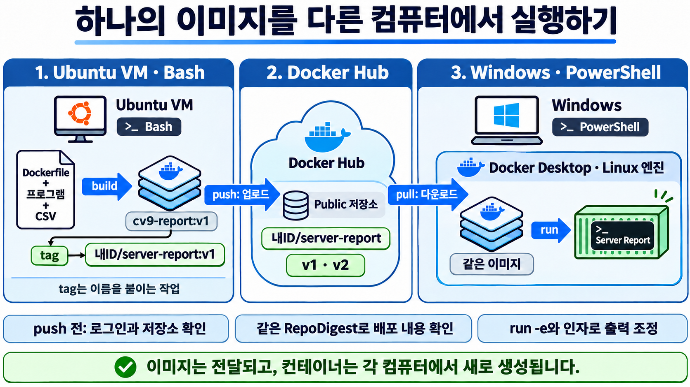

그림 읽기: VM Bash에서 build·tag·push를 수행하고, Windows PowerShell에서는 pull·run을 수행합니다. Hub가 전달하는 것은 이미지이며 Windows의 Docker Desktop Linux 엔진이 그 이미지로 새 컨테이너를 만듭니다. 같은 이미지를 받아도 ENV와 인자는 실행할 때 선택할 수 있습니다.

실행 위치: 전반부는 기존 SSH 창의 VM Bash, 후반부는 SSH로 접속하지 않은 별도 창의 Windows PowerShell입니다. VM에서는 `sudo docker`, Windows에서는 `docker`를 사용합니다. 두 창을 열어 둡니다.

### Docker Hub 저장소와 로그인 준비

명령 28: 본인 계정과 공개 저장소 준비 — PC 웹 브라우저

1. [Docker Hub](https://hub.docker.com/)에 본인의 Docker ID로 로그인합니다. VM 접속 계정과 Docker ID는 별개입니다.
2. My Hub → Repositories에서 선택된 계정을 확인합니다. 주소의 `https://hub.docker.com/repositories/본인ID` 부분도 확인합니다. 아래 교수자 화면의 `choongheecho2`는 예시이며, 학생은 자신의 Docker ID를 사용합니다.
3. Create repository를 누르고 아래 값을 지정합니다. 이미 같은 이름의 수업용 저장소가 있다면 기존 내용을 확인합니다.

   | 입력 항목 | 학생이 선택할 값 | 의미 |
   | --- | --- | --- |
   | Namespace / 선택된 계정 | 본인의 Docker ID | 이미지를 올릴 계정 |
   | Repository Name | `server-report` | 이번 실습의 이미지 저장소 |
   | Visibility | `Public` | 로그인하지 않은 다른 컴퓨터에서도 다운로드 가능 |
   | Short description | 선택 사항 | 저장소를 설명하는 짧은 문장 |

   현재 화면처럼 Namespace 입력란이 따로 없다면 왼쪽 계정 선택을 먼저 확인합니다. 생성 화면 주소에 `?namespace=본인ID`가 표시될 수도 있습니다. 저장소 이름에 계정을 중복 입력하지 않고 Repository Name에는 `server-report`만 적습니다.

4. Create를 누릅니다. 생성된 저장소 이름이 `본인ID/server-report`인지 확인합니다. 저장소를 만들었다고 이미지가 업로드되는 것은 아닙니다. `v1`·`v2` 태그는 뒤에서 push한 후 Tags 화면에서 확인합니다. [저장소 생성 안내](https://docs.docker.com/docker-hub/repos/create/)

<details>
<summary>교수자 예시 화면: 계정 확인과 Public 저장소 입력</summary>

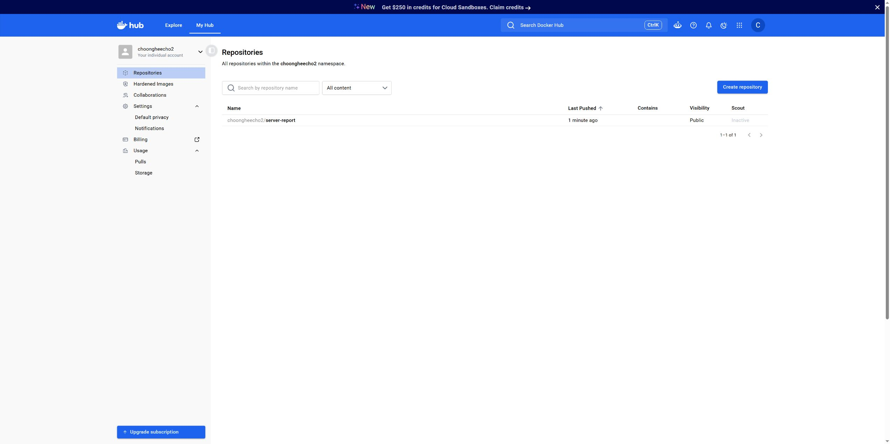

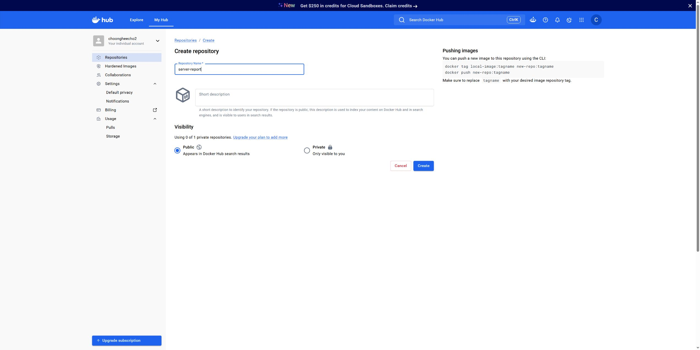

화면의 `choongheecho2`를 학생 자신의 Docker ID로 바꿉니다. 저장소 이름은 `server-report`, 버전을 구분하는 태그는 이후 `v1`·`v2`를 사용합니다.

</details>

Public 저장소의 이미지는 다른 사람도 내려받을 수 있습니다. 이 실습에서 만든 예제 파일만 이미지에 포함했는지 확인합니다. SSH 비밀번호·로그인용 일회성 코드·Docker 토큰을 Dockerfile·보고서·공유용 스크린샷에 넣지 않습니다.

명령 29: Docker ID 입력 — VM Bash

아래 입력에는 본인의 Docker ID를 적습니다. 이메일 주소나 VM 사용자 이름을 자동으로 사용하지 않습니다.

```bash
read -rp '본인의 Docker ID: ' HUB_USER
```

입력값을 확인합니다.

```bash
printf '배포할 저장소: %s/server-report\n' "$HUB_USER"
```

`$HUB_USER` 값을 이어서 사용할 수 있도록 같은 SSH 창에서 계속 진행합니다.

명령 30: Docker Hub 로그인 — VM Bash

```bash
sudo docker login
```

로그인은 한 번만 진행하고, 이후 `push`는 저장된 인증 정보를 사용합니다. 로그인·업로드·로그아웃은 모두 `sudo docker`로 실행합니다.

`--username`을 생략하면 Docker Hub의 웹 로그인(device code) 방식이 시작됩니다. [Docker 로그인](https://docs.docker.com/reference/cli/docker/login/)

1. SSH 터미널에 표시된 로그인 URL과 일회성 코드를 확인합니다. VM에서 브라우저가 열리지 않아도 괜찮습니다.
2. PC의 웹 브라우저에서 표시된 URL을 열고 코드를 입력합니다.
3. 브라우저의 로그인 계정이 앞에서 만든 저장소의 Namespace 및 `$HUB_USER`와 같은지 확인한 뒤 Confirm으로 진행합니다. 다른 계정이면 올바른 계정으로 로그인한 후 진행합니다.
4. SSH 터미널로 돌아와 `Login Succeeded`를 확인합니다. 브라우저 로그인만 성공한 상태에서 바로 push하지 않습니다.

### 이미지 이름을 붙이고 두 버전 업로드

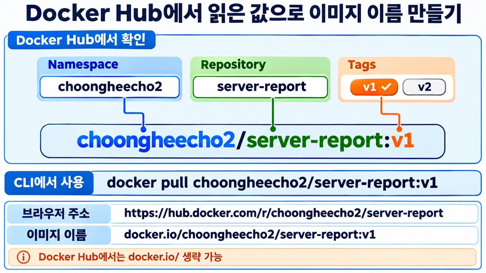

그림 읽기: `본인ID/server-report:v1`은 Namespace·저장소·태그를 합친 주소이며, 이 실습에서는 레지스트리 이름을 생략해 Docker Hub를 사용합니다. Namespace는 본인의 Docker ID로 바꾸고 저장소는 `server-report`, 태그는 `v1`·`v2`를 사용합니다. `docker tag`는 로컬 이미지에 이름을 추가하고, 실제 업로드는 `docker push`가 수행합니다.

명령 31: 배포할 로컬 이미지 확인 — VM Bash

```bash
sudo docker image ls cv9-report
```

`v1`과 `v2`가 모두 있어야 합니다. `v1`은 프로그램 버전 1.0, `v2`는 2.0을 담은 앞 단계의 이미지입니다.

명령 32: Docker Hub 이름으로 태그 추가 — VM Bash

```bash
sudo docker tag cv9-report:v1 "$HUB_USER/server-report:v1"
```

```bash
sudo docker tag cv9-report:v2 "$HUB_USER/server-report:v2"
```

추가한 태그를 이미지 목록에서 확인합니다.

```bash
sudo docker image ls
```

Docker 29에서는 `IMAGE` 열에 `본인DockerID/server-report:v1`, `본인DockerID/server-report:v2`가 표시되는지 확인합니다. `REPOSITORY`와 `TAG`가 나뉘어 표시되는 버전에서는 저장소 이름과 태그를 각각 확인합니다. 기존 `cv9-report` 이름도 목록에 남아 있습니다.

`Docker ID/server-report:v1`은 `네임스페이스/저장소:태그`입니다. 레지스트리를 생략했으므로 Docker Hub를 사용합니다. `tag`는 기존 이미지를 가리키는 이름을 추가하며 새로 빌드하거나 업로드하지 않습니다. [이미지 태그](https://docs.docker.com/reference/cli/docker/image/tag/)

명령 33: 태그 전후 이미지 ID 비교 — VM Bash

```bash
sudo docker image inspect cv9-report:v1 "$HUB_USER/server-report:v1" --format '{{.Id}}'
```

```bash
sudo docker image inspect cv9-report:v2 "$HUB_USER/server-report:v2" --format '{{.Id}}'
```

각 블록에서 나온 두 ID는 서로 같아야 합니다. v1과 v2끼리 같은 ID여야 한다는 뜻은 아닙니다.

명령 34: v1 업로드 — VM Bash

```bash
sudo docker push "$HUB_USER/server-report:v1"
```

끝에 `digest: sha256:...`가 나오고 명령이 성공해야 합니다. `Layer already exists`는 같은 레이어가 이미 레지스트리에 있다는 뜻이며 정상 결과입니다.

명령 35: v2 업로드와 웹 화면 확인 — VM Bash·PC 웹 브라우저

```bash
sudo docker push "$HUB_USER/server-report:v2"
```

Docker Hub의 본인 `server-report` 저장소에서 `v1`, `v2` 태그를 확인합니다. 일부 공통 레이어를 재사용하더라도 서로 다른 프로그램 버전을 담을 수 있습니다. `push` 완료 후에도 VM에 있던 이미지와 컨테이너는 그대로 남습니다. [이미지 업로드](https://docs.docker.com/reference/cli/docker/image/push/)

<details>
<summary>실제 업로드 후 Tags 화면</summary>


`v1`·`v2`가 모두 있는지, 플랫폼이 `linux/amd64`인지 확인합니다. 다음 단계에서는 각 태그의 전체 다이제스트를 push 결과와 비교합니다.

</details>

### 태그와 digest 구분

명령 36: push 결과와 Docker Hub의 이미지·다이제스트 비교 — VM Bash·PC 웹 브라우저

추가 명령 없이 앞에서 실행한 `docker push`의 결과와 Docker Hub 화면을 비교합니다.

1. 명령 34·35의 push 완료 출력에서 v1과 v2 각각의 `digest: sha256:...` 값을 확인합니다.
2. Docker Hub에서 본인의 `server-report` 저장소 → Tags를 열고, `v1`과 `v2`가 모두 올라왔는지 확인합니다.
3. 각 태그의 상세 화면에서 전체 다이제스트를 확인해 해당 버전의 push 출력과 비교합니다. 같은 종류의 다이제스트끼리 비교했을 때 값이 같으면, push한 이미지가 Hub에 동일하게 등록된 것입니다.

| 구분 | 식별하는 대상 |
| --- | --- |
| Index Digest | 여러 플랫폼용 이미지의 명세(Manifest)를 묶은 목록(Index)을 식별하는 해시값 |
| Manifest Digest | 특정 플랫폼용 이미지의 구성 정보와 레이어를 참조하는 명세(Manifest)를 식별하는 해시값 |

push 결과가 Index Digest라면 Hub의 Index Digest와 비교합니다. 플랫폼별 상세 화면의 Manifest Digest와는 값이 다를 수 있습니다. 단일 플랫폼 이미지라도 빌드 증명 정보가 함께 포함되면 Index가 만들어질 수 있습니다. [Index와 빌드 증명 정보](https://docs.docker.com/build/metadata/attestations/attestation-storage/)

명령 37: Docker Hub 로그아웃 — VM Bash

업로드를 마쳤으면 VM에서 로그아웃합니다.

```bash
sudo docker logout
```

Docker Hub에 올린 이미지와 VM의 이미지는 삭제되지 않습니다.

### Windows Docker Desktop에서 실행

<details>
<summary>처음 설치하는 경우: 설치 화면과 WSL 2 오류 해결 사례</summary>

설치·Windows 기능 변경·재부팅은 실습 전에 준비합니다. 아래 캡처는 Docker Desktop 4.99.0을 설치한 실제 화면이며, 버전에 따라 표시가 달라질 수 있습니다.

1. [Docker 공식 Windows 설치 안내](https://docs.docker.com/desktop/setup/install/windows-install/)에서 설치 파일을 내려받습니다. 이 실습 PC에서는 Per-user installation과 WSL 2를 선택했습니다.

   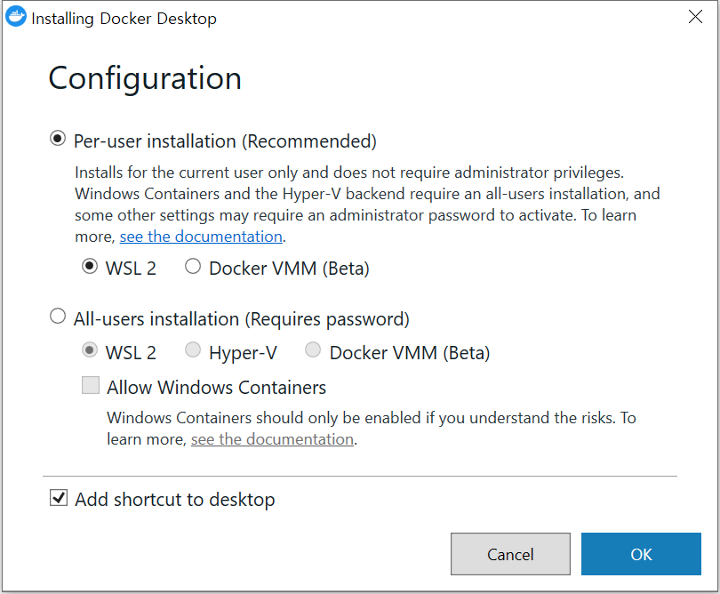

2. 설치가 끝나면 Installation succeeded를 확인하고 Docker Desktop을 실행합니다. 설치 성공 메시지는 파일 설치가 끝났다는 뜻이며, 엔진 실행 여부는 별도로 확인해야 합니다.

   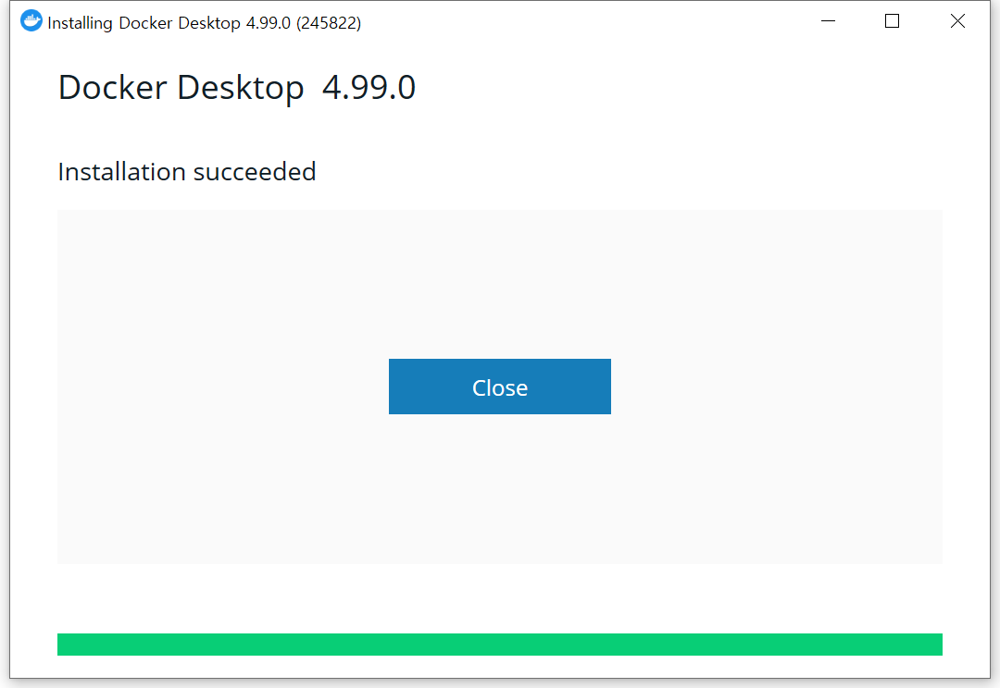

3. 첫 실행에서 약관을 읽고 동의할 경우 Accept를 선택합니다. 로그인 화면과 엔진 실행 상태는 구분합니다.

4. 이 PC의 첫 실행에서는 `Wsl/Service/RegisterDistro/CreateVm/HCS/ERROR_NOT_SUPPORTED`가 발생했습니다. CPU 가상화는 켜져 있었지만 가상 머신 플랫폼은 꺼져 있었습니다.

   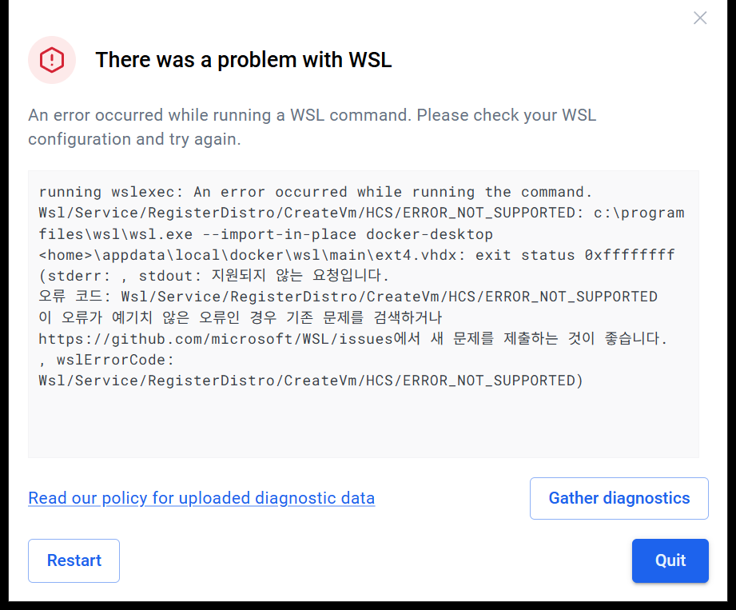

5. 이 PC의 해결 사례: 가상 머신 플랫폼만 켜고 재부팅했을 때는 오류가 계속되었다고 사용자가 보고했습니다. 이후 Windows 기능 켜기/끄기에서 아래 세 기능을 모두 켠 상태로 정상 실행되었습니다. Windows 기능 변경 후에는 저장할 작업을 마친 다음 재부팅합니다.

   | Windows 기능 이름 | 내부 기능 이름 | 정상화 후 확인 |
   | --- | --- | --- |
   | Linux용 Windows 하위 시스템 | `Microsoft-Windows-Subsystem-Linux` | 활성 |
   | Windows 하이퍼바이저 플랫폼 | `HypervisorPlatform` | 활성 |
   | 가상 머신 플랫폼 | `VirtualMachinePlatform` | 활성 |

   위 세 기능의 조합은 이번 PC에서 확인한 해결 사례입니다. Windows 하이퍼바이저 플랫폼을 모든 WSL 2 환경의 필수 조건으로 일반화하지 않습니다. Microsoft의 [수동 WSL 설치 안내](https://learn.microsoft.com/en-us/windows/wsl/install-manual)는 WSL 선택 기능, 가상 머신 플랫폼과 재부팅 절차를 설명합니다. 문제가 계속되면 [WSL 문제 해결 안내](https://learn.microsoft.com/en-us/windows/wsl/troubleshooting)에 따라 가상화 지원과 설정을 함께 점검합니다.

6. Docker Desktop 하단의 Engine running을 확인합니다. 다음 명령 38에서 Client·Server와 Linux 플랫폼까지 확인한 뒤 아래 설치 점검용 컨테이너를 실행합니다.

   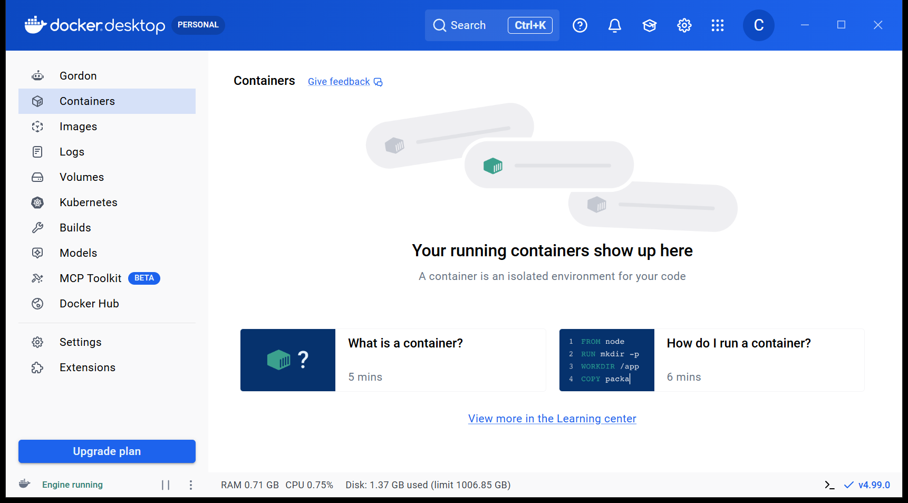

   ```powershell
   docker run --rm hello-world
   ```

   `Hello from Docker!`가 나타나면 기본 이미지 다운로드와 컨테이너 실행이 성공한 것입니다. 이번 PC에서 2026-11-17에 이 결과를 확인했습니다. 이것만으로 수업 예제 이미지의 Hub 업로드·다른 컴퓨터 배포까지 검증되는 것은 아닙니다.

</details>

명령 38: 실행 컴퓨터와 Linux 엔진 확인 — Windows PowerShell

PC에 Docker Desktop을 설치하고 시작합니다. 설치가 필요하면 [Windows 설치 안내](https://docs.docker.com/desktop/setup/install/windows-install/)에 따라 준비하며, 설치·재부팅 시간은 실습 시간과 별도로 잡습니다. Linux 컨테이너 모드를 사용합니다. SSH 창을 그대로 두고 새 PowerShell 창을 엽니다.

```powershell
docker context ls
```

별표(`*`)로 표시된 활성 context가 이 PC의 Docker Desktop 엔진을 가리키는지 확인합니다. 원격 SSH/TCP 엔진을 선택한 상태라면 목록에서 로컬 Docker Desktop context로 전환한 뒤 진행합니다. PowerShell에서 명령을 입력해도 원격 엔진을 사용하면 다른 컴퓨터에서 실행하는 실습이 되지 않습니다.

```powershell
docker version
```

명령 39: 같은 Docker Hub 저장소 선택 — Windows PowerShell

```powershell
$HubUser = Read-Host 'VM에서 사용한 본인의 Docker ID'
```

```powershell
"${HubUser}/server-report:v1"
```

Windows의 `$HubUser`와 VM Bash의 `$HUB_USER`는 서로 다른 창의 별도 변수입니다. 값을 다시 입력합니다. Public 저장소는 로그인 없이 pull할 수 있습니다. 익명 다운로드 제한이 발생하면 자신의 Docker ID로 로그인하고 다시 시도합니다.

<details>
<summary>Windows에서 로그인이 필요한 경우</summary>

```powershell
docker login --username $HubUser
```

`Password:`에 PAT를 입력합니다. 토큰을 명령줄 인자로 적지 않습니다. Docker Desktop은 운영체제의 자격 증명 저장소를 사용합니다. 이 단계는 평소 Docker Desktop 로그인 계정에 영향을 주므로 본인의 PC에서 본인 계정으로 진행합니다.
</details>

명령 40: v1 다운로드와 기본 실행 — Windows PowerShell

```powershell
docker pull "${HubUser}/server-report:v1"
```

Docker Desktop이 실행되지 않았거나 Linux 엔진이 아직 준비되지 않았다면 다음 오류가 나올 수 있습니다.

```text
failed to connect to the docker API at npipe:////./pipe/dockerDesktopLinuxEngine; check if the path is correct and if the daemon is running: open //./pipe/dockerDesktopLinuxEngine: The system cannot find the file specified.
```

Docker Desktop을 실행하고 `Engine running`을 확인한 뒤, 위의 `docker pull` 명령을 다시 실행합니다.

```powershell
docker run --rm "${HubUser}/server-report:v1"
```

VM에서 빌드한 프로그램 버전 1.0의 기본 모드·기본 개수 결과를 확인합니다. Windows에 Python이나 예제 CSV를 별도로 설치·복사하지 않았다는 점을 기록합니다. 실행에 필요한 사용자 공간 파일이 이미지에 있기 때문입니다.

명령 41: v2 다운로드와 실행 조건 변경 — Windows PowerShell

```powershell
docker pull "${HubUser}/server-report:v2"
```

```powershell
docker run --rm -e REPORT_MODE=detail "${HubUser}/server-report:v2" --limit 3
```

프로그램 버전 2.0, detail 모드, 최대 3개 항목의 출력을 확인합니다. `-e REPORT_MODE=detail`은 Docker 옵션이므로 이미지 이름 앞에 있고, `--limit 3`은 프로그램 인자이므로 이미지 이름 뒤에 있습니다. 뒤의 인자가 CMD의 `--limit 2`를 대체하고 ENTRYPOINT의 Python 프로그램에 전달됩니다. 이미지를 다시 빌드하지 않았습니다.

## 실습 자원 정리

보고서에 필요한 실행 결과를 먼저 정리합니다. 이번 문서에서 만든 정확한 이름만 정리합니다. 기존 7·8주차 자원, 공용 베이스 이미지, 빌드 캐시는 지우지 않습니다. `docker system prune`이나 모든 컨테이너를 한꺼번에 삭제하는 명령을 사용하지 않습니다.

명령 42: 9주차 컨테이너 정리 — 호스트 Bash

```bash
sudo docker stop cv9-web-unpublished cv9-web-published
```

```bash
sudo docker rm cv9-web-unpublished cv9-web-published cv9-report-old
```

실시하지 않은 단계의 이름에 `No such container`가 나오면 해당 정리만 건너뜁니다. 다른 이름의 자원을 대신 삭제하지 않습니다.

명령 43: 실습 이미지 이름 정리 — 호스트 Bash

Task 4를 진행했다면 Hub용 로컬 이름을 정리합니다. Docker Hub 서버의 이미지를 삭제하는 명령은 아닙니다.

```bash
if [ -n "${HUB_USER:-}" ]; then
  sudo docker image rm "$HUB_USER/server-report:v1" "$HUB_USER/server-report:v2"
fi
```

```bash
sudo docker image rm cv9-report:no-workdir cv9-report:workdir cv9-report:cmd-v1 cv9-report:cmd-v2 cv9-report:v1 cv9-report:v2 cv9-report:release cv9-web:v1
```

사용 중이라는 메시지가 나오면 `sudo docker ps -a`로 해당 이미지의 컨테이너를 확인합니다. 강제 삭제하지 않습니다. `~/week09-report`, `~/week09-web` 소스는 복습용으로 남겨 둡니다.

명령 44: Windows 실습 이미지 정리 — Windows PowerShell

Task 4를 진행한 PC에서만 실행합니다. 다른 실행 중인 컨테이너가 이미지를 사용한다면 먼저 해당 컨테이너의 용도를 확인합니다.

```powershell
docker image rm "${HubUser}/server-report:v1" "${HubUser}/server-report:v2"
```

Hub 저장소는 제출·공유를 위해 남겨 둡니다. 실습용 PAT가 더 필요 없으면 계정 설정에서 해당 토큰만 폐기합니다.

## 자주 발생하는 문제

| 증상 | 확인과 해결 |
| --- | --- |
| `docker: command not found` 또는 Server 연결 실패 | 명령 01의 설치 안내 확인. Docker CE와 Ubuntu docker.io 패키지를 혼합하지 않음 |
| Docker 소켓 `permission denied` | VM에서 `sudo docker`를 사용했는지 확인. Windows에는 sudo를 붙이지 않음 |
| 빌드에서 `report.py` 또는 `servers.csv` 없음 | `pwd`, `ls -la`로 `~/week09-report`인지 확인. 마지막 빌드 컨텍스트 `.`와 .dockerignore 확인 |
| `FileNotFoundError: servers.csv` | 명령 09 첫 실행은 의도한 오류. 이후 단계에서는 WORKDIR가 `/app`인지 확인 |
| heredoc 뒤에 `>` 프롬프트가 계속됨 | `Ctrl+C` 후 마지막 EOF까지 전체 복사. EOF 줄 앞뒤 공백 확인 |
| 이미지 뒤 `--limit`을 실행 파일로 찾음 | CMD만 있는 `:cmd-v2`와 ENTRYPOINT가 있는 `:v2`를 혼동했는지 확인 |
| `report.py: error: unrecognized arguments: python report.py` | ENTRYPOINT가 있는 이미지 뒤에는 `--limit 3`만 전달. 프로그램 이름을 반복하지 않음 |
| `invalid reference format` | Docker ID 입력과 태그 형식, 빈 변수, 대문자 저장소 이름 확인 |
| `port is already allocated` | VM 8081의 기존 사용 여부 확인. 기존 서비스는 중지하지 말고 새 호스트 포트를 선택한 후 curl 주소도 함께 변경 |
| curl 연결 거부·연결 초기화 | 컨테이너가 시작될 때 재시도. 계속 실패하면 `sudo docker logs cv9-web-published`, `sudo docker port cv9-web-published` 확인 |
| PC 브라우저에서 VM의 localhost에 접근 못 함 | `127.0.0.1`은 명령을 실행하는 컴퓨터 자신. 본 실습은 VM Bash에서 curl 사용 |
| 컨테이너 이름 충돌 | `sudo docker ps -a`로 해당 cv9 이름 확인. 기존 실습이면 정확한 이름만 정리 |
| 로그인은 성공했지만 push 거부 | 웹 로그인 계정·태그의 Namespace·저장소 쓰기 권한 확인. PAT 방식이면 토큰의 쓰기 권한도 확인. 로그인과 push 모두 `sudo docker`로 실행 |
| `pull access denied` / `manifest unknown` | Hub에 push 완료되었는지, Public 여부와 태그 철자 확인. tag 명령만으로 업로드되지 않음 |
| Hub 다운로드 제한·네트워크 시간 초과 | 본인 계정 로그인 후 재시도하거나 잠시 뒤 재시도. 학교 네트워크 문제는 교수자에게 확인하며 daemon 설정을 통째로 덮어쓰지 않음 |
| Windows `docker` 없음 / 엔진 연결 실패 | Docker Desktop 설치·실행 상태 확인. PowerShell을 새로 열고 Client·Server 확인 |
| `dockerDesktopLinuxEngine` / `The system cannot find the file specified` | Docker Desktop 실행 후 `Engine running`까지 기다림. `docker version`에 Client·Server가 모두 나오면 pull 재시도. 계속 실패하면 명령 38의 context와 Linux 엔진 상태 확인 |
| 첫 실행에서 WSL `ERROR_NOT_SUPPORTED` | 위 설치 안내의 실제 해결 사례 확인. CPU 가상화, WSL·가상 머신 플랫폼과 재부팅 여부를 점검. 이 PC는 Windows 하이퍼바이저 플랫폼을 포함한 세 기능 활성화 후 정상화 |
| Windows에서 `windows/amd64`, 플랫폼 불일치 | Linux 컨테이너 모드와 CPU 플랫폼을 확인. 단일 플랫폼 이미지를 모든 CPU에서 그대로 실행할 수 있는 것은 아님 |
| 새 태그를 받았는데 기존 컨테이너는 이전 버전 | 정상 동작. restart는 이미지 교체가 아니므로 새 이미지로 컨테이너 생성 |

## 이론과 다음 주차 연결

Dockerfile은 파일과 기본 실행 설정을 함께 정의합니다. ARG로 제작 조건을, ENV와 인자로 실행 조건을 바꿀 수 있습니다. Registry는 완성된 이미지를 전달하고, 받는 컴퓨터는 그 이미지로 새 컨테이너를 만듭니다. 태그와 digest를 구분하면 배포할 대상을 더 정확히 선택할 수 있습니다.

10주차에는 이번에 사용한 포트 게시를 확장하여 컨테이너 통신을 살펴보고, Volume과 Bind Mount로 컨테이너 밖에 데이터를 유지하는 방법을 학습합니다.

## 참고 자료

- 수업 교안: `클라우드가상화_9주차_20261116.pptx`의 WORKDIR, ARG·ENV, ENTRYPOINT·CMD, EXPOSE, 이미지 배포 관련 내용. 교안의 화면 쪽수는 일부 연속적이지 않아 절 제목으로 연결했습니다.
- 구성 참고: [8주차 실습](https://github.com/choong-syu/cloud-virtualization/blob/main/week08/README.md).
- 명령 문법: [Dockerfile reference](https://docs.docker.com/reference/dockerfile/), [docker run](https://docs.docker.com/reference/cli/docker/container/run/).
- 배포: [docker tag](https://docs.docker.com/reference/cli/docker/image/tag/), [docker push](https://docs.docker.com/reference/cli/docker/image/push/), [docker pull](https://docs.docker.com/reference/cli/docker/image/pull/).
- 실행 환경: [Docker Desktop의 WSL 2 백엔드](https://docs.docker.com/desktop/features/wsl/).


새로 추가한 개념 그림은 이 실습의 흐름을 설명하기 위해 AI로 생성한 도식입니다. 설치·Docker Hub 화면은 실제 캡처이며, 명령 출력과 식별값은 각자의 실행 결과를 기준으로 확인합니다.
