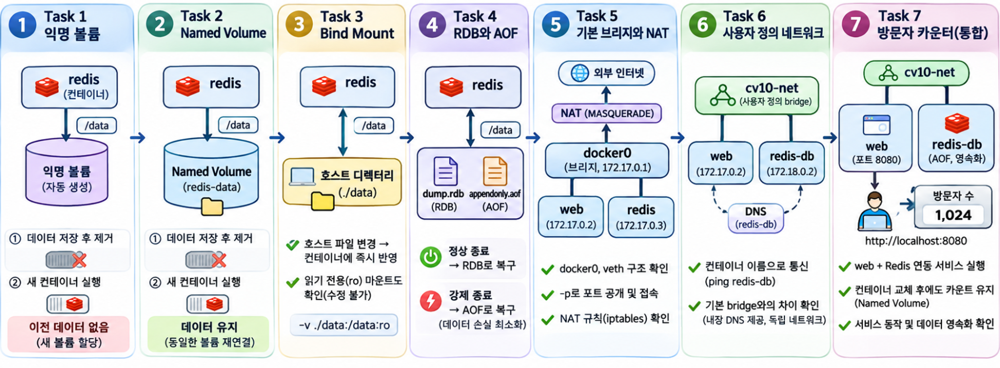
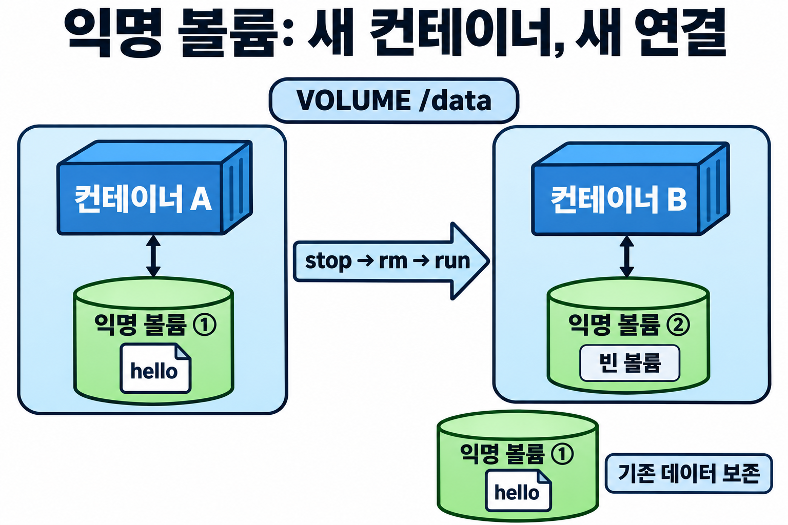
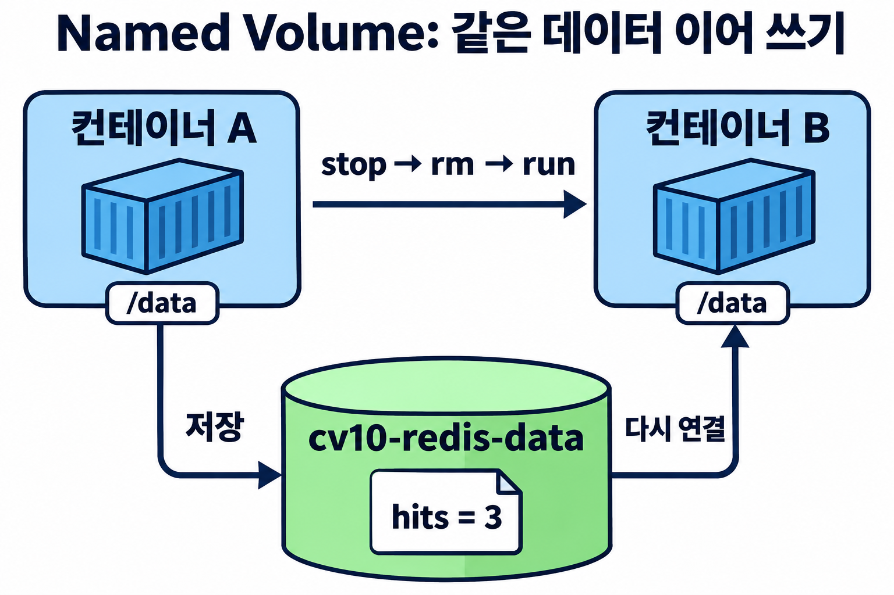
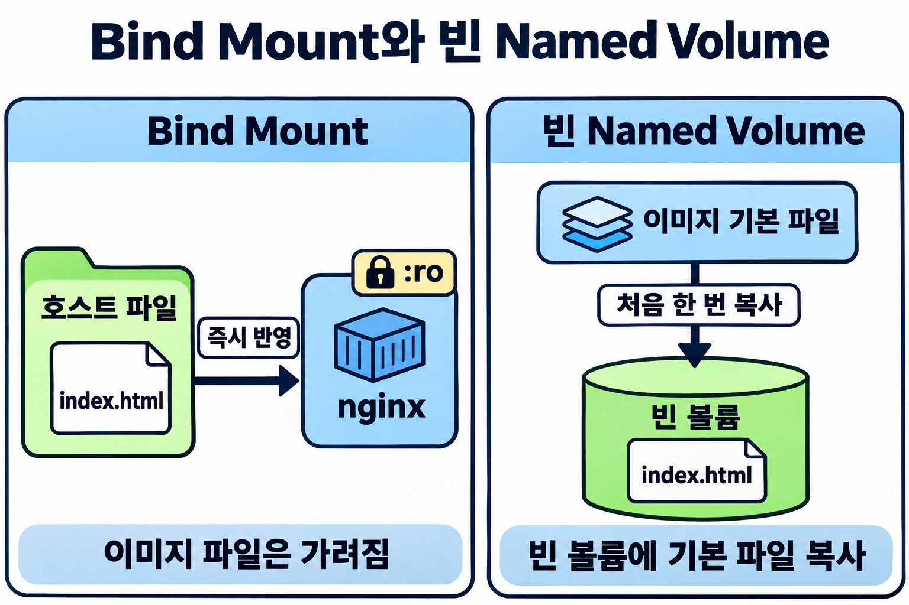
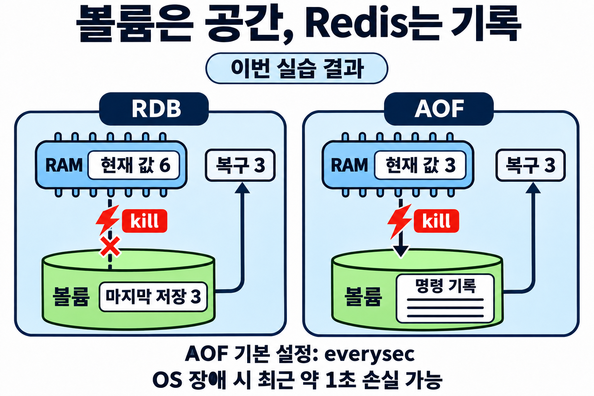
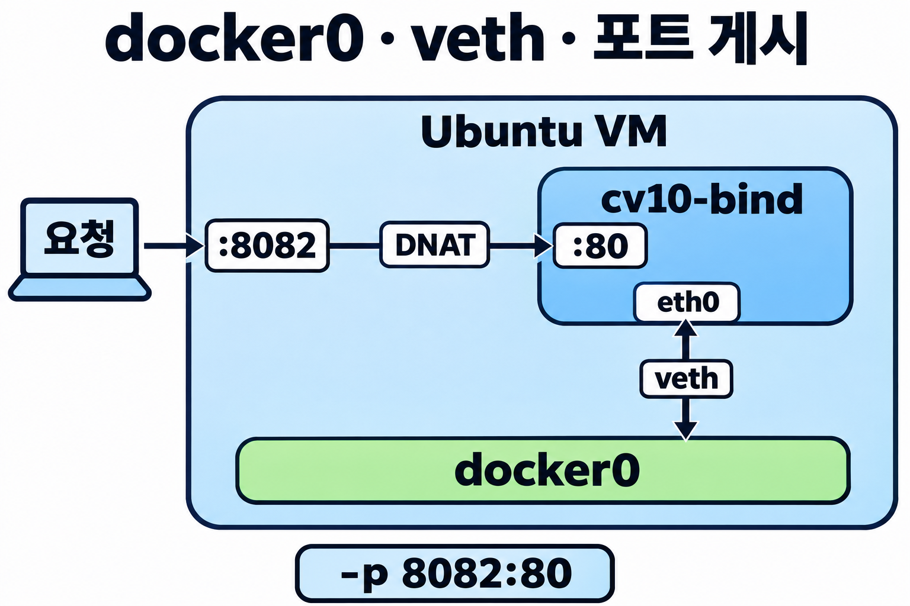
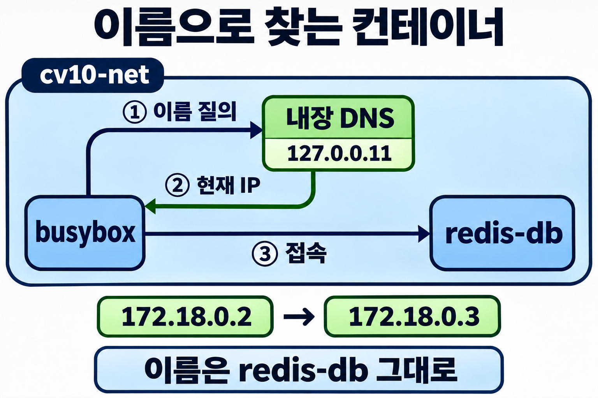
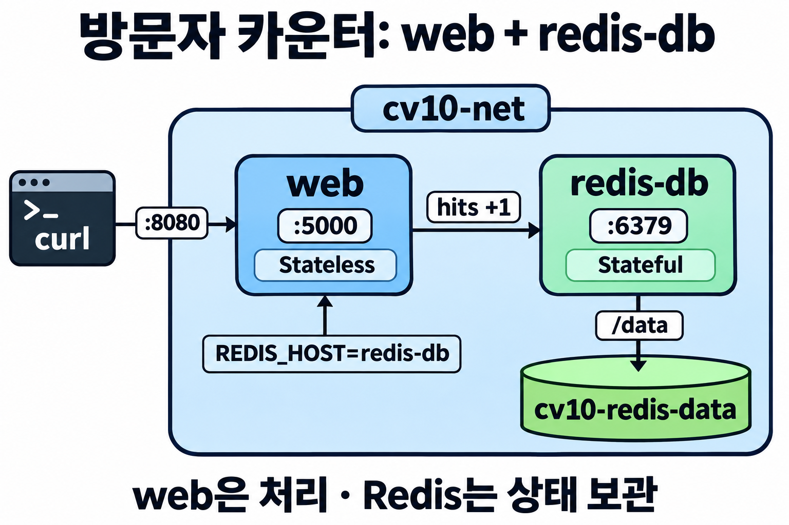

# 10주차 실습 — 데이터 영속성과 컨테이너 네트워크

[전체 주차 목록](../README.md) · [9주차 실습](../week09/README.md)

9주차에는 새 버전을 적용하려면 컨테이너를 새로 만들어야 한다는 것을 확인했습니다. 그런데 컨테이너를 지우면 쓰기 레이어에 저장한 데이터도 함께 사라집니다. 이번 주에는 **데이터를 컨테이너 밖에 보관하는 방법**과 **컨테이너끼리 이름으로 통신하는 방법**을 익힙니다.

학습 목표: 볼륨과 Bind Mount로 데이터를 보존하고, 사용자 정의 네트워크에서 컨테이너 이름으로 통신하는 방문자 카운터(web + redis-db)를 완성합니다.

## 먼저 알아 둘 용어

| 용어 | 한 줄 설명 |
| --- | --- |
| 볼륨(Named Volume) | Docker가 관리하는 저장 공간. 컨테이너를 지워도 남음 |
| 익명 볼륨 | 이름 없이(64자리 무작위 이름) 자동으로 만들어진 볼륨. 나중에 다시 찾기 어려움 |
| Bind Mount | 호스트의 폴더를 컨테이너에 그대로 연결. 호스트에서 고치면 바로 반영 |
| RDB · AOF | Redis가 메모리의 데이터를 디스크에 저장하는 두 가지 방식 |
| docker0 | Docker가 만든 기본 Linux Bridge(5주차의 가상 스위치) |
| 사용자 정의 네트워크 | `docker network create`로 만든 네트워크. 컨테이너 **이름**으로 통신 가능 |

## 실습 전체 흐름



## 준비

### 단계 01: Docker 실행 확인

**명령 01-01: Docker 실행 확인**

```bash
if systemctl is-active --quiet docker; then
  echo "Docker 실행 중"
else
  sudo systemctl start docker && echo "Docker 시작 완료"
fi
```

### 단계 02: 이번 주에 사용할 이미지 받기

**명령 02-01: Redis 이미지 받기**

```bash
sudo docker pull redis:7.4-alpine
```

**명령 02-02: nginx 이미지 받기**

```bash
sudo docker pull nginx:alpine
```

**명령 02-03: BusyBox 이미지 받기**

```bash
sudo docker pull busybox:1.36
```

**명령 02-04: Python 이미지 받기**

```bash
sudo docker pull python:3.12-slim
```

`redis`는 데이터 저장소, `nginx`는 웹 서버, `busybox`는 네트워크 확인용 도구, `python`은 방문자 카운터를 만들 때 사용합니다.

### 단계 03: 포트·MTU 확인과 작업 폴더 준비

이번 실습은 VM의 8080~8083번 포트를 사용합니다.

**명령 03-01: 컨테이너의 포트 사용 현황 확인**

```bash
sudo docker ps --format '{{.Names}}  {{.Ports}}'
```

7주차의 `cv7-web`은 8080, 9주차의 `cv9-web-published`는 8081을 사용할 수 있습니다. 다음 명령은 두 컨테이너 중 실행 중인 것만 중지합니다.

**명령 03-02: 이전 주차 컨테이너 중지**

```bash
for name in cv7-web cv9-web-published; do
  if [ "$(sudo docker inspect --format '{{.State.Running}}' "$name" 2>/dev/null)" = "true" ]; then
    sudo docker stop "$name"
  fi
done
```

**명령 03-03: 8080~8083번 포트 확인**

```bash
sudo ss -ltn | grep -E ':(8080|8081|8082|8083)\b' || echo "8080~8083 사용 가능"
```

`8080~8083 사용 가능`이 나오면 다음으로 진행합니다. 다른 컨테이너가 포트를 사용한다면 목록에서 이름을 확인한 뒤 `sudo docker stop 컨테이너이름`으로 중지합니다.

8주차에서 설정한 Docker 기본 브리지(`docker0`)의 MTU도 확인합니다. 수업 VM에 맞춰 `1442`로 설정하면 이미지 빌드 중 패키지를 안정적으로 내려받을 수 있습니다.

**명령 03-04: VM 네트워크 MTU 확인**

```bash
ip -o link show ens3
```

**명령 03-05: Docker 기본 브리지 MTU 확인**

```bash
ip -o link show docker0
```

두 출력의 `mtu`가 모두 `1442`이면 됩니다. 아래 명령은 Docker의 MTU가 다를 때만 기존 설정에 `mtu` 값을 반영하고 Docker를 재시작합니다. Docker 재시작 시 실행 중인 컨테이너가 중지될 수 있으므로 실습 컨테이너를 만들기 전에 실행합니다.

**명령 03-06: MTU가 다르면 설정 적용**

```bash
if [ "$(cat /sys/class/net/docker0/mtu)" != "1442" ]; then
  sudo python3 - <<'PY'
import json
from pathlib import Path
path = Path('/etc/docker/daemon.json')
config = json.loads(path.read_text()) if path.exists() else {}
config['mtu'] = 1442
path.parent.mkdir(parents=True, exist_ok=True)
path.write_text(json.dumps(config, indent=2) + '\n')
PY
  sudo systemctl restart docker
fi
```

**명령 03-07: 적용된 Docker MTU 확인**

```bash
ip -o link show docker0
```

**명령 03-08: 실습 폴더 만들기**

```bash
mkdir -p ~/week10/html ~/week10/web
```

**명령 03-09: 실습 폴더로 이동**

```bash
cd ~/week10
```

## Task 1. 볼륨 옵션 없이 실행하면 데이터는 어디로 갈까?

교안 연결: 「컨테이너 쓰기 레이어는 일시적이다」, 「이름 있는 볼륨과 익명 볼륨」



그림 읽기: Redis 이미지에는 `VOLUME /data`가 선언되어 있어서, `-v`를 쓰지 않아도 **이름 없는 볼륨(익명 볼륨)**이 자동으로 붙습니다. 하지만 컨테이너를 다시 만들면 **새** 익명 볼륨이 붙기 때문에 이전 데이터를 찾지 못합니다.

### 단계 04: 이미지에 선언된 볼륨 경로 확인

**명령 04-01: Redis 이미지의 볼륨 선언 확인**

```bash
sudo docker image inspect redis:7.4-alpine --format '{{json .Config.Volumes}}'
```

예상 출력: `{"/data":{}}` — Redis 이미지가 `/data`를 볼륨 경로로 선언했습니다.

### 단계 05: 볼륨 옵션 없이 Redis 실행하고 데이터 저장

**명령 05-01: 볼륨 옵션 없이 Redis 실행**

```bash
sudo docker run -d --name cv10-tmp redis:7.4-alpine
```

**명령 05-02: note 값 저장**

```bash
sudo docker exec cv10-tmp redis-cli set note hello
```

예상 출력: `OK` — 키 `note`에 값 `hello`를 저장했습니다. `redis-cli`는 Redis에 명령을 보내는 도구입니다.

나중에 정리할 수 있도록 자동으로 붙은 볼륨 이름을 변수에 저장해 둡니다.

**명령 05-03: 익명 볼륨 이름을 변수에 저장**

```bash
ANON1=$(sudo docker inspect cv10-tmp --format '{{range .Mounts}}{{.Name}}{{end}}')
```

**명령 05-04: 저장한 볼륨 이름 출력**

```bash
echo "$ANON1"
```

64자리의 긴 이름이 출력됩니다. 이름만 보고는 무슨 데이터인지 알 수 없습니다.

### 단계 06: 정상 종료한 뒤 컨테이너를 다시 만들어 데이터 확인

**명령 06-01: Redis 정상 종료**

```bash
sudo docker stop cv10-tmp
```

**명령 06-02: 기존 컨테이너 삭제**

```bash
sudo docker rm cv10-tmp
```

정상 종료하면 Redis가 `note=hello`를 기존 익명 볼륨의 파일에 저장합니다. 이제 같은 이름으로 새 컨테이너를 만듭니다.

**명령 06-03: 같은 이름으로 새 Redis 실행**

```bash
sudo docker run -d --name cv10-tmp redis:7.4-alpine
```

**명령 06-04: 새 컨테이너에서 note 조회**

```bash
sudo docker exec cv10-tmp redis-cli get note
```

예상 출력: **빈 줄** — 값이 없습니다. 같은 이름, 같은 이미지로 만들었지만 이전 데이터가 보이지 않습니다.

**명령 06-05: 익명 볼륨 목록 확인**

```bash
sudo docker volume ls
```

64자리 이름의 볼륨이 **두 개** 보입니다. 이전 볼륨은 남아 있지만, 새 컨테이너는 다른 볼륨을 받았기 때문에 이전 데이터를 찾지 못했습니다.

### 단계 07: Task 1 정리

**명령 07-01: 컨테이너와 현재 익명 볼륨 삭제**

```bash
sudo docker rm -f -v cv10-tmp
```

**명령 07-02: 이전 익명 볼륨 삭제**

```bash
sudo docker volume rm "$ANON1"
```

`rm -v`는 컨테이너와 함께 그 컨테이너의 익명 볼륨도 지웁니다. 먼저 지운 컨테이너의 볼륨은 저장해 둔 이름으로 지웁니다.

> 정리: 다시 찾아야 하는 데이터에는 **이름을 붙인 볼륨**이 필요합니다. → Task 2

## Task 2. Named Volume으로 데이터 이어 쓰기

교안 연결: 「마운트」, 「Named Volume」, 「-v와 --mount」



그림 읽기: 컨테이너의 `/data`에 쓴 내용은 호스트의 볼륨 폴더에 저장됩니다. 컨테이너 A를 지워도 볼륨은 남고, 새 컨테이너 B에 같은 볼륨을 연결하면 데이터를 이어서 쓸 수 있습니다.

### 단계 08: 볼륨 만들기

**명령 08-01: Named Volume 만들기**

```bash
sudo docker volume create cv10-redis-data
```

**명령 08-02: 볼륨의 호스트 저장 경로 확인**

```bash
sudo docker volume inspect cv10-redis-data --format '{{.Mountpoint}}'
```

예상 출력: `/var/lib/docker/volumes/cv10-redis-data/_data` — 실제 데이터가 저장되는 호스트 경로입니다.

### 단계 09: 컨테이너 A에 볼륨을 연결하고 값 증가

**명령 09-01: 컨테이너 A에 볼륨 연결**

```bash
sudo docker run -d --name cv10-redis-a -v cv10-redis-data:/data redis:7.4-alpine
```

`-v 볼륨이름:컨테이너경로`는 "이 볼륨을 컨테이너의 `/data`에 연결하라"는 뜻입니다.

아래 명령을 **세 번** 실행합니다.

**명령 09-02: hits 증가 — 세 번 실행**

```bash
sudo docker exec cv10-redis-a redis-cli incr hits
```

예상 출력: `1` → `2` → `3`. `incr`은 값을 1 늘리고 결과를 보여 줍니다.

### 단계 10: 컨테이너 A를 지우고 새 컨테이너 B에서 확인

**명령 10-01: 컨테이너 A 정상 종료**

```bash
sudo docker stop cv10-redis-a
```

**명령 10-02: 컨테이너 A 삭제**

```bash
sudo docker rm cv10-redis-a
```

`docker stop`으로 정상 종료하면 Redis가 데이터를 파일로 저장한 뒤 종료합니다(Task 4에서 자세히 봅니다).

이번에는 `-v` 대신 `--mount` 문법으로 같은 볼륨을 연결합니다. 결과는 같습니다.

**명령 10-03: 같은 볼륨으로 컨테이너 B 실행**

```bash
sudo docker run -d --name cv10-redis-b \
  --mount type=volume,src=cv10-redis-data,dst=/data \
  redis:7.4-alpine
```

**명령 10-04: 컨테이너 B에서 hits 조회**

```bash
sudo docker exec cv10-redis-b redis-cli get hits
```

예상 출력: `3` — 새 컨테이너 B가 A의 데이터를 이어서 읽었습니다.

| 문법 | 예 | 특징 |
| --- | --- | --- |
| `-v` | `-v cv10-redis-data:/data` | 짧게 쓸 수 있음 |
| `--mount` | `--mount type=volume,src=cv10-redis-data,dst=/data` | 항목 이름이 있어 읽기 쉬움 |

### 단계 11: 사용 중인 볼륨 삭제 시도와 정리

**명령 11-01: 사용 중인 볼륨 삭제 시도 — 의도한 오류**

```bash
sudo docker volume rm cv10-redis-data
```

의도한 오류: `volume is in use` — 컨테이너가 사용 중인 볼륨은 지울 수 없습니다. 컨테이너를 먼저 지운 뒤 볼륨을 지웁니다.

**명령 11-02: 컨테이너 B 삭제**

```bash
sudo docker rm -f cv10-redis-b
```

**명령 11-03: 사용이 끝난 볼륨 삭제**

```bash
sudo docker volume rm cv10-redis-data
```

Named Volume은 컨테이너 삭제만으로는 사라지지 않습니다. 여기서는 `docker volume rm`으로 볼륨까지 정리합니다.

## Task 3. Bind Mount: 호스트 폴더를 그대로 연결

교안 연결: 「Bind Mount」, 「빈 Named Volume과 Bind Mount의 차이」



그림 읽기: Bind Mount는 호스트 폴더를 그대로 보여 주므로, 이미지에 원래 있던 파일은 가려집니다. 반대로 **빈** Named Volume을 연결하면 이미지에 있던 파일이 볼륨으로 복사되어 보입니다.

### 단계 12: 호스트에 웹 페이지를 만들고 nginx에 연결

**명령 12-01: 호스트에 웹 페이지 작성**

```bash
echo '<h1>Bind Mount</h1>' > ~/week10/html/index.html
```

**명령 12-02: Bind Mount로 nginx 실행**

```bash
sudo docker run -d --name cv10-bind -p 8082:80 \
  -v ~/week10/html:/usr/share/nginx/html:ro \
  nginx:alpine
```

`-v` 앞부분이 호스트 경로(`~/week10/html`)이면 Bind Mount입니다. 끝의 `:ro`는 "읽기 전용"이라는 뜻입니다.

**명령 12-03: 웹 페이지 확인**

```bash
curl http://localhost:8082
```

예상 출력: `<h1>Bind Mount</h1>` — nginx 기본 페이지가 아니라 호스트에서 만든 파일이 보입니다. `Connection reset`·`Empty reply`가 나오면 서버가 시작 중이므로 잠시 후 다시 실행합니다.

### 단계 13: 호스트에서 파일을 고치고 바로 확인

**명령 13-01: 호스트 웹 페이지 수정**

```bash
echo '<h1>Edited on host</h1>' > ~/week10/html/index.html
```

**명령 13-02: 수정 결과 확인**

```bash
curl http://localhost:8082
```

예상 출력: `<h1>Edited on host</h1>` — 이미지를 다시 빌드하지 않았는데 바로 반영되었습니다. 그래서 개발 중에 편리합니다.

컨테이너 안에서 파일을 고쳐 봅니다.

**명령 13-03: 컨테이너에서 쓰기 시도 — 의도한 오류**

```bash
sudo docker exec cv10-bind sh -c 'echo hacked > /usr/share/nginx/html/index.html'
```

의도한 오류: `Read-only file system` — `:ro` 덕분에 컨테이너는 호스트 파일을 바꿀 수 없습니다.

> `cv10-bind`는 Task 5에서 다시 사용하므로 지우지 않습니다.

### 단계 14: 비교 — 빈 Named Volume을 같은 경로에 연결

**명령 14-01: 빈 Named Volume으로 nginx 실행**

```bash
sudo docker run -d --name cv10-vol-html -p 8083:80 \
  -v cv10-html-vol:/usr/share/nginx/html \
  nginx:alpine
```

**명령 14-02: nginx 기본 페이지 확인**

```bash
curl -s http://localhost:8083 | grep '<title>'
```

예상 출력: `<title>Welcome to nginx!</title>` — 비어 있던 볼륨에 이미지의 기본 페이지가 복사되었습니다.

| 같은 경로에 연결 | 보이는 내용 |
| --- | --- |
| Bind Mount | 호스트 폴더의 파일 (이미지 파일은 가려짐) |
| 빈 Named Volume | 이미지에 있던 파일 (처음 한 번 볼륨으로 복사) |

**명령 14-03: 비교용 컨테이너 삭제**

```bash
sudo docker rm -f cv10-vol-html
```

**명령 14-04: 비교용 볼륨 삭제**

```bash
sudo docker volume rm cv10-html-vol
```

> 정리: 개발 중인 소스는 **Bind Mount**, 보존할 데이터는 **Named Volume**, 남기면 안 되는 임시 데이터는 메모리에 두는 **tmpfs**(`--tmpfs /경로`)를 사용합니다.

## Task 4. 볼륨이 있어도 데이터가 사라질 수 있다: RDB와 AOF

교안 연결: 「볼륨은 공간을 제공하고, 기록 시점은 애플리케이션이 결정한다」, 「정상 종료와 강제 종료」



그림 읽기: Redis는 데이터를 메모리에서 처리하고, 정해진 때에만 디스크에 저장합니다. 볼륨은 저장할 **공간**일 뿐이고, **언제 저장할지**는 Redis 설정이 정합니다.

| 방식 | 언제 저장하나? | 강제 종료(`docker kill`)하면 |
| --- | --- | --- |
| RDB (기본값) | 조건을 만족할 때, 정상 종료할 때 | 마지막 저장 이후 변경분 손실 |
| AOF (`--appendonly yes`) | 쓰기 명령을 파일에 추가, 기본 `everysec`은 약 1초마다 디스크 동기화 | 이번 실습에서는 기록된 값으로 복구 |

`docker kill`은 Redis 프로세스를 종료합니다. VM 전체나 OS가 중단되는 장애와는 다르며, AOF의 기본 `everysec` 설정에서는 그런 장애 시 최근 약 1초의 변경분이 손실될 수 있습니다.

### 단계 15: RDB(기본값) — 정상 종료와 강제 종료 비교

**명령 15-01: RDB 방식의 Redis 실행**

```bash
sudo docker run -d --name cv10-rdb -v cv10-rdb-data:/data redis:7.4-alpine
```

아래 명령을 **세 번** 실행합니다. (`1` → `2` → `3`)

**명령 15-02: hits를 1~3으로 증가 — 세 번 실행**

```bash
sudo docker exec cv10-rdb redis-cli incr hits
```

**정상 종료(stop)** 후 다시 시작해 확인합니다.

**명령 15-03: Redis 정상 종료**

```bash
sudo docker stop cv10-rdb
```

**명령 15-04: Redis 다시 시작**

```bash
sudo docker start cv10-rdb
```

**명령 15-05: 정상 종료 후 hits 조회**

```bash
sudo docker exec cv10-rdb redis-cli get hits
```

예상 출력: `3` — `docker stop`은 Redis에게 종료할 시간을 주어 데이터를 저장했습니다.

이번에는 값을 세 번 더 올린 뒤(`4` → `5` → `6`) **강제 종료(kill)** 합니다.

**명령 15-06: hits를 4~6으로 증가 — 세 번 실행**

```bash
sudo docker exec cv10-rdb redis-cli incr hits
```

**명령 15-07: Redis 강제 종료**

```bash
sudo docker kill cv10-rdb
```

**명령 15-08: 강제 종료한 Redis 다시 시작**

```bash
sudo docker start cv10-rdb
```

**명령 15-09: 강제 종료 후 hits 조회**

```bash
sudo docker exec cv10-rdb redis-cli get hits
```

예상 출력: `3` — 저장할 기회 없이 종료되어, 마지막 저장(3) 이후의 변경분(4~6)이 사라졌습니다.

### 단계 16: AOF — 강제 종료해도 유지되는지 확인

이미지 이름 뒤의 `redis-server --appendonly yes`는 Redis를 AOF 모드로 실행하라는 뜻입니다(9주차: 이미지 뒤의 명령은 CMD를 대체).

**명령 16-01: AOF 방식의 Redis 실행**

```bash
sudo docker run -d --name cv10-aof -v cv10-aof-data:/data \
  redis:7.4-alpine redis-server --appendonly yes
```

아래 명령을 **세 번** 실행합니다. (`1` → `2` → `3`)

**명령 16-02: hits 증가 — 세 번 실행**

```bash
sudo docker exec cv10-aof redis-cli incr hits
```

**명령 16-03: AOF Redis 강제 종료**

```bash
sudo docker kill cv10-aof
```

**명령 16-04: AOF Redis 다시 시작**

```bash
sudo docker start cv10-aof
```

**명령 16-05: 복구된 hits 조회**

```bash
sudo docker exec cv10-aof redis-cli get hits
```

예상 출력: `3` — 이번 실험에서는 AOF에 기록된 값을 읽어 복구했습니다.

### 단계 17: Task 4 정리

**명령 17-01: RDB·AOF 컨테이너 삭제**

```bash
sudo docker rm -f cv10-rdb cv10-aof
```

**명령 17-02: RDB·AOF 볼륨 삭제**

```bash
sudo docker volume rm cv10-rdb-data cv10-aof-data
```

> 정리: 볼륨은 컨테이너 **삭제 후에도 저장 공간을 유지**하고, Redis의 기록 설정은 **종료 후 복구할 수 있는 데이터의 범위**를 정합니다.
>
> 참고: RDB로 쓰던 볼륨에 나중에 AOF를 켜면 기존 값이 보이지 않을 수 있습니다. 그래서 이 실습은 RDB용과 AOF용 볼륨을 따로 사용합니다.

## Task 5. 컨테이너는 호스트와 어떻게 연결될까?

교안 연결: 「Network Namespace · veth · Linux Bridge」, 「docker0 브리지」, 「포트 게시(-p)는 NAT 규칙으로 동작한다」



그림 읽기: 5주차에 `ip` 명령으로 직접 만들었던 **veth(가상 케이블)**와 **브리지(가상 스위치)**를 Docker가 자동으로 만듭니다. 컨테이너의 `eth0`는 케이블의 한쪽 끝이고, 다른 끝은 호스트의 `docker0` 스위치에 꽂혀 있습니다. `-p 8082:80`은 "호스트 8082번으로 온 요청을 컨테이너 80번으로 보내라"는 규칙(NAT)을 만듭니다.

### 단계 18: docker0 브리지와 컨테이너 IP 확인

**명령 18-01: docker0 주소 확인**

```bash
ip -br addr show docker0
```

예상 출력의 형태: `docker0  UP  172.17.0.1/16` — Docker가 만든 브리지이며, 컨테이너의 기본 게이트웨이입니다.

Task 3의 `cv10-bind` 컨테이너 IP를 확인합니다.

**명령 18-02: 컨테이너 eth0 주소 확인**

```bash
sudo docker exec cv10-bind ip -4 addr show eth0
```

예상 출력의 형태:

```text
2: eth0@if67: <BROADCAST,MULTICAST,UP,LOWER_UP> mtu 1442 ...
    inet 172.17.0.2/16 brd 172.17.255.255 scope global eth0
```

컨테이너의 `eth0`가 `172.17.0.x` 주소를 받았습니다. `eth0@if67`은 "케이블 반대쪽 끝이 호스트의 67번 인터페이스"라는 뜻입니다(숫자는 사람마다 다름).

### 단계 19: docker0에 꽂힌 veth 확인

**명령 19-01: docker0에 연결된 veth 확인**

```bash
ip -br link show master docker0
```

예상 출력의 형태: `veth3a1b2c4@if2  UP ...` — 호스트 쪽 veth가 `docker0`에 연결되어 있습니다. 5주차에 직접 했던 `ip link set ... master` 작업을 Docker가 대신했습니다.

### 단계 20: 포트 게시가 만든 NAT 규칙 확인

**명령 20-01: iptables로 8082번 NAT 규칙 확인**

```bash
sudo iptables -t nat -L DOCKER -n | grep 8082
```

예상 출력의 형태:

```text
DNAT  tcp  --  0.0.0.0/0  0.0.0.0/0  tcp dpt:8082 to:172.17.0.2:80
```

"8082번(`dpt:8082`)으로 온 요청을 `172.17.0.2:80`으로 보낸다"는 뜻입니다. `to:` 뒤의 IP가 명령 18-02의 컨테이너 IP와 같은지 확인합니다. 9주차의 `EXPOSE`만으로는 이 규칙이 생기지 않고 `-p`를 써야 생깁니다.

`iptables` 명령이 없을 때만 다음 대체 명령으로 확인합니다.

**명령 20-02: nft로 NAT 규칙 확인 — iptables가 없을 때만**

```bash
sudo nft list ruleset | grep 8082
```

### 단계 21: Task 5 정리

**명령 21-01: Bind Mount 실습 컨테이너 삭제**

```bash
sudo docker rm -f cv10-bind
```

컨테이너를 지우면 Docker가 veth와 NAT 규칙도 함께 지웁니다.

## Task 6. IP 대신 이름으로 찾기: 사용자 정의 네트워크

교안 연결: 「컨테이너 IP는 고정되어 있지 않다」, 「Docker 내장 DNS」, 「기본 bridge와 사용자 정의 bridge 비교」



그림 읽기: 컨테이너 IP는 다시 만들 때마다 바뀔 수 있어서 코드에 IP를 적으면 안 됩니다. 직접 만든 네트워크(사용자 정의 네트워크)에서는 Docker의 **내장 DNS**가 컨테이너 이름을 현재 IP로 알려 줍니다. 기본 네트워크(`docker0`)에서는 이름으로 찾을 수 없습니다.

### 단계 22: 네트워크 만들기

**명령 22-01: 사용자 정의 네트워크 만들기**

```bash
sudo docker network create cv10-net
```

**명령 22-02: 새 Linux Bridge 확인**

```bash
ip -br link show type bridge
```

`docker0` 외에 `br-`로 시작하는 브리지가 새로 생겼습니다. 네트워크마다 별도의 가상 스위치가 만들어집니다.

### 단계 23: cv10-net에 redis-db 실행

**명령 23-01: 사용자 정의 네트워크에 Redis 실행**

```bash
sudo docker run -d --rm --name redis-db --network cv10-net redis:7.4-alpine
```

`--rm`은 컨테이너가 종료되면 컨테이너와 익명 볼륨을 자동 정리하는 옵션입니다. 아래에서 직접 강제 삭제할 때는 `rm -f -v`로 익명 볼륨까지 함께 정리합니다.

### 단계 24: 기본 네트워크와 cv10-net에서 이름으로 찾기

`--network`를 생략하면 기본 네트워크(`docker0`)에 연결됩니다.

**명령 24-01: 기본 네트워크에서 이름으로 접속 — 의도한 오류**

```bash
sudo docker run --rm busybox:1.36 ping -c 1 redis-db
```

의도한 오류: `ping: bad address 'redis-db'` — 기본 네트워크에서는 이름을 찾지 못합니다.

**명령 24-02: 사용자 정의 네트워크에서 이름으로 접속**

```bash
sudo docker run --rm --network cv10-net busybox:1.36 ping -c 1 redis-db
```

예상 출력의 형태:

```text
PING redis-db (172.18.0.2): 56 data bytes
64 bytes from 172.18.0.2: seq=0 ttl=64 time=0.064 ms
```

같은 `cv10-net`에서는 이름으로 찾았습니다. 괄호 안의 IP를 기억해 둡니다.

이름을 IP로 바꿔 준 DNS 서버를 확인합니다.

**명령 24-03: Docker 내장 DNS 주소 확인**

```bash
sudo docker run --rm --network cv10-net busybox:1.36 cat /etc/resolv.conf
```

출력의 `nameserver 127.0.0.11`이 Docker의 내장 DNS입니다.

### 단계 25: IP가 바뀌어도 이름으로 찾아지는지 확인

`redis-db`를 지우고, 다른 컨테이너가 먼저 IP를 받게 한 뒤 `redis-db`를 다시 만듭니다.

**명령 25-01: 기존 Redis와 익명 볼륨 삭제**

```bash
sudo docker rm -f -v redis-db
```

**명령 25-02: 다른 컨테이너가 먼저 IP를 받도록 실행**

```bash
sudo docker run -d --name cv10-other --network cv10-net busybox:1.36 sleep 600
```

**명령 25-03: redis-db 다시 실행**

```bash
sudo docker run -d --rm --name redis-db --network cv10-net redis:7.4-alpine
```

**명령 25-04: 이름으로 접속하고 바뀐 IP 확인**

```bash
sudo docker run --rm --network cv10-net busybox:1.36 ping -c 1 redis-db
```

예상 결과: 괄호 안의 IP가 명령 24-02와 다릅니다(예: `172.18.0.2` → `172.18.0.3`). IP는 바뀌었지만 **이름은 그대로** 찾아집니다. 그래서 컨테이너끼리는 IP가 아니라 이름으로 연결합니다.

### 단계 26: Task 6 정리

**명령 26-01: Task 6 컨테이너와 익명 볼륨 삭제**

```bash
sudo docker rm -f -v redis-db cv10-other
```

**명령 26-02: Task 6 네트워크 삭제**

```bash
sudo docker network rm cv10-net
```

네트워크는 연결된 컨테이너를 먼저 지워야 삭제됩니다. Task 7에서 네트워크를 다시 만듭니다.

## Task 7. 방문자 카운터 완성: web + redis-db

교안 연결: 「서비스 단위의 분리」, 「Stateless와 Stateful」, 「최소 노출 원칙」, 「설정과 코드의 분리」, 「전체 구성을 명령어로 실행하기」



그림 읽기: 외부에서는 `web`(8080)에만 접속합니다. `web`은 같은 네트워크의 `redis-db`에 **이름으로** 접속해 방문 수를 1씩 올립니다. `web`은 데이터를 갖지 않는 **Stateless**, `redis-db`는 데이터를 볼륨에 보관하는 **Stateful** 컨테이너입니다.

### 단계 27: 방문자 카운터 프로그램 작성

**명령 27-01: 프로그램 작업 폴더로 이동**

```bash
cd ~/week10/web
```

**명령 27-02: app.py 작성**

```bash
cat > app.py <<'EOF'
import os
from flask import Flask
import redis

app = Flask(__name__)
r = redis.Redis(
    host=os.environ.get("REDIS_HOST", "localhost"),
    port=6379)

@app.route("/")
def index():
    count = r.incr("hits")
    return f"방문 횟수: {count}\n"

if __name__ == "__main__":
    app.run(host="0.0.0.0", port=5000)
EOF
```

- `REDIS_HOST`: 접속할 Redis 주소를 **환경 변수**로 받습니다. 없으면 `localhost`를 씁니다.
- `r.incr("hits")`: 접속할 때마다 방문 수를 1 올립니다. 숫자는 Redis에 저장되므로 web에는 남지 않습니다.

### 단계 28: 이미지 빌드

**명령 28-01: Dockerfile 작성**

```bash
cat > Dockerfile <<'EOF'
FROM python:3.12-slim
WORKDIR /app
RUN pip install --no-cache-dir flask redis
COPY app.py .
ENV REDIS_HOST=localhost
EXPOSE 5000
CMD ["python", "app.py"]
EOF
```

**명령 28-02: 방문자 카운터 이미지 빌드**

```bash
sudo docker build -t cv10-web:v1 .
```

9주차에 배운 `WORKDIR`, `ENV`, `EXPOSE`, `CMD`를 그대로 사용합니다. `RUN pip install`은 Flask와 Redis 라이브러리를 이미지에 설치합니다.

### 단계 29: 네트워크 → 볼륨 → redis-db 순서로 실행

**명령 29-01: 방문자 카운터 네트워크 만들기**

```bash
sudo docker network create cv10-net
```

**명령 29-02: 방문자 데이터 볼륨 만들기**

```bash
sudo docker volume create cv10-redis-data
```

**명령 29-03: 볼륨을 연결해 AOF Redis 실행**

```bash
sudo docker run -d --name redis-db --network cv10-net \
  -v cv10-redis-data:/data \
  redis:7.4-alpine redis-server --appendonly yes
```

`redis-db`에는 `-p`를 쓰지 않아 호스트 포트로 게시하지 않았습니다. `web`을 비롯해 같은 네트워크에 연결된 컨테이너는 `redis-db:6379`로 접속할 수 있습니다. 외부에 필요한 web 포트만 게시하는 구성입니다(최소 노출 원칙).

### 단계 30: 실수 체험 — `-e`를 빠뜨리고 web 실행

**명령 30-01: REDIS_HOST 없이 web 실행**

```bash
sudo docker run -d --name cv10-web-noenv --network cv10-net -p 8081:5000 cv10-web:v1
```

**명령 30-02: HTTP 오류 코드 확인**

```bash
curl -s -o /dev/null -w '%{http_code}\n' http://localhost:8081
```

예상 출력: `500`(서버 오류). `000`이 나오면 웹 서버가 아직 시작 중이므로 잠시 후 다시 실행합니다.

환경 변수가 없어서 기본값 `localhost`를 사용했고, web은 **자기 컨테이너 안**에서 Redis를 찾다가 실패했습니다. 컨테이너마다 네트워크 공간이 따로 있으므로 `localhost`는 다른 컨테이너를 뜻하지 않습니다.

**명령 30-03: 오류 체험용 web 삭제**

```bash
sudo docker rm -f cv10-web-noenv
```

### 단계 31: 올바르게 web 실행

**명령 31-01: REDIS_HOST를 지정해 web 실행**

```bash
sudo docker run -d --name web --network cv10-net \
  -e REDIS_HOST=redis-db -p 8080:5000 cv10-web:v1
```

아래 명령을 **세 번** 실행합니다.

**명령 31-02: 방문자 카운터 접속 — 세 번 실행**

```bash
curl http://localhost:8080
```

예상 출력: `방문 횟수: 1` → `2` → `3`. 처음에 `Connection reset`이 나오면 web이 시작 중이므로 잠시 후 다시 실행합니다. 코드는 그대로 두고 `-e`로 접속 대상만 알려 주었습니다. `redis-db`라는 이름은 내장 DNS가 IP로 바꿔 주었습니다.

| 옵션 | 의미 |
| --- | --- |
| `--network cv10-net` | 이름으로 통신 |
| `-v cv10-redis-data:/data` | 데이터는 볼륨에 보존 |
| `--appendonly yes` | 쓰기 명령을 AOF에 기록해 재시작 시 복구 |
| `-e REDIS_HOST=redis-db` | 접속 대상은 실행할 때 지정 |
| `-p 8080:5000` | web만 외부에 공개 |

### 단계 32: 외부에 열린 포트 확인

**명령 32-01: web과 redis-db의 포트 게시 상태 확인**

```bash
sudo docker ps --filter 'name=^/(web|redis-db)$' --format '{{.Names}}  {{.Ports}}'
```

예상 출력:

```text
web  0.0.0.0:8080->5000/tcp, [::]:8080->5000/tcp
redis-db  6379/tcp
```

`web`에는 `->`가 있어 호스트 포트에 연결되었고, `redis-db`는 외부에 열리지 않았습니다.

### 단계 33: 컨테이너를 교체해도 방문 수가 유지되는지 확인

① **web**을 지우고 다시 만듭니다.

**명령 33-01: 기존 web 삭제**

```bash
sudo docker rm -f web
```

**명령 33-02: web 다시 실행**

```bash
sudo docker run -d --name web --network cv10-net \
  -e REDIS_HOST=redis-db -p 8080:5000 cv10-web:v1
```

**명령 33-03: web 교체 후 방문 수 확인**

```bash
curl http://localhost:8080
```

예상 출력: `방문 횟수: 4` — web에는 데이터가 없으므로 언제든 새로 만들어도 됩니다.

② **redis-db**를 지우고 같은 볼륨으로 다시 만듭니다.

**명령 33-04: 기존 redis-db 삭제**

```bash
sudo docker rm -f redis-db
```

**명령 33-05: 같은 볼륨으로 redis-db 다시 실행**

```bash
sudo docker run -d --name redis-db --network cv10-net \
  -v cv10-redis-data:/data \
  redis:7.4-alpine redis-server --appendonly yes
```

**명령 33-06: redis-db 교체 후 방문 수 확인**

```bash
curl http://localhost:8080
```

예상 출력: `방문 횟수: 5` — 데이터가 볼륨에 있어 이어서 증가했습니다. redis-db의 IP가 바뀌었어도 web은 이름으로 찾아 연결했습니다.

③ **redis-db**를 강제 종료했다가 다시 시작합니다.

**명령 33-07: redis-db 강제 종료**

```bash
sudo docker kill redis-db
```

**명령 33-08: redis-db 다시 시작**

```bash
sudo docker start redis-db
```

**명령 33-09: 강제 종료 후 방문 수 확인**

```bash
curl http://localhost:8080
```

예상 출력: `방문 횟수: 6` — 이번 실험에서는 AOF에 기록된 값을 복구해 이어서 증가했습니다. `curl`이 실패하면 Redis가 시작되는 중이므로 잠시 후 다시 실행합니다.

| 실험 | 결과 | 이유 |
| --- | --- | --- |
| web 교체 | 이어서 증가 | web은 Stateless |
| redis-db 교체 | 이어서 증가 | 데이터는 Named Volume에 있음 |
| redis-db 강제 종료 | 이번 실험에서 이어서 증가 | AOF에 기록된 값을 복구 |

이번 구성은 순서를 지켜야 하고 옵션이 길어 실수하기 쉽습니다. 11주차에는 같은 구성을 파일 하나(`compose.yaml`)로 정의하는 Docker Compose를 배웁니다.

## 관찰 기록

예상값을 복사하지 말고 실제 출력과 이유를 한 문장씩 적습니다.

| 항목 | 기록할 질문 | 나의 관찰 |
| --- | --- | --- |
| 익명 볼륨 | 다시 만든 컨테이너에서 `note`가 보이지 않은 이유는? | |
| Named Volume | 컨테이너 B가 A의 `hits`를 읽을 수 있었던 이유는? | |
| Bind Mount | 호스트에서 고친 파일이 바로 보인 이유와 `:ro`의 효과는? | |
| RDB·AOF | `docker kill` 후 RDB와 AOF의 값은 각각 얼마였는가? | |
| NAT | 8082번 규칙의 `to:` 주소는 무엇이었는가? | |
| DNS | 기본 네트워크와 cv10-net에서 `ping redis-db` 결과가 다른 이유는? | |
| 환경 변수 | `-e REDIS_HOST`를 빠뜨렸을 때 결과와 원인은? | |
| 교체 실험 | web·redis-db를 교체했을 때 방문 횟수는? | |

## 실습 자원 정리

결과를 먼저 기록한 뒤 이번 주에 만든 자원만 정리합니다. `docker system prune`처럼 한꺼번에 지우는 명령은 사용하지 않습니다.

### 단계 34: 10주차 자원 정리

**명령 34-01: 방문자 카운터 컨테이너 삭제**

```bash
sudo docker rm -f web redis-db
```

**명령 34-02: 방문자 데이터 볼륨 삭제**

```bash
sudo docker volume rm cv10-redis-data
```

**명령 34-03: 방문자 카운터 네트워크 삭제**

```bash
sudo docker network rm cv10-net
```

**명령 34-04: 실습에서 빌드한 이미지 삭제**

```bash
sudo docker image rm cv10-web:v1
```

`No such container`처럼 이미 없다는 메시지는 무시해도 됩니다. `~/week10` 폴더는 11주차에도 사용하므로 남겨 둡니다.

## 자주 발생하는 문제

| 증상 | 해결 |
| --- | --- |
| `port is already allocated` | 명령 03-01에서 점유 컨테이너 확인. `cv7-web`은 8080, `cv9-web-published`는 8081을 사용할 수 있음 |
| `container name ... is already in use` | 이전 실행이 남은 것. `sudo docker rm -f 이름` 후 다시 실행 |
| `volume is in use` | 그 볼륨을 쓰는 컨테이너를 먼저 삭제 |
| `curl`에 `Connection refused` | 컨테이너가 시작 중. 잠시 후 다시 실행 |
| `curl`에 `500` | `-e REDIS_HOST=redis-db`를 넣었는지, redis-db가 실행 중인지 확인 |
| `ping: bad address 'redis-db'` | `--network cv10-net`을 넣었는지 확인 (명령 24-01에서는 의도한 오류) |
| 빌드 중 `pip install`이 멈춤 | 명령 03-04~03-07의 MTU 설정 확인. `docker0`의 MTU가 `1442`인지 확인한 뒤 다시 빌드 |
| heredoc 뒤 `>`가 계속 나옴 | `Ctrl+C` 후 마지막 `EOF`까지 다시 복사 |

## 이론과 다음 주차 연결

컨테이너를 지우면 쓰기 레이어의 데이터도 사라지므로, 보존할 데이터는 **볼륨**에 둡니다. 볼륨은 공간만 제공하고, 언제 저장할지는 애플리케이션 설정(RDB·AOF)이 정합니다. Docker 네트워크는 5주차의 veth와 브리지로 만들어지고, `-p`는 NAT 규칙으로 동작합니다. 컨테이너 IP는 바뀔 수 있으므로 사용자 정의 네트워크에서 **이름**으로 통신합니다.

11주차에는 이번에 하나씩 입력한 명령들을 `compose.yaml` 하나로 정의하는 Docker Compose를 배웁니다.

## 참고 자료

- 수업 교안: `클라우드가상화_10주차.pptx`
- 스토리지: [Volumes](https://docs.docker.com/engine/storage/volumes/), [Bind mounts](https://docs.docker.com/engine/storage/bind-mounts/), [tmpfs mounts](https://docs.docker.com/engine/storage/tmpfs/)
- 네트워크: [Bridge network driver](https://docs.docker.com/engine/network/drivers/bridge/), [Packet filtering and firewalls](https://docs.docker.com/engine/network/packet-filtering-firewalls/)
- Redis: [Redis persistence](https://redis.io/docs/latest/operate/oss_and_stack/management/persistence/)

예상 출력은 Docker 29.x와 `redis:7.4-alpine` 기준이며, IP 주소와 자동 생성 이름은 환경마다 다릅니다.
