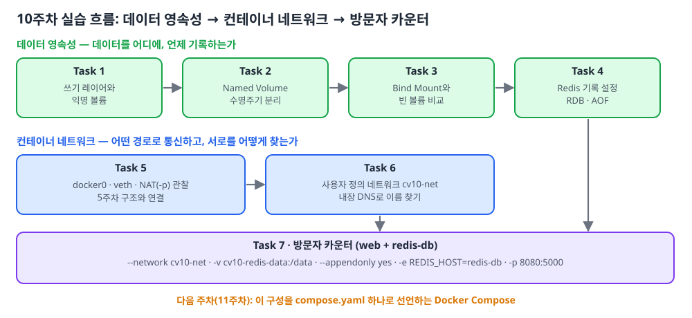
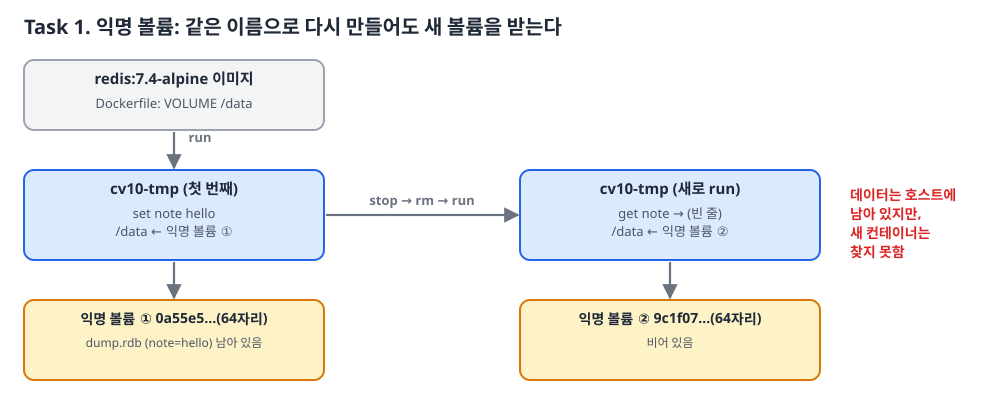
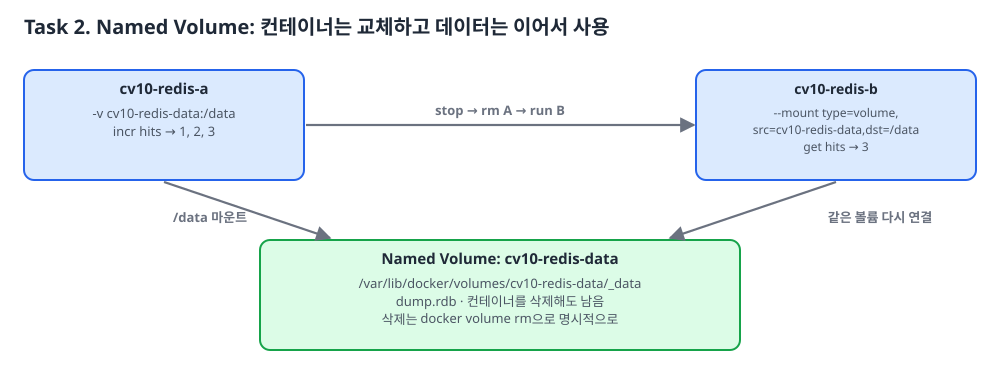
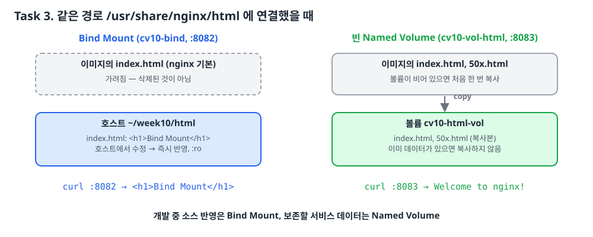
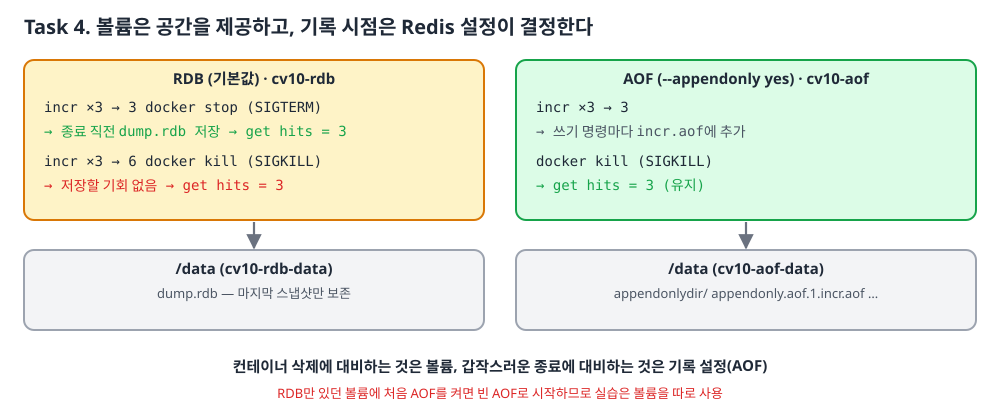
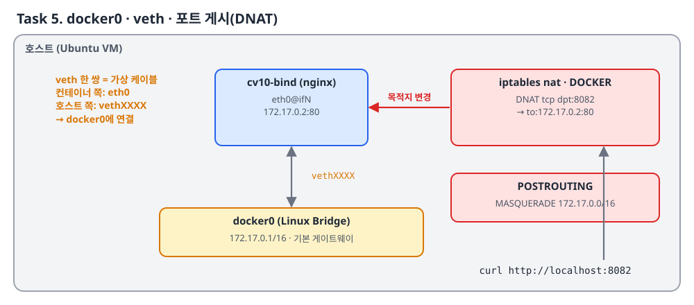
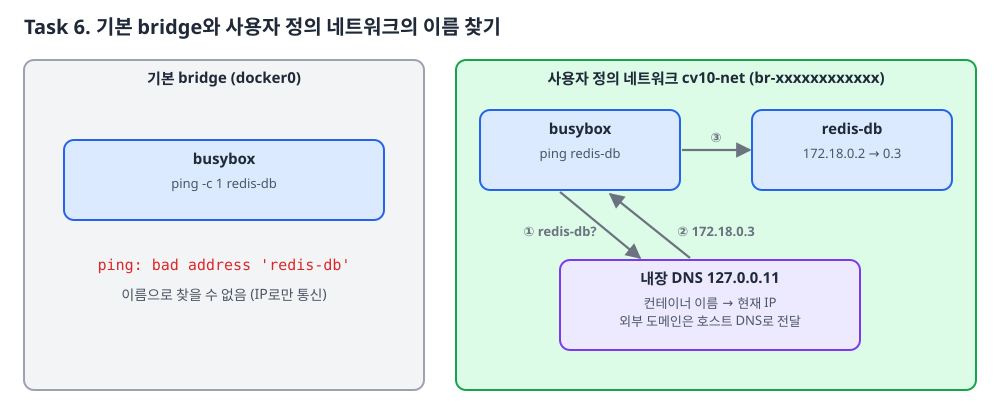
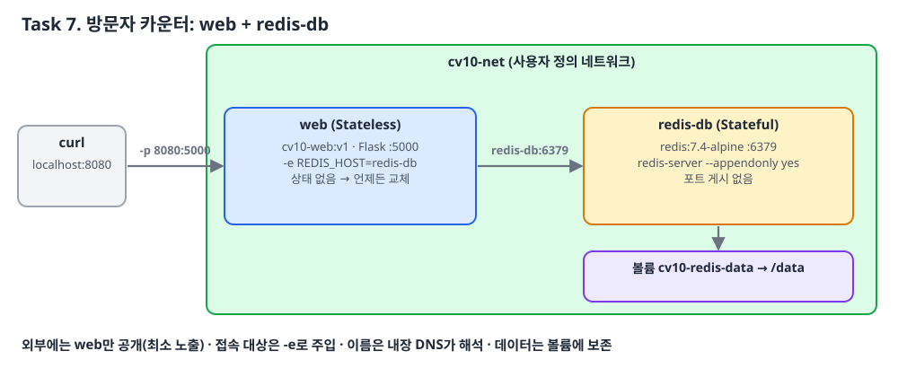

# 10주차 실습 — 데이터 영속성과 컨테이너 네트워크

[전체 주차 목록](../README.md) · [9주차 실습](../week09/README.md)

9주차에는 새 버전을 적용하려면 컨테이너를 새로 만들어야 한다는 것을 확인했습니다. 그렇다면 컨테이너 안에 쌓인 데이터는 어떻게 될까요? 이번에는 데이터를 컨테이너 밖에 두어 컨테이너와 데이터의 수명주기를 분리하고, 여러 컨테이너가 이름으로 서로를 찾아 통신하도록 구성합니다.

학습 목표: 쓰기 레이어·익명 볼륨·Named Volume·Bind Mount의 차이를 실제 출력으로 구분하고, Redis의 기록 설정(RDB·AOF)이 데이터 보존에 주는 영향을 설명합니다. docker0·veth·NAT 규칙을 5주차의 네트워크 구조와 연결하고, 사용자 정의 네트워크의 내장 DNS로 컨테이너 이름 통신을 구성합니다.

교안의 방문자 카운터 예제를 완성합니다. 웹 서버(`web`)는 접속할 때마다 Redis(`redis-db`)의 `hits` 값을 1씩 증가시키고 결과를 응답합니다.

## 실습 전체 흐름



그림 읽기: Task 1~4는 데이터를 어디에, 언제 기록하는지를 다룹니다. Task 5~6은 컨테이너가 어떤 경로로 통신하고 서로를 어떻게 찾는지 다룹니다. Task 7에서 두 내용을 합쳐 `web`과 `redis-db`를 실행하고, 컨테이너를 교체해도 방문자 수가 유지되는지 확인합니다.

| 구간 | 확인할 질문 | 예상 시간 |
| --- | --- | ---: |
| 준비 | Docker·이미지·포트가 준비되었는가? | 5~10분 |
| Task 1 | 볼륨 없이 실행한 Redis를 삭제하면 데이터는 어떻게 되는가? | 10분 |
| Task 2 | 컨테이너를 새로 만들어도 데이터를 이어서 쓸 수 있는가? | 15분 |
| Task 3 | 호스트에서 고친 파일이 재빌드 없이 컨테이너에 반영되는가? | 15분 |
| Task 4 | 볼륨이 있어도 강제 종료하면 데이터가 사라질 수 있는가? | 10분 |
| Task 5 | 컨테이너의 eth0와 포트 게시는 호스트의 무엇과 연결되는가? | 15분 |
| Task 6 | 컨테이너 IP가 바뀌어도 이름으로 찾을 수 있는가? | 15분 |
| Task 7 | web과 redis-db를 교체해도 방문자 수가 유지되는가? | 20분 |
| 기록·정리 | 관찰을 교안의 개념으로 설명할 수 있는가? | 10분 |

약 110~120분입니다. 이미지 최초 다운로드 시간은 별도입니다. 수업 시간이 짧으면 Task 5를 관찰 기록 없이 진행하고, Task 3의 빈 볼륨 비교를 과제로 진행합니다.

## 시작 전에

- 학생별 Ubuntu 24.04 VM에 SSH로 접속합니다. **이 문서의 모든 명령은 VM의 일반 사용자 Bash에서 실행**합니다.
- 7~9주차의 Ubuntu `docker.io` 설치와 8주차의 MTU 설정(`/etc/docker/daemon.json`)을 이어 씁니다.
- **코드 블록 하나씩 복사해 위에서 아래 순서로 실행**합니다. 한 명령 번호 안에 여러 복사 블록이 있을 수 있습니다. 같은 SSH 창을 계속 사용합니다. Task 1에서 저장한 변수(`ANON1`)를 뒤에서 다시 사용합니다.
- `cat > 파일 <<'EOF'` 블록은 마지막 `EOF`까지 한 번에 복사합니다. `>` 프롬프트가 계속 나오면 `Ctrl+C` 후 블록 전체를 다시 붙여 넣습니다.
- 컨테이너 ID, IP 주소, 익명 볼륨 이름, `vethXXXX`·`br-XXXX` 이름은 실행할 때마다 달라집니다. 예시의 값을 입력하지 말고 자신의 출력값을 사용합니다.
- 이번 주차에서 만드는 자원의 이름은 `cv10-`으로 시작하며, 교안과 같게 `web`, `redis-db` 두 이름도 사용합니다.

### 실행 도구와 이미지 준비

명령 01: Docker 실행 확인 — 호스트 Bash

```bash
if systemctl is-active --quiet docker; then
  echo "Docker 실행 중"
else
  sudo systemctl start docker && echo "Docker 시작 완료"
fi
```

```bash
sudo docker version --format 'Client={{.Client.Version}} Server={{.Server.Version}}'
```

Client와 Server 버전이 모두 표시되어야 합니다. 오류가 나오면 [9주차 명령 01](../week09/README.md#실행-도구와-베이스-이미지-준비)의 설치 안내를 확인합니다.

명령 02: 이번 주차 이미지 받기 — 호스트 Bash

```bash
sudo docker pull redis:7.4-alpine
```

```bash
sudo docker pull nginx:alpine
```

```bash
sudo docker pull busybox:1.36
```

```bash
sudo docker pull python:3.12-slim
```

`redis:7.4-alpine`은 데이터 저장소, `nginx:alpine`은 Bind Mount 관찰용 웹 서버, `busybox:1.36`은 네트워크 관찰 도구, `python:3.12-slim`은 방문자 카운터의 베이스 이미지입니다.

명령 03: 사용할 포트와 기존 자원 확인 — 호스트 Bash

이번 실습은 VM의 8080~8083번 포트를 사용합니다.

```bash
sudo ss -ltn | grep -E ':(8080|8081|8082|8083)\b' || echo "8080~8083 사용 가능"
```

`8080~8083 사용 가능`이 나오면 다음으로 진행합니다. 포트가 사용 중이면 어떤 컨테이너인지 확인합니다.

```bash
sudo docker ps --format '{{.Names}}  {{.Ports}}'
```

7주차의 `cv7-web`이 8080을 사용 중이라면 `sudo docker stop cv7-web`으로 중지만 합니다. 다른 서비스라면 중지하지 말고 교수자에게 알립니다.

명령 04: 작업 폴더 준비 — 호스트 Bash

```bash
mkdir -p "$HOME/week10/html" "$HOME/week10/web"
cd "$HOME/week10"
pwd
```

작업 경로가 `/home/자신의계정/week10`인지 확인합니다.

## Task 1. 쓰기 레이어와 익명 볼륨

교안 연결: 「복습: 컨테이너 쓰기 레이어는 일시적이다」, 「이름 있는 볼륨과 익명 볼륨」. 볼륨 옵션(`-v`) 없이 Redis를 실행하고, 컨테이너를 삭제·재생성했을 때 데이터가 어디에 남는지 확인합니다.



그림 읽기: Redis 공식 이미지는 Dockerfile에 `VOLUME /data`를 선언했습니다. 그래서 `-v`를 생략해도 `/data`에는 무작위 이름의 익명 볼륨이 연결됩니다. 같은 이름으로 컨테이너를 다시 만들어도 Docker는 **새** 익명 볼륨을 연결하므로, 이전 볼륨에 데이터가 남아 있어도 찾지 못합니다.

명령 05: 이미지에 선언된 볼륨 경로 확인 — 호스트 Bash

```bash
sudo docker image inspect redis:7.4-alpine --format '{{json .Config.Volumes}}'
```

예상 출력:

```text
{"/data":{}}
```

9주차의 `.Config.Env`, `.Config.Cmd`처럼 이미지의 실행 설정을 조회했습니다. `/data`가 볼륨 경로로 선언되어 있습니다.

명령 06: 볼륨 옵션 없이 Redis 실행 후 데이터 기록 — 호스트 Bash

```bash
sudo docker run -d --name cv10-tmp redis:7.4-alpine
```

```bash
sudo docker exec cv10-tmp redis-cli set note hello
```

예상 출력: `OK`. Redis에 키 `note`, 값 `hello`를 저장했습니다. `redis-cli`는 Redis 이미지에 포함된 명령행 클라이언트입니다.

컨테이너에 연결된 마운트 정보를 확인하고, 익명 볼륨 이름을 변수에 저장합니다.

```bash
sudo docker inspect cv10-tmp --format '{{range .Mounts}}{{.Type}} {{.Name}} -> {{.Destination}}{{end}}'
```

```bash
ANON1=$(sudo docker inspect cv10-tmp --format '{{range .Mounts}}{{.Name}}{{end}}')
echo "$ANON1"
```

예상 출력의 형태:

```text
volume 0a55e525176f737caa007939636a66131514f533e3df59b8c6441ade7c33ead2 -> /data
```

`-v`를 쓰지 않았는데도 `volume` 유형의 마운트가 있고, 이름은 64자리 무작위 값입니다. 이름만 보고는 어떤 데이터인지 알기 어렵습니다.

명령 07: stop·start와 rm·run 비교 — 호스트 Bash

먼저 같은 컨테이너를 중지했다가 다시 시작합니다.

```bash
sudo docker stop cv10-tmp
```

```bash
sudo docker start cv10-tmp
```

```bash
sudo docker exec cv10-tmp redis-cli get note
```

예상 출력: `hello`. 8주차와 같이 stop·start는 같은 컨테이너를 다시 사용하므로 데이터가 유지됩니다.

이번에는 컨테이너를 삭제하고 같은 이름으로 새로 만듭니다.

```bash
sudo docker stop cv10-tmp
```

```bash
sudo docker rm cv10-tmp
```

```bash
sudo docker run -d --name cv10-tmp redis:7.4-alpine
```

```bash
sudo docker exec cv10-tmp redis-cli get note
```

예상 출력: **빈 줄**. 값이 없으면 `redis-cli`가 빈 줄을 출력합니다. 같은 이름, 같은 이미지로 만들었지만 이전 데이터가 보이지 않습니다.

명령 08: 남아 있는 이전 익명 볼륨 확인 — 호스트 Bash

```bash
sudo docker volume ls
```

64자리 이름의 볼륨이 **두 개** 이상 보입니다. 하나는 삭제한 컨테이너가 쓰던 `$ANON1`, 다른 하나는 새 컨테이너의 볼륨입니다. 이전 볼륨 안을 확인합니다.

```bash
sudo ls -l "/var/lib/docker/volumes/$ANON1/_data"
```

예상 출력에 `dump.rdb`가 있습니다. `docker stop` 때 Redis가 저장한 파일입니다. 데이터는 호스트에 남아 있지만 새 컨테이너는 다른 볼륨을 받았기 때문에 찾지 못했습니다.

| 작업 | 데이터 `note` | 이유 |
| --- | --- | --- |
| stop → start | 유지 | 같은 컨테이너, 같은 볼륨 |
| rm → 새 run | 보이지 않음 | 새 컨테이너에 새 익명 볼륨이 연결됨 |

> `-v` 없이 실행한 일반 이미지라면 데이터가 쓰기 레이어에 기록되어 `docker rm` 때 함께 사라집니다(8주차 Task 4). Redis는 `VOLUME /data` 선언 때문에 데이터가 쓰기 레이어 대신 익명 볼륨으로 갔지만, 다시 찾을 수 없다는 점에서는 결과가 같습니다.

명령 09: 익명 볼륨 정리 — 호스트 Bash

`-v` 옵션을 붙인 `docker rm -v`는 컨테이너와 함께 그 컨테이너의 익명 볼륨도 삭제합니다.

```bash
sudo docker rm -f -v cv10-tmp
```

먼저 삭제한 컨테이너의 익명 볼륨은 이름을 지정해 삭제합니다.

```bash
sudo docker volume rm "$ANON1"
```

`docker volume prune`은 사용하지 않는 익명 볼륨을 모두 삭제하므로 다른 주차의 자원까지 지울 수 있습니다. 이번 실습에서는 이름을 지정해 삭제합니다.

## Task 2. Named Volume으로 컨테이너와 데이터의 수명주기 분리

교안 연결: 「마운트」, 「Docker 마운트 옵션과 OCI 실행 설정의 mounts」, 「Named Volume」, 「-v와 --mount」. 이름을 붙인 볼륨은 컨테이너를 교체해도 다시 연결할 수 있습니다.



그림 읽기: 컨테이너의 `/data` 아래 쓰기는 쓰기 레이어가 아니라 호스트의 `/var/lib/docker/volumes/cv10-redis-data/_data`에 기록됩니다. 컨테이너 A를 삭제해도 볼륨은 남고, 컨테이너 B에 같은 이름의 볼륨을 연결하면 같은 디렉터리가 다시 `/data`에 마운트됩니다.

명령 10: 볼륨 생성과 저장 위치 확인 — 호스트 Bash

```bash
sudo docker volume create cv10-redis-data
```

```bash
sudo docker volume ls
```

```bash
sudo docker volume inspect cv10-redis-data --format '{{.Driver}} {{.Mountpoint}}'
```

예상 출력:

```text
local /var/lib/docker/volumes/cv10-redis-data/_data
```

이번에는 볼륨 이름이 `cv10-redis-data`로 보입니다. 실제 데이터는 `Mountpoint`의 경로에 저장됩니다.

명령 11: 볼륨을 연결한 컨테이너 A에서 데이터 기록 — 호스트 Bash

```bash
sudo docker run -d --name cv10-redis-a -v cv10-redis-data:/data redis:7.4-alpine
```

방문자 수처럼 `hits` 값을 세 번 증가시킵니다.

```bash
sudo docker exec cv10-redis-a redis-cli incr hits
```

```bash
sudo docker exec cv10-redis-a redis-cli incr hits
```

```bash
sudo docker exec cv10-redis-a redis-cli incr hits
```

예상 출력: `1`, `2`, `3`. `incr`은 값을 1 증가시키고 증가한 결과를 돌려줍니다.

Docker가 이 연결을 어떻게 기록했는지 확인합니다.

```bash
sudo docker inspect cv10-redis-a --format '{{range .Mounts}}{{.Type}} {{.Name}} {{.Source}} -> {{.Destination}}{{end}}'
```

예상 출력:

```text
volume cv10-redis-data /var/lib/docker/volumes/cv10-redis-data/_data -> /data
```

교안 연결: `-v cv10-redis-data:/data`는 런타임에 전달되는 OCI 실행 설정(7주차 `config.json`)의 `mounts` 항목이 되며, `source`가 위 경로이고 `destination`이 `/data`인 bind 마운트로 적용됩니다. Volume·Bind Mount·tmpfs는 모두 Linux 마운트 기능이며, 차이는 저장 위치와 관리 주체입니다.

명령 12: 컨테이너 A를 삭제하고 볼륨 확인 — 호스트 Bash

`docker stop`으로 정상 종료하면 Redis가 종료 직전에 데이터를 파일로 저장합니다. 저장 시점은 Task 4에서 자세히 비교합니다.

```bash
sudo docker stop cv10-redis-a
```

```bash
sudo docker rm cv10-redis-a
```

```bash
sudo docker volume ls --filter name=cv10-redis-data
```

```bash
sudo ls -l /var/lib/docker/volumes/cv10-redis-data/_data
```

컨테이너는 삭제했지만 볼륨과 그 안의 `dump.rdb`는 남아 있습니다.

명령 13: --mount 문법으로 새 컨테이너 B에 같은 볼륨 연결 — 호스트 Bash

`-v` 대신 Docker 공식 문서가 권장하는 `--mount` 문법을 사용합니다. 결과는 같습니다.

```bash
sudo docker run -d --name cv10-redis-b \
  --mount type=volume,src=cv10-redis-data,dst=/data \
  redis:7.4-alpine
```

```bash
sudo docker exec cv10-redis-b redis-cli get hits
```

예상 출력: `3`. 컨테이너 B는 새로 만들었지만 A가 기록한 값을 이어서 읽습니다.

```bash
sudo docker exec cv10-redis-b redis-cli incr hits
```

예상 출력: `4`.

| 문법 | 형태 | 특징 |
| --- | --- | --- |
| `-v` | `-v 볼륨이름:컨테이너경로[:옵션]` | 짧음. 이름의 볼륨이 없으면 자동 생성 |
| `--mount` | `--mount type=volume,src=이름,dst=경로` | 항목 이름을 명시해 읽기 쉬움 |

명령 14: 사용 중인 볼륨 삭제 시도와 정리 — 호스트 Bash

```bash
sudo docker volume rm cv10-redis-data
```

의도한 오류: `volume is in use`. 컨테이너가 사용 중인 볼륨은 삭제할 수 없습니다. 컨테이너를 먼저 삭제한 뒤 볼륨을 삭제합니다.

```bash
sudo docker rm -f cv10-redis-b
```

```bash
sudo docker volume rm cv10-redis-data
```

이번에는 볼륨 이름이 출력되며 삭제됩니다. Named Volume은 `docker volume rm`으로 **명시적으로** 삭제해야 사라집니다. Task 7에서는 같은 이름의 볼륨을 새로 만들어 사용합니다.

## Task 3. Bind Mount와 빈 Named Volume 비교

교안 연결: 「Bind Mount」, 「빈 Named Volume과 Bind Mount의 차이」, 「Docker 스토리지 3가지 유형 비교」. Bind Mount는 호스트 디렉터리를 그대로 연결하므로, 호스트에서 고친 파일이 이미지 재빌드 없이 컨테이너에 반영됩니다.



그림 읽기: Bind Mount는 호스트 디렉터리의 내용을 그대로 보여 주며, 이미지에 원래 있던 파일은 삭제되지 않고 가려집니다. 빈 Named Volume을 처음 연결하면 Docker가 이미지의 해당 경로 파일을 볼륨으로 복사합니다. 이 복사는 볼륨이 비어 있을 때 한 번만 일어납니다.

명령 15: 호스트에 웹 문서 작성 — 호스트 Bash

```bash
echo '<h1>Bind Mount</h1>' > "$HOME/week10/html/index.html"
```

```bash
cat "$HOME/week10/html/index.html"
```

명령 16: Bind Mount로 nginx 실행 — 호스트 Bash

```bash
sudo docker run -d --name cv10-bind \
  -p 8082:80 \
  -v "$HOME/week10/html":/usr/share/nginx/html:ro \
  nginx:alpine
```

`-v` 앞부분이 `/`로 시작하는 호스트 경로이므로 Bind Mount로 동작합니다. `:ro`는 컨테이너에서 읽기만 허용합니다.

```bash
curl http://localhost:8082
```

예상 출력: `<h1>Bind Mount</h1>`. nginx 이미지의 기본 환영 페이지가 아니라 호스트의 파일이 응답됩니다.

명령 17: 호스트 파일 수정 후 재빌드 없이 확인 — 호스트 Bash

```bash
echo '<h1>Bind Mount - edited on host</h1>' > "$HOME/week10/html/index.html"
```

```bash
curl http://localhost:8082
```

예상 출력: `<h1>Bind Mount - edited on host</h1>`. `docker build`나 컨테이너 재시작 없이 즉시 반영되었습니다. 8주차처럼 `COPY` 후 다시 빌드할 필요가 없어 개발 단계에서 편리합니다.

컨테이너 안에서 파일 수정을 시도합니다.

```bash
sudo docker exec cv10-bind sh -c 'echo hacked > /usr/share/nginx/html/index.html'
```

의도한 오류: `Read-only file system`. `:ro` 때문에 컨테이너는 호스트 파일을 바꿀 수 없습니다. `:ro`가 없으면 컨테이너가 호스트 파일을 수정·삭제할 수 있습니다.

> `cv10-bind`는 Task 5의 포트 게시 관찰에 다시 사용하므로 삭제하지 않습니다.

명령 18: 빈 Named Volume을 같은 경로에 연결 — 호스트 Bash

```bash
sudo docker run -d --name cv10-vol-html \
  -p 8083:80 \
  -v cv10-html-vol:/usr/share/nginx/html \
  nginx:alpine
```

`cv10-html-vol`은 아직 없는 볼륨이므로 `-v`가 새로 만듭니다.

```bash
curl -s http://localhost:8083 | grep -i '<title>'
```

예상 출력: `<title>Welcome to nginx!</title>`. 비어 있던 볼륨에 이미지의 기본 페이지가 복사되었습니다.

```bash
sudo ls /var/lib/docker/volumes/cv10-html-vol/_data
```

예상 출력: `50x.html  index.html`. 이미지의 파일이 볼륨 디렉터리에 실제로 복사되어 있습니다.

| 같은 경로에 연결 | 이미지의 기존 파일 | 보이는 내용 |
| --- | --- | --- |
| Bind Mount (`$HOME/week10/html`) | 가려짐(삭제 아님) | 호스트 디렉터리의 파일 |
| 빈 Named Volume (`cv10-html-vol`) | 처음 한 번 볼륨으로 복사 | 이미지의 기본 페이지 |

명령 19: --mount의 Bind Mount 오류 관찰과 정리 — 호스트 Bash

```bash
sudo docker run --rm --mount type=bind,src="$HOME/week10/no-such-dir",dst=/x busybox:1.36 true
```

의도한 오류: `bind source path does not exist`. `--mount`는 없는 호스트 경로를 만들지 않고 오류를 냅니다. 같은 경로를 `-v`로 지정하면 Docker가 디렉터리를 새로 만들어 버리므로 경로 오타를 알아채기 어렵습니다.

빈 볼륨 비교에 사용한 컨테이너와 볼륨을 정리합니다.

```bash
sudo docker rm -f cv10-vol-html
```

```bash
sudo docker volume rm cv10-html-vol
```

<details>
<summary>참고: tmpfs 마운트 확인하기</summary>

이번 실습의 필수 단계는 아닙니다. tmpfs는 호스트 메모리에 만들어지는 임시 파일시스템이며 컨테이너가 중지되면 사라집니다.

```bash
sudo docker run --rm --tmpfs /run busybox:1.36 sh -c 'echo secret > /run/token; df -h /run; cat /run/token'
```

`df` 출력의 Filesystem이 `tmpfs`로 표시됩니다. 디스크에 남기면 안 되는 임시·민감 데이터에 사용합니다.

</details>

## Task 4. Redis의 기록 설정: RDB와 AOF

교안 연결: 「볼륨은 공간을 제공하고, 기록 시점은 애플리케이션이 결정한다」, 「정상 종료와 강제 종료에서 보존되는 데이터」. 볼륨은 저장 공간만 제공합니다. 메모리의 데이터를 언제 디스크에 기록할지는 Redis 설정이 정합니다.



그림 읽기: RDB는 조건을 만족하거나 정상 종료할 때 전체 데이터를 `dump.rdb`에 저장합니다. `docker kill`은 저장할 기회 없이 프로세스를 끝내므로 마지막 스냅샷 이후 변경분이 사라집니다. AOF는 쓰기 명령을 `appendonlydir/`의 파일에 계속 추가하므로 강제 종료 후에도 변경분이 남습니다.

명령 20: RDB(기본값) Redis에 기록 후 정상 종료 — 호스트 Bash

```bash
sudo docker run -d --name cv10-rdb -v cv10-rdb-data:/data redis:7.4-alpine
```

```bash
for i in 1 2 3; do sudo docker exec cv10-rdb redis-cli incr hits; done
```

예상 출력: `1`, `2`, `3`.

```bash
sudo docker stop cv10-rdb
```

```bash
sudo docker start cv10-rdb
```

```bash
sudo docker exec cv10-rdb redis-cli get hits
```

예상 출력: `3`. `docker stop`은 주 프로세스에 SIGTERM을 보내고, Redis는 종료 직전에 RDB 스냅샷을 저장합니다.

명령 21: 같은 Redis를 강제 종료 — 호스트 Bash

```bash
for i in 1 2 3; do sudo docker exec cv10-rdb redis-cli incr hits; done
```

예상 출력: `4`, `5`, `6`.

```bash
sudo docker kill cv10-rdb
```

```bash
sudo docker start cv10-rdb
```

```bash
sudo docker exec cv10-rdb redis-cli get hits
```

예상 출력: `3`. `docker kill`은 SIGKILL로 즉시 종료하므로 저장할 기회가 없습니다. 볼륨에 남은 것은 명령 20의 정상 종료 때 저장한 스냅샷(3)이며, 그 이후 변경분(4~6)은 사라졌습니다.

> Redis의 기본 자동 저장 조건은 "1시간에 1회 이상, 5분에 100회 이상, 1분에 1만 회 이상 변경" 중 하나입니다. 실습처럼 짧은 시간에 몇 번만 변경하면 자동 저장이 일어나지 않습니다.

명령 22: AOF를 켠 Redis 실행 — 호스트 Bash

이미지 이름 뒤의 `redis-server --appendonly yes`는 이미지의 CMD를 대체합니다(9주차 CMD와 ENTRYPOINT).

```bash
sudo docker run -d --name cv10-aof -v cv10-aof-data:/data \
  redis:7.4-alpine redis-server --appendonly yes
```

```bash
sudo docker exec cv10-aof redis-cli config get appendonly
```

예상 출력: `appendonly`, `yes` 두 줄.

```bash
for i in 1 2 3; do sudo docker exec cv10-aof redis-cli incr hits; done
```

예상 출력: `1`, `2`, `3`.

명령 23: AOF Redis를 강제 종료 — 호스트 Bash

```bash
sudo docker kill cv10-aof
```

```bash
sudo docker start cv10-aof
```

```bash
sudo docker exec cv10-aof redis-cli get hits
```

예상 출력: `3`. 강제 종료했지만 변경분이 유지되었습니다. 기록된 파일을 확인합니다.

```bash
sudo ls -l /var/lib/docker/volumes/cv10-aof-data/_data/appendonlydir
```

`appendonly.aof.1.base.rdb`, `appendonly.aof.1.incr.aof`, `appendonly.aof.manifest`가 보입니다. `incr.aof` 파일에 쓰기 명령이 계속 추가됩니다.

| 구성 | `docker stop` | `docker kill` |
| --- | --- | --- |
| 볼륨 없이 실행 후 rm | 손실 | 손실 |
| Named Volume + RDB(기본값) | 유지 | 마지막 스냅샷 이후 변경분 손실 |
| Named Volume + AOF | 유지 | 유지 (`everysec` 기본값에서 OS 장애 시 최대 약 1초 손실) |

> 주의: 이미 RDB 파일만 있는 볼륨에 처음으로 `--appendonly yes`를 붙여 실행하면, Redis는 AOF 파일을 우선 읽기 때문에 새로 만든 빈 AOF로 시작하여 기존 값이 보이지 않습니다. 그래서 이 실습은 RDB용 `cv10-rdb-data`와 AOF용 `cv10-aof-data`를 따로 사용합니다. 운영 중인 Redis를 AOF로 전환할 때는 실행 중에 `CONFIG SET appendonly yes`로 전환합니다.

명령 24: Task 4 자원 정리 — 호스트 Bash

```bash
sudo docker rm -f cv10-rdb cv10-aof
```

```bash
sudo docker volume rm cv10-rdb-data cv10-aof-data
```

컨테이너 삭제에 대비하는 것은 볼륨이고, 갑작스러운 종료에 대비하는 것은 애플리케이션의 기록 설정(AOF)입니다.

## Task 5. docker0·veth와 포트 게시(NAT) 관찰

교안 연결: 「복습: Network Namespace · veth · Linux Bridge」, 「Docker 기본 네트워크: docker0 브리지」, 「포트 게시(-p)는 NAT 규칙으로 동작한다」. 5주차에 `ip netns`·`ip link`로 직접 만든 구조를 Docker가 자동으로 만든 모습과 비교합니다.



그림 읽기: 컨테이너의 `eth0`와 호스트의 `vethXXXX`는 veth 한 쌍의 양 끝입니다. 호스트 쪽 끝은 Linux Bridge인 `docker0`에 연결됩니다. `docker0`는 5주차의 브리지와 달리 IP(172.17.0.1)를 가져 컨테이너의 기본 게이트웨이가 됩니다. `-p 8082:80`은 호스트의 8082번으로 들어온 요청의 목적지를 컨테이너IP:80으로 바꾸는 DNAT 규칙입니다.

명령 25: 호스트의 Linux Bridge 확인 — 호스트 Bash

```bash
ip -br link show type bridge
```

```bash
ip -br -4 addr show docker0
```

`docker0`와 `172.17.0.1/16`을 확인합니다. 이전 주차에서 만든 사용자 정의 네트워크가 있으면 `br-`로 시작하는 브리지도 함께 보입니다.

명령 26: 관찰용 컨테이너의 eth0 확인 — 호스트 Bash

```bash
sudo docker run -d --name cv10-probe busybox:1.36 sleep 600
```

```bash
sudo docker exec cv10-probe ip -4 addr show eth0
```

예상 출력의 형태:

```text
2: eth0@if67: <BROADCAST,MULTICAST,UP,LOWER_UP,M-DOWN> mtu 1442 qdisc noqueue
    inet 172.17.0.3/16 brd 172.17.255.255 scope global eth0
```

컨테이너는 `172.17.0.x/16` 주소를 받았습니다. `eth0@if67`의 `67`은 veth 반대쪽 끝이 호스트에서 가진 인터페이스 번호입니다. 숫자는 환경마다 다릅니다. `mtu 1442`는 8주차에 설정한 MTU입니다.

명령 27: veth의 반대쪽 끝을 호스트에서 찾기 — 호스트 Bash

```bash
PEER=$(sudo docker exec cv10-probe cat /sys/class/net/eth0/iflink)
echo "호스트 쪽 인터페이스 번호: $PEER"
```

```bash
ip -o link | grep "^$PEER:"
```

예상 출력의 형태:

```text
67: veth3a1b2c4@if2: <BROADCAST,MULTICAST,UP,LOWER_UP> mtu 1442 qdisc noqueue master docker0 state UP ...
```

`vethXXXX`의 `master docker0`를 확인합니다. 호스트 쪽 끝이 `docker0` 브리지에 연결되어 있습니다. 브리지에 연결된 veth 목록도 확인합니다.

```bash
ip -br link show master docker0
```

`cv10-probe`와 Task 3의 `cv10-bind`가 각각 하나씩 veth를 가지므로 두 개 이상 보입니다.

| 5주차에 직접 실행 | Docker가 자동으로 수행 |
| --- | --- |
| `ip netns add` | 컨테이너마다 새 Network Namespace 생성 |
| `ip link add ... type veth peer ...` | veth 한 쌍 생성: 컨테이너 쪽 `eth0`, 호스트 쪽 `vethXXXX` |
| `ip link set ... master br0` | 호스트 쪽 끝을 `docker0`에 연결 |
| `ip addr add ...` | 컨테이너 `eth0`에 IP 할당 |

명령 28: 포트 게시가 만든 NAT 규칙 확인 — 호스트 Bash

Task 3의 `cv10-bind`는 `-p 8082:80`으로 실행했습니다. 컨테이너의 IP를 확인합니다.

```bash
sudo docker inspect -f '{{range .NetworkSettings.Networks}}{{.IPAddress}}{{end}}' cv10-bind
```

```bash
sudo iptables -t nat -L DOCKER -n | grep 8082
```

예상 출력의 형태:

```text
DNAT       tcp  --  0.0.0.0/0            0.0.0.0/0            tcp dpt:8082 to:172.17.0.2:80
```

`dpt:8082`로 들어온 TCP 요청의 목적지를 `to:` 뒤의 주소로 바꿉니다. `to:`의 IP가 바로 위에서 확인한 `cv10-bind`의 IP와 같은지 비교합니다.

컨테이너가 인터넷으로 나갈 때 사용하는 반대 방향의 규칙도 확인합니다.

```bash
sudo iptables -t nat -L POSTROUTING -n | grep MASQUERADE
```

`172.17.0.0/16`에서 나가는 패킷의 출발지를 호스트 주소로 바꾸는 `MASQUERADE` 규칙이 보입니다.

> 9주차의 `EXPOSE`만으로는 이 DNAT 규칙이 생기지 않습니다. 규칙은 `-p`로 포트를 게시할 때 생깁니다. `iptables` 명령이 없거나 규칙이 보이지 않는 환경이면 `sudo nft list ruleset | grep 8082`로 확인합니다.

명령 29: 관찰용 자원 정리 — 호스트 Bash

```bash
sudo docker rm -f cv10-probe cv10-bind
```

```bash
sudo iptables -t nat -L DOCKER -n | grep 8082 || echo "8082 규칙 없음"
```

컨테이너를 삭제하면 Docker가 해당 DNAT 규칙과 veth를 함께 제거합니다. `~/week10/html` 폴더는 복습용으로 남깁니다.

## Task 6. 사용자 정의 네트워크와 내장 DNS

교안 연결: 「컨테이너 IP는 고정되어 있지 않다」, 「Docker 내장 DNS」, 「기본 bridge와 사용자 정의 bridge 비교」, 「docker network 명령」. 컨테이너를 다시 만들면 IP가 바뀔 수 있으므로, 이름으로 찾는 방법이 필요합니다.



그림 읽기: 사용자 정의 네트워크마다 호스트에 별도의 Linux Bridge(`br-…`)가 만들어집니다. 이 네트워크의 컨테이너는 `127.0.0.11`의 내장 DNS에 질의하고, 내장 DNS는 컨테이너 이름을 **현재** IP로 응답합니다. 기본 bridge(`docker0`)의 컨테이너는 이름으로 다른 컨테이너를 찾을 수 없습니다.

명령 30: 사용자 정의 네트워크 생성 — 호스트 Bash

```bash
sudo docker network create cv10-net
```

```bash
sudo docker network ls
```

```bash
sudo docker network inspect cv10-net --format '{{range .IPAM.Config}}Subnet={{.Subnet}} Gateway={{.Gateway}}{{end}}'
```

예상 출력의 형태: `Subnet=172.18.0.0/16 Gateway=172.18.0.1`. 다른 사용자 정의 네트워크가 이미 있으면 `172.19.0.0/16`처럼 다른 대역이 나옵니다.

호스트에 새로 생긴 브리지를 확인합니다.

```bash
echo "br-$(sudo docker network inspect -f '{{.Id}}' cv10-net | cut -c1-12)"
```

```bash
ip -br link show type bridge
```

위에서 출력한 `br-` 이름이 브리지 목록에 있는지 확인합니다. 브리지 이름은 네트워크 ID의 앞 12자리입니다. 네트워크마다 별도의 브리지가 생기므로 네트워크끼리 격리됩니다.

명령 31: cv10-net에 redis-db 실행 — 호스트 Bash

```bash
sudo docker run -d --rm --name redis-db --network cv10-net redis:7.4-alpine
```

`--rm`으로 실행했으므로 이 컨테이너가 삭제될 때 익명 볼륨도 함께 삭제됩니다. 이 Task에서는 데이터 보존이 아니라 이름 찾기를 관찰합니다.

명령 32: 기본 bridge와 cv10-net에서 이름 찾기 비교 — 호스트 Bash

`--network`를 생략하면 기본 bridge(`docker0`)에 연결됩니다.

```bash
sudo docker run --rm busybox:1.36 ping -c 1 redis-db
```

의도한 오류: `ping: bad address 'redis-db'`. 기본 bridge에서는 컨테이너 이름을 IP로 바꿔 주지 않습니다.

```bash
sudo docker run --rm --network cv10-net busybox:1.36 ping -c 1 redis-db
```

예상 출력의 형태:

```text
PING redis-db (172.18.0.2): 56 data bytes
64 bytes from 172.18.0.2: seq=0 ttl=64 time=0.064 ms
```

같은 `cv10-net`에 연결한 컨테이너는 이름으로 찾았습니다.

명령 33: 내장 DNS 확인 — 호스트 Bash

```bash
sudo docker run --rm --network cv10-net busybox:1.36 cat /etc/resolv.conf
```

출력에서 `nameserver 127.0.0.11`을 확인합니다.

```bash
sudo docker run --rm --network cv10-net busybox:1.36 nslookup redis-db
```

`Server: 127.0.0.11`과 `Name: redis-db`, `Address: 172.18.0.x`를 확인합니다. 컨테이너 이름을 IP로 알려 준 것은 Docker의 내장 DNS입니다. 외부 도메인 질의는 호스트의 DNS 설정으로 전달됩니다.

명령 34: 컨테이너를 다시 만들면 IP가 바뀌는지 확인 — 호스트 Bash

현재 IP를 기록합니다.

```bash
sudo docker inspect -f '{{range .NetworkSettings.Networks}}{{.IPAddress}}{{end}}' redis-db
```

`redis-db`를 삭제하고, 다른 컨테이너가 먼저 같은 네트워크에 연결되게 합니다.

```bash
sudo docker rm -f redis-db
```

```bash
sudo docker run -d --name cv10-other --network cv10-net busybox:1.36 sleep 600
```

```bash
sudo docker run -d --rm --name redis-db --network cv10-net redis:7.4-alpine
```

```bash
sudo docker inspect -f '{{range .NetworkSettings.Networks}}{{.IPAddress}}{{end}}' redis-db
```

예상 결과: 처음과 다른 IP(예: `172.18.0.2` → `172.18.0.3`). 처음 IP는 `cv10-other`가 먼저 받았습니다. IP를 코드에 직접 적었다면 이제 연결에 실패합니다.

```bash
sudo docker run --rm --network cv10-net busybox:1.36 ping -c 1 redis-db
```

IP가 바뀌었어도 이름으로는 새 IP에 연결됩니다. 이름으로 대상을 찾고 현재 IP는 시스템이 알려 주는 방식을 서비스 디스커버리(Service Discovery)라고 합니다.

명령 35: 연결된 컨테이너가 있는 네트워크 삭제 시도와 정리 — 호스트 Bash

```bash
sudo docker network inspect cv10-net --format '{{range .Containers}}{{.Name}} {{.IPv4Address}}{{println}}{{end}}'
```

`redis-db`와 `cv10-other`가 연결되어 있습니다.

```bash
sudo docker network rm cv10-net
```

의도한 오류: `network cv10-net has active endpoints`. 연결된 컨테이너가 있으면 네트워크를 삭제할 수 없습니다.

```bash
sudo docker rm -f redis-db cv10-other
```

```bash
sudo docker network rm cv10-net
```

이번에는 삭제됩니다. Task 7에서는 교안의 순서대로 네트워크부터 다시 만듭니다.

| 구분 | 기본 bridge (`docker0`) | 사용자 정의 bridge (`cv10-net`) |
| --- | --- | --- |
| 만드는 방법 | Docker 설치 시 자동 생성 | `docker network create` |
| 연결 방법 | `--network` 생략 | `--network cv10-net` |
| 이름으로 통신 | 불가 (`bad address`) | 가능 (내장 DNS `127.0.0.11`) |
| 호스트의 브리지 | `docker0` | `br-` + 네트워크 ID 12자리 |

## Task 7. 방문자 카운터: web + redis-db

교안 연결: 「서비스 단위의 분리와 독립 배포」, 「Stateless와 Stateful」, 「외부 노출과 내부 통신: 최소 노출 원칙」, 「설정과 코드의 분리」, 「전체 구성을 명령어로 실행하기」, 「컨테이너를 교체해도 방문자 수가 유지되는지 확인」.



그림 읽기: 외부에서는 `web`의 8080번만 접근할 수 있습니다. `redis-db`의 6379번은 게시하지 않고 같은 `cv10-net`의 `web`만 접근합니다. `web`은 상태를 보관하지 않는 Stateless 컨테이너이고, `redis-db`는 방문자 수를 `cv10-redis-data` 볼륨에 보관하는 Stateful 컨테이너입니다. `web`이 접속할 대상 이름은 `-e REDIS_HOST=redis-db`로 전달합니다.

명령 36: 방문자 카운터 프로그램 작성 — 호스트 Bash

```bash
cd "$HOME/week10/web"
```

```bash
cat > app.py <<'EOF'
import os
from flask import Flask
import redis

app = Flask(__name__)
r = redis.Redis(
    host=os.environ.get("REDIS_HOST", "localhost"),
    port=6379)

@app.route("/")
def index():
    count = r.incr("hits")
    return f"방문 횟수: {count}\n"

if __name__ == "__main__":
    app.run(host="0.0.0.0", port=5000)
EOF
```

| 코드 | 의미 |
| --- | --- |
| `os.environ.get("REDIS_HOST", "localhost")` | 접속할 Redis 주소를 환경 변수에서 받음. 없으면 `localhost` |
| `r.incr("hits")` | Redis의 `hits` 값을 1 증가시키고 결과를 반환. web에는 상태가 남지 않음 |
| `host="0.0.0.0"` | 컨테이너의 모든 인터페이스에서 요청을 받음. `127.0.0.1`이면 `-p`로 접속할 수 없음 |

명령 37: Dockerfile 작성과 이미지 빌드 — 호스트 Bash

```bash
cat > Dockerfile <<'EOF'
FROM python:3.12-slim
WORKDIR /app
RUN pip install --no-cache-dir flask redis
COPY app.py .
ENV REDIS_HOST=localhost
EXPOSE 5000
CMD ["python", "app.py"]
EOF
```

```bash
sudo docker build -t cv10-web:v1 .
```

`RUN pip install`은 빌드 중에 Flask와 Redis 클라이언트 라이브러리를 이미지에 설치합니다. 소스보다 먼저 설치하므로 `app.py`만 고쳐 다시 빌드하면 설치 단계는 캐시를 사용합니다(8주차 캐시와 명령 순서). `ENV REDIS_HOST=localhost`는 이미지에 기록하는 기본값입니다.

명령 38: 네트워크 → 볼륨 → redis-db 순서로 실행 — 호스트 Bash

① 네트워크 생성

```bash
sudo docker network create cv10-net
```

② 볼륨 생성

```bash
sudo docker volume create cv10-redis-data
```

③ redis-db 실행 (포트 게시 없음)

```bash
sudo docker run -d --name redis-db --network cv10-net \
  -v cv10-redis-data:/data \
  redis:7.4-alpine redis-server --appendonly yes
```

명령 39: 환경 변수를 빠뜨린 web 실행 — 호스트 Bash

교안의 경고를 먼저 확인합니다. `-e REDIS_HOST`를 빠뜨리고 실행합니다.

```bash
sudo docker run -d --name cv10-web-noenv --network cv10-net \
  -p 8081:5000 cv10-web:v1
```

```bash
curl -s -o /dev/null -w '%{http_code}\n' http://localhost:8081
```

예상 출력: `500`. 웹 서버가 시작 중이라 `000`이 나오면 잠시 후 다시 실행합니다.

```bash
sudo docker logs cv10-web-noenv 2>&1 | grep ConnectionError
```

예상 출력의 형태:

```text
redis.exceptions.ConnectionError: Error 111 connecting to localhost:6379. Connection refused.
```

ENV 기본값 `localhost`를 사용했기 때문에 web은 **자기 컨테이너 안**의 6379번에서 Redis를 찾았습니다. 컨테이너마다 Network Namespace가 따로 있으므로 `localhost`는 다른 컨테이너를 가리키지 않습니다.

```bash
sudo docker rm -f cv10-web-noenv
```

명령 40: web 실행 (8080만 게시) — 호스트 Bash

④ web 실행

```bash
sudo docker run -d --name web --network cv10-net \
  -e REDIS_HOST=redis-db -p 8080:5000 cv10-web:v1
```

```bash
curl http://localhost:8080
```

```bash
curl http://localhost:8080
```

```bash
curl http://localhost:8080
```

예상 출력: `방문 횟수: 1`, `방문 횟수: 2`, `방문 횟수: 3`. 코드를 고치지 않고 실행 설정(`-e`)만으로 접속 대상을 바꾸었고, 이름 `redis-db`는 내장 DNS가 IP로 바꾸었습니다.

| 옵션 | 적용한 개념 |
| --- | --- |
| `--network cv10-net` | 내장 DNS로 이름 통신 |
| `-v cv10-redis-data:/data` | Named Volume 영속화 |
| `--appendonly yes` | 애플리케이션 기록 설정 |
| `-e REDIS_HOST=redis-db` | 설정과 코드의 분리 |
| `-p 8080:5000` | 최소 노출 원칙 (web만 게시) |

명령 41: 최소 노출 원칙 확인 — 호스트 Bash

```bash
sudo docker ps --filter name=web --filter name=redis-db --format '{{.Names}}  {{.Ports}}'
```

예상 출력:

```text
web  0.0.0.0:8080->5000/tcp, [::]:8080->5000/tcp
redis-db  6379/tcp
```

`web`은 호스트 포트에 게시되었고(`->`), `redis-db`의 `6379/tcp`는 게시되지 않았습니다. 같은 네트워크에서는 게시하지 않아도 접근할 수 있습니다.

```bash
sudo docker run --rm --network cv10-net redis:7.4-alpine redis-cli -h redis-db get hits
```

예상 출력: `3`. 같은 `cv10-net`의 컨테이너는 이름으로 Redis에 접속합니다. 네트워크를 지정하지 않으면 접속할 수 없습니다.

```bash
sudo docker run --rm redis:7.4-alpine redis-cli -h redis-db get hits
```

의도한 오류: `Could not connect to Redis at redis-db:6379: Name has no usable address`와 비슷한 메시지. 기본 bridge에서는 `redis-db`라는 이름을 찾을 수 없습니다. 외부에 열린 포트가 적을수록 공격 가능한 경로가 줄어듭니다. 인증 없는 Redis 포트를 외부에 게시하지 않습니다.

명령 42: 컨테이너 교체 실험 — 호스트 Bash

① Stateless인 web을 삭제하고 새로 만듭니다.

```bash
sudo docker rm -f web
```

```bash
sudo docker run -d --name web --network cv10-net \
  -e REDIS_HOST=redis-db -p 8080:5000 cv10-web:v1
```

```bash
curl http://localhost:8080
```

예상 출력: `방문 횟수: 4`. web에는 상태가 없으므로 언제든 새로 만들어도 됩니다.

② Stateful인 redis-db를 삭제하고 같은 볼륨으로 새로 만듭니다.

```bash
sudo docker rm -f redis-db
```

```bash
sudo docker run -d --name redis-db --network cv10-net \
  -v cv10-redis-data:/data \
  redis:7.4-alpine redis-server --appendonly yes
```

```bash
curl http://localhost:8080
```

예상 출력: `방문 횟수: 5`. 컨테이너는 교체되었지만 볼륨의 값에 이어서 증가했습니다. web은 다시 시작하지 않았는데도 새 redis-db에 연결되었습니다. IP가 바뀌어도 이름으로 찾기 때문입니다.

③ redis-db를 강제 종료합니다.

```bash
sudo docker kill redis-db
```

```bash
curl -s -o /dev/null -w '%{http_code}\n' http://localhost:8080
```

예상 출력: `500`. Redis가 중지된 동안 web은 응답을 만들 수 없지만 web 컨테이너 자체는 계속 실행 중입니다(장애 격리).

```bash
sudo docker ps --filter name=web --format '{{.Names}} {{.Status}}'
```

```bash
sudo docker start redis-db
```

```bash
curl http://localhost:8080
```

예상 출력: `방문 횟수: 6`. AOF 설정이므로 강제 종료 후에도 값(5)이 유지되었고 이어서 증가했습니다.

| 실험 | 결과 | 설명 |
| --- | --- | --- |
| web 삭제·재생성 | 이어서 증가 | web은 Stateless, 상태는 redis-db에 있음 |
| redis-db 삭제·재생성 | 이어서 증가 | 데이터는 Named Volume에 있음 |
| redis-db 강제 종료 후 시작 | 이어서 증가 | AOF가 변경분을 기록함 |

명령 43: 실행 순서 되돌아보기 — 호스트 Bash

```bash
sudo docker inspect redis-db --format 'network={{range $k, $v := .NetworkSettings.Networks}}{{$k}}{{end}} mounts={{range .Mounts}}{{.Name}}:{{.Destination}}{{end}} cmd={{json .Config.Cmd}}'
```

```bash
sudo docker inspect web --format 'network={{range $k, $v := .NetworkSettings.Networks}}{{$k}}{{end}} env={{json .Config.Env}} ports={{json .HostConfig.PortBindings}}'
```

두 컨테이너에 적용한 네트워크·볼륨·명령·환경 변수·포트 설정을 확인합니다. 이 구성은 네트워크 → 볼륨 → redis-db → web의 순서를 지켜야 하고 옵션이 길어 실수하기 쉽습니다. 11주차에는 같은 구성을 `compose.yaml` 하나로 선언하는 Docker Compose를 학습합니다.

## 관찰 기록

예상값을 복사하지 말고 실제 출력과 이유를 한 문장씩 기록합니다. 오류가 난 경우 오류 내용과 실행 위치도 함께 적습니다.

| 항목 | 기록할 질문 | 나의 관찰 |
| --- | --- | --- |
| 익명 볼륨 | `-v` 없이 실행했는데 `/data`에 볼륨이 생긴 이유는? | |
| rm·run | 새 컨테이너에서 `note`가 보이지 않은 이유는? 데이터는 어디에 남았는가? | |
| Named Volume | 컨테이너 B가 A의 `hits`를 읽을 수 있었던 이유는? | |
| -v와 --mount | 두 문법의 결과와 Bind Mount에서의 차이는? | |
| Bind Mount | 호스트 수정이 즉시 반영된 이유와 `:ro`의 효과는? | |
| 빈 볼륨 | 빈 Named Volume에서 nginx 기본 페이지가 보인 이유는? | |
| RDB·AOF | `docker kill` 후 RDB와 AOF의 `hits` 값은 각각 무엇이었는가? | |
| veth | 컨테이너 `eth0@ifN`의 N은 호스트의 어떤 인터페이스였는가? | |
| NAT | 8082번 DNAT 규칙의 `to:` 주소는 무엇이었는가? | |
| DNS | 기본 bridge와 cv10-net의 `ping redis-db` 결과와 이유는? | |
| IP 변경 | redis-db의 IP는 어떻게 바뀌었고 이름 접속은 어떻게 되었는가? | |
| 환경 변수 | `-e REDIS_HOST`를 빠뜨렸을 때 HTTP 상태 코드와 원인은? | |
| 최소 노출 | `docker ps`에서 web과 redis-db의 Ports 차이는? | |
| 교체 실험 | web·redis-db를 교체했을 때 방문 횟수는? | |

## 실습 자원 정리

결과를 먼저 기록합니다. 이번 문서에서 만든 정확한 이름만 정리합니다. 기존 7~9주차 자원과 베이스 이미지는 지우지 않습니다. `docker system prune`, `docker volume prune`처럼 한꺼번에 삭제하는 명령을 사용하지 않습니다.

명령 44: 10주차 컨테이너 정리 — 호스트 Bash

```bash
sudo docker ps -a --filter name=cv10- --filter name=web --filter name=redis-db --format '{{.Names}}  {{.Status}}'
```

```bash
sudo docker rm -f web redis-db
```

중간 Task에서 멈춘 경우 위 목록에 남은 `cv10-` 이름만 지정해 추가로 삭제합니다. `No such container`는 이미 정리되었다는 뜻이므로 다른 컨테이너를 대신 삭제하지 않습니다.

명령 45: 볼륨·네트워크 정리 — 호스트 Bash

```bash
sudo docker volume rm cv10-redis-data
```

```bash
sudo docker network rm cv10-net
```

```bash
sudo docker volume ls --filter name=cv10-
```

```bash
sudo docker network ls --filter name=cv10-
```

두 목록이 비어 있어야 합니다. Task 1의 익명 볼륨을 정리하지 않았다면 `echo "$ANON1"`으로 이름을 확인한 뒤 `sudo docker volume rm` 뒤에 그 이름을 지정해 삭제합니다.

명령 46: 실습 이미지 정리 — 호스트 Bash

```bash
sudo docker image rm cv10-web:v1
```

`~/week10/html`, `~/week10/web` 소스는 복습용으로 남겨 둡니다. 11주차에도 방문자 카운터를 사용합니다. 7주차의 `cv7-web`을 중지했다면 필요할 때 `sudo docker start cv7-web`으로 다시 시작합니다.

## 자주 발생하는 문제

| 증상 | 확인과 해결 |
| --- | --- |
| `port is already allocated` | 명령 03으로 8080~8083 사용 여부 확인. 이전 주차의 실습 컨테이너면 `stop`만 하고, 다른 서비스면 교수자에게 확인 |
| `Conflict. The container name "/web" is already in use` | `sudo docker ps -a --filter name=web`으로 확인. 이번 실습에서 만든 컨테이너이면 `sudo docker rm -f web` 후 다시 실행 |
| `volume is in use` | 의도한 오류(명령 14)가 아니라면 `sudo docker ps -a --filter volume=볼륨이름`으로 사용하는 컨테이너 확인 후 그 컨테이너를 먼저 삭제 |
| `redis-cli get`이 빈 줄 | 값이 없다는 뜻. 명령 07은 의도한 결과. 다른 단계라면 같은 볼륨 이름을 연결했는지 `docker inspect`의 Mounts로 확인 |
| AOF로 바꿨더니 이전 값이 사라짐 | RDB만 있는 볼륨에 처음 `--appendonly yes`를 적용한 경우. Task 4 주의 사항 참고. 실습은 새 볼륨으로 시작 |
| `curl`에 `Connection refused`·`000` | 컨테이너가 시작 중일 수 있음. 잠시 후 재시도. 계속 실패하면 `sudo docker logs web`, `sudo docker ps -a`로 상태 확인 |
| `curl`에 `500` | `-e REDIS_HOST=redis-db`를 넣었는지, redis-db가 실행 중이고 같은 `cv10-net`에 있는지 확인 |
| `ping: bad address 'redis-db'` | 명령 32 첫 실행은 의도한 오류. 그 외에는 `--network cv10-net`을 넣었는지 확인 |
| `bind source path does not exist` | 명령 19는 의도한 오류. 그 외에는 `ls -ld` 로 호스트 경로 철자 확인 |
| `Read-only file system` | 명령 17의 의도한 오류. `:ro`로 연결한 경로는 컨테이너에서 수정할 수 없음 |
| 빌드 중 `pip install` 시간 초과 | 8주차의 MTU 1442 설정(`cat /etc/docker/daemon.json`)과 Docker 재시작 여부 확인 후 다시 빌드 |
| `iptables: command not found` 또는 규칙 없음 | `sudo nft list ruleset \| grep 8082`로 확인. 규칙 형식은 환경에 따라 다를 수 있음 |
| `network cv10-net has active endpoints` | 명령 35는 의도한 오류. 정리 단계라면 `sudo docker network inspect cv10-net`으로 연결된 컨테이너 확인 후 삭제 |
| SSH가 끊어짐 | `cd ~/week10` 후 `sudo docker ps -a`로 상태를 확인하고 이어서 진행. `ANON1` 변수는 사라지므로 Task 1 정리 전이면 `sudo docker volume ls`에서 이름 확인 |

## 이론과 다음 주차 연결

컨테이너의 쓰기 레이어는 일시적이므로, 보존해야 할 데이터는 마운트를 이용해 컨테이너 밖의 저장 공간에 기록합니다. Named Volume은 보존할 데이터, Bind Mount는 개발용 연결, tmpfs는 메모리 임시 저장에 사용합니다. 볼륨은 공간만 제공하며, 언제 기록할지는 애플리케이션 설정(RDB·AOF)이 결정합니다.

Docker 네트워크는 5주차의 Network Namespace·veth·Linux Bridge로 만들어지며, `-p`는 NAT(DNAT) 규칙으로 동작합니다. 컨테이너 IP는 바뀔 수 있으므로 사용자 정의 네트워크의 내장 DNS로 이름을 사용하고, 접속 대상은 환경 변수(`-e`)로 주입합니다. 외부에는 필요한 포트만 게시합니다.

11주차에는 이번에 하나씩 입력한 네트워크·볼륨·redis-db·web 명령 4개를 `compose.yaml` 하나로 정의하는 Docker Compose를 학습합니다.

## 참고 자료

- 수업 교안: `클라우드가상화_10주차.pptx`의 컨테이너 아키텍처, 데이터 영속성, 컨테이너 네트워킹, 전체 실행 흐름 관련 내용.
- 구성 참고: [9주차 실습](https://github.com/choong-syu/cloud-virtualization/blob/main/week09/README.md), [5주차 실습](https://github.com/choong-syu/cloud-virtualization/blob/main/week05/README.md).
- 스토리지: [Volumes](https://docs.docker.com/engine/storage/volumes/), [Bind mounts](https://docs.docker.com/engine/storage/bind-mounts/), [tmpfs mounts](https://docs.docker.com/engine/storage/tmpfs/).
- 네트워크: [Bridge network driver](https://docs.docker.com/engine/network/drivers/bridge/), [Packet filtering and firewalls](https://docs.docker.com/engine/network/packet-filtering-firewalls/).
- Redis 영속성: [Redis persistence](https://redis.io/docs/latest/operate/oss_and_stack/management/persistence/).
- Mount namespace: [mount_namespaces(7)](https://man7.org/linux/man-pages/man7/mount_namespaces.7.html).

이번 주차의 개념 그림은 실습 흐름을 설명하기 위해 만든 SVG 도식입니다. 명령 출력의 IP 주소·인터페이스 번호·볼륨 이름은 각자의 실행 결과를 기준으로 확인합니다. 예상 출력은 Docker 29.x와 `redis:7.4-alpine`에서 확인한 결과입니다.
