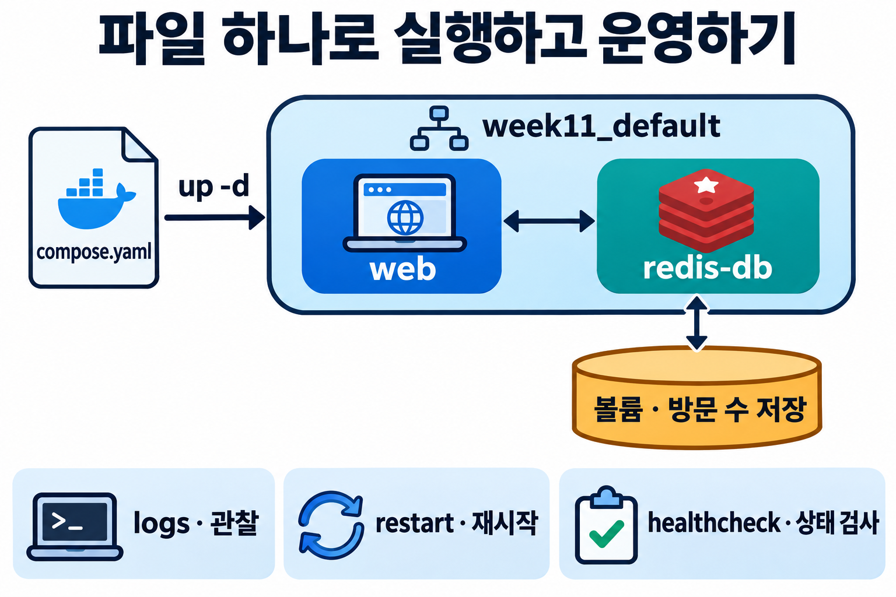
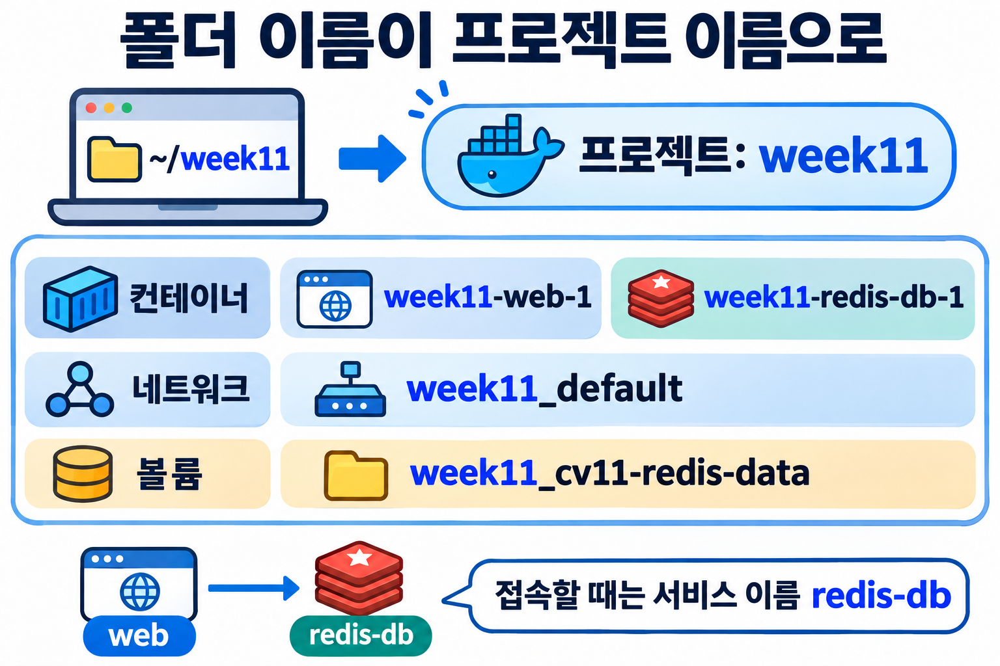
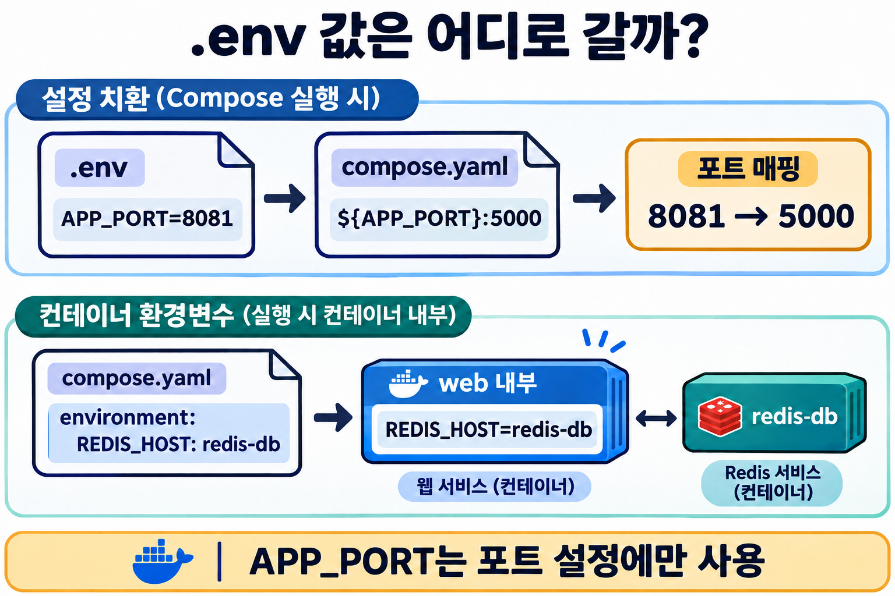
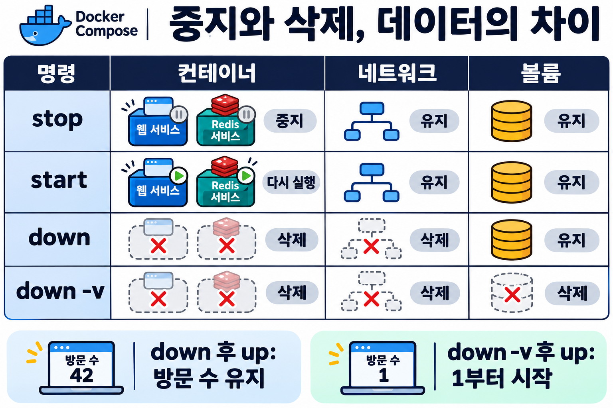
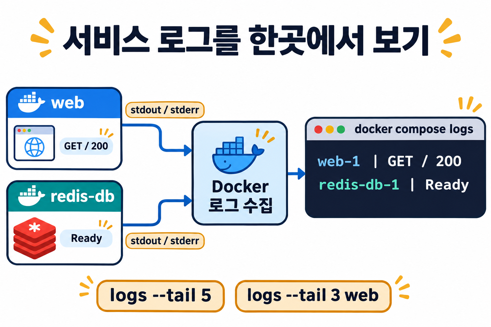
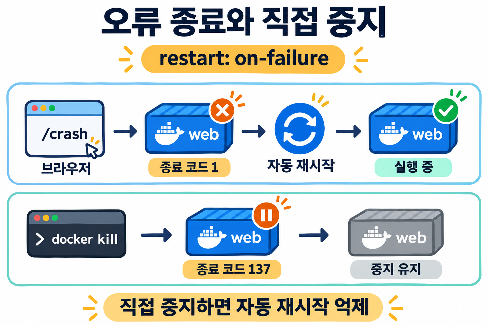
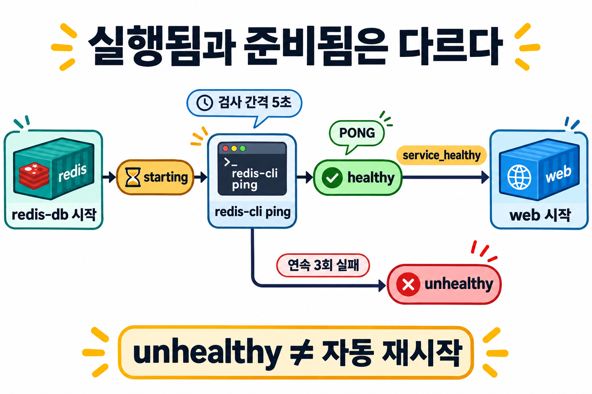

# 11주차 실습 — Docker Compose와 멀티 컨테이너 운영

[전체 주차 목록](https://github.com/choong-syu/cloud-virtualization/blob/main/README.md) · [10주차 실습](https://github.com/choong-syu/cloud-virtualization/blob/main/week10/README.md)

10주차에는 네트워크 → 볼륨 → redis-db → web 순서로 **명령 4개를 직접 입력**해 방문자 카운터를 만들었습니다. 이번 주에는 같은 구성을 **compose.yaml 파일 하나로 선언**하고, 실행 중인 서비스를 관찰하고 자동으로 복구하는 방법을 익힙니다.

학습 목표: compose.yaml로 web + redis-db를 실행하고, `down`과 `down -v`의 차이, 로그 확인, restart(자동 복구), healthcheck(상태 검사)를 직접 확인합니다.

## 먼저 알아 둘 용어

| 용어 | 한 줄 설명 |
| --- | --- |
| Docker Compose | 여러 컨테이너·네트워크·볼륨을 파일 하나로 정의하고 한 번에 실행하는 도구 |
| compose.yaml | Compose가 읽는 설정 파일. YAML 형식(들여쓰기로 계층 표현) |
| 서비스 | compose.yaml의 `services:` 아래 항목(web, redis-db). 서비스 이름이 곧 내장 DNS 이름 |
| 프로젝트 | Compose가 관리하는 자원 묶음. 기본 이름은 **폴더 이름**(이번 실습은 `week11`) |
| restart | 컨테이너가 종료되었을 때 정책에 따라 Docker가 다시 시작하는 규칙. 이번 실습은 `on-failure` 사용 |
| healthcheck | 컨테이너 안에서 검사 명령을 주기적으로 실행해 healthy / unhealthy를 판별 |

## 실습 전체 흐름



그림 읽기: compose.yaml 하나로 web, redis-db, 네트워크, 볼륨을 만들고(Task 1~3), 실행 중인 서비스를 관찰하고(Task 4) 스스로 복구하게 만듭니다(Task 5~6).

| 구간 | 확인할 질문 | 예상 시간 |
| --- | --- | ---: |
| 준비 | Compose가 설치되었는가? | 10분 |
| Task 1 | 명령 4개를 파일 하나로 실행할 수 있는가? | 20분 |
| Task 2 | .env로 포트를 바꾸면 무엇이 다시 만들어지는가? | 10분 |
| Task 3 | down과 down -v는 데이터에 어떤 차이를 주는가? | 10분 |
| Task 4 | 실행 중인 서비스를 어떻게 관찰하는가? | 10분 |
| Task 5 | 앱이 죽으면 Docker가 다시 살려 주는가? | 15분 |
| Task 6 | DB가 준비된 뒤에 web을 시작할 수 있는가? | 15분 |
| 기록·정리 | 관찰을 개념으로 설명할 수 있는가? | 10분 |

## 시작 전에

- 학생별 Ubuntu VM에 SSH로 접속합니다. **모든 명령은 VM의 Bash에서 실행**합니다.
- **코드 블록을 하나씩 복사해 위에서 아래 순서로 실행**합니다. 같은 SSH 창을 계속 사용합니다.
- **명령 12-02**는 단계 12의 두 번째 명령입니다. 수업에서는 “12단계 2번 명령”처럼 부릅니다.
- 조건문·반복문·여러 줄 명령은 번호 하나가 실행 단위입니다. 해당 코드 블록 전체를 복사합니다.
- `cat > 파일 <<'EOF'` 블록은 마지막 `EOF`까지 한 번에 복사합니다.
- compose.yaml은 **들여쓰기가 문법**입니다. 블록 전체를 그대로 복사하고, 직접 고칠 때는 탭(Tab) 대신 공백을 사용합니다.
- "의도한 오류"라고 적힌 단계는 오류가 나오는 것이 정상입니다.
- `docker compose` 명령은 **compose.yaml이 있는 `~/week11` 폴더에서** 실행해야 합니다.

## 준비

### 단계 01: Docker 실행 확인

**명령 01-01: Docker 실행 확인**

```bash
if systemctl is-active --quiet docker; then
  echo "Docker 실행 중"
else
  sudo systemctl start docker && echo "Docker 시작 완료"
fi
```

### 단계 02: Docker Compose 설치와 버전 확인

Ubuntu의 `docker.io`에는 Compose가 포함되어 있지 않으므로 플러그인을 설치합니다. 이미 설치되어 있으면 그대로 넘어갑니다.

**명령 02-01: 패키지 목록 갱신**

```bash
sudo apt-get update
```

**명령 02-02: Docker Compose 플러그인 설치**

```bash
sudo apt-get install -y docker-compose-v2
```

**명령 02-03: Compose 버전 확인**

```bash
sudo docker compose version
```

예상 출력의 형태: `Docker Compose version 2.xx.x` 또는 `v2.xx.x` (설치된 버전에 따라 다릅니다).

> 이번 실습은 플러그인 방식인 `docker compose`(띄어쓰기)를 사용합니다. 오래된 Compose V1 예제의 `docker-compose up`은 `docker compose up`으로 바꿔 읽습니다.

### 단계 03: 이전 주차 자원과 포트 확인

이번 실습은 **8080과 8081**을 차례로 사용합니다. 10주차의 `web`이나 9주차의 `cv9-web-published`가 남아 있으면 포트가 겹칠 수 있습니다.

**명령 03-01: 컨테이너의 포트 사용 현황 확인**

```bash
sudo docker ps --format '{{.Names}}  {{.Ports}}'
```

목록에 10주차의 `web`, `redis-db`가 있다면 10주차 [정리 명령](https://github.com/choong-syu/cloud-virtualization/blob/main/week10/README.md#실습-자원-정리)으로 먼저 정리합니다. 이전 실습의 웹 컨테이너는 남아 있을 때만 중지합니다.

**명령 03-02: 이전 주차 웹 컨테이너 중지**

```bash
for name in cv7-web cv9-web-published; do
  if [ "$(sudo docker inspect -f '{{.State.Running}}' "$name" 2>/dev/null)" = true ]; then
    sudo docker stop "$name"
  fi
done
```

**명령 03-03: 8080·8081번 포트 확인**

```bash
sudo ss -ltnp '( sport = :8080 or sport = :8081 )'
```

8080·8081의 사용 내역이 없으면 다음으로 진행합니다. 다른 프로그램이 표시되면 해당 프로그램을 확인해 포트를 비운 뒤 진행합니다.

### 단계 04: 작업 폴더 준비

폴더 이름 `week11`이 그대로 **프로젝트 이름**이 됩니다.

**명령 04-01: 실습 폴더 만들기**

```bash
mkdir -p ~/week11
```

**명령 04-02: 실습 폴더로 이동**

```bash
cd ~/week11
```

**명령 04-03: 현재 폴더 확인**

```bash
pwd
```

## Task 1. compose.yaml로 방문자 카운터 실행하기

교안 연결: 「명령형과 선언형」, 「compose.yaml의 최상위 구조」, 「10주차 명령어 → compose.yaml」, 「build와 image」

### 단계 05: 방문자 카운터 프로그램 작성

`/`로 요청하면 Redis의 `hits`를 1 늘리고 방문 수를 응답합니다. `/crash`는 Task 5에서 오류 종료를 관찰하기 위한 실습용 경로입니다. 10주차 `app.py`에 이 경로를 추가했습니다.

**명령 05-01: 방문자 카운터 app.py 작성**

```bash
cat > app.py <<'EOF'
import os
from flask import Flask
import redis

app = Flask(__name__)
r = redis.Redis(
    host=os.environ.get("REDIS_HOST", "localhost"),
    port=6379)

@app.route("/")
def index():
    count = r.incr("hits")
    return f"방문 횟수: {count}\n"

@app.route("/crash")
def crash():
    os._exit(1)   # 일부러 오류 코드 1로 종료 (Task 5)

if __name__ == "__main__":
    app.run(host="0.0.0.0", port=5000)
EOF
```

### 단계 06: Dockerfile 작성

10주차와 같은 Dockerfile입니다.

**명령 06-01: Dockerfile 작성**

```bash
cat > Dockerfile <<'EOF'
FROM python:3.12-slim
WORKDIR /app
RUN pip install --no-cache-dir flask redis
COPY app.py .
ENV REDIS_HOST=localhost
EXPOSE 5000
CMD ["python", "app.py"]
EOF
```

### 단계 07: compose.yaml 작성

10주차의 명령 4개를 파일 하나로 옮깁니다.

**명령 07-01: compose.yaml 작성**

```bash
cat > compose.yaml <<'EOF'
services:
  web:
    build: .
    image: cv11-web:v1
    ports:
      - "8080:5000"
    environment:
      REDIS_HOST: redis-db
    depends_on:
      - redis-db
  redis-db:
    image: redis:7.4-alpine
    command: redis-server --appendonly yes
    volumes:
      - cv11-redis-data:/data

volumes:
  cv11-redis-data:
EOF
```

| 10주차 명령·옵션 | compose.yaml |
| --- | --- |
| `--name web`, `--name redis-db` | `services:` 아래 서비스 이름으로 서로 접속. 실제 컨테이너 이름은 Compose가 생성 |
| `docker build -t cv10-web:v1 .` | `build: .` + `image: cv11-web:v1` |
| `-p 8080:5000` | `ports:` |
| `-e REDIS_HOST=redis-db` | `environment:` |
| `-v cv10-redis-data:/data` | 서비스의 `volumes:` + 최상위 `volumes:` |
| `redis-server --appendonly yes` | `command:` |
| `docker network create cv10-net` | (적지 않아도 Compose가 자동 생성) |

### 단계 08: 설정 확인

실행하기 전에 문법과 최종 설정을 확인하는 습관을 들입니다.

**명령 08-01: Compose 문법과 최종 설정 확인**

```bash
sudo docker compose config
```

오류 없이 설정이 출력되면 됩니다. 출력 끝부분에서 `name: week11_default`(네트워크)와 `name: week11_cv11-redis-data`(볼륨)를 찾아봅니다. 들여쓰기가 틀리면 여기서 오류가 나옵니다.

### 단계 09: 한 번에 실행

**명령 09-01: 이미지 빌드와 서비스 실행**

```bash
sudo docker compose up -d --build
```

`--build`로 web 이미지를 이 폴더의 Dockerfile에서 빌드한 뒤 실행합니다. 이후 설정만 바꿀 때는 `up -d`를 사용하고, app.py나 Dockerfile을 바꿨을 때는 `--build`를 다시 붙입니다. 처음에는 시간이 조금 걸립니다. 예상 출력의 끝부분:

```text
 ✔ Network week11_default             Created
 ✔ Volume week11_cv11-redis-data      Created
 ✔ Container week11-redis-db-1        Started
 ✔ Container week11-web-1             Started
```

10주차에 명령 4개로 하던 일을 한 줄로 끝냈습니다. `depends_on` 때문에 redis-db가 먼저 시작되었습니다.

### 단계 10: 상태 확인과 접속

**명령 10-01: 서비스 실행 상태 확인**

```bash
sudo docker compose ps
```

예상 출력의 형태:

```text
NAME                IMAGE              ...   SERVICE    STATUS         PORTS
week11-redis-db-1   redis:7.4-alpine   ...   redis-db   Up 5 seconds   6379/tcp
week11-web-1        cv11-web:v1        ...   web        Up 5 seconds   0.0.0.0:8080->5000/tcp
```

아래 명령을 **세 번** 실행합니다.

**명령 10-02: 방문자 카운터 접속 — 세 번 실행**

```bash
curl http://localhost:8080
```

예상 출력: `방문 횟수: 1` → `2` → `3`. **이후 모든 `up -d` 직후에도** 앱이 준비될 때까지 잠시 걸릴 수 있습니다. `Connection reset`·`Connection refused` 또는 시작 중 `500`이 나오면 잠시 후 다시 요청합니다. 추가로 성공한 요청만큼 방문 수가 늘어나므로, 아래 숫자보다 데이터가 이어지는지에 주목합니다.

### 단계 11: Compose가 붙인 이름 확인



**명령 11-01: 프로젝트 네트워크 이름 확인**

```bash
sudo docker network ls --filter name=week11
```

**명령 11-02: 프로젝트 볼륨 이름 확인**

```bash
sudo docker volume ls --filter name=week11
```

`week11_default` 네트워크와 `week11_cv11-redis-data` 볼륨이 보입니다. 직접 만들지 않았지만 Compose가 **프로젝트 이름(폴더 이름)** 을 붙여 자동으로 만들었습니다. 그래도 web은 서비스 이름 `redis-db`로 접속합니다.

## Task 2. .env로 포트 바꾸기

교안 연결: 「환경 변수 전달: environment와 env_file」, 「.env로 설정 분리와 docker compose config」, 「설정 변경과 부분 재생성」



그림 읽기: `.env`는 compose.yaml 안의 `${변수}` 자리를 채우는 파일입니다. 컨테이너 안의 환경 변수로 자동 전달되지는 않습니다.

### 단계 12: .env 파일 만들고 compose.yaml에서 사용

**명령 12-01: .env에 공개 포트 지정**

```bash
echo "APP_PORT=8081" > .env
```

포트 부분만 `${APP_PORT}`로 바꾼 compose.yaml로 다시 작성합니다.

**명령 12-02: 포트 변수를 사용하는 compose.yaml 작성**

```bash
cat > compose.yaml <<'EOF'
services:
  web:
    build: .
    image: cv11-web:v1
    ports:
      - "${APP_PORT}:5000"
    environment:
      REDIS_HOST: redis-db
    depends_on:
      - redis-db
  redis-db:
    image: redis:7.4-alpine
    command: redis-server --appendonly yes
    volumes:
      - cv11-redis-data:/data

volumes:
  cv11-redis-data:
EOF
```

변수가 어떻게 채워졌는지 확인합니다.

**명령 12-03: 변수가 반영된 포트 확인**

```bash
sudo docker compose config | grep published
```

예상 출력: `published: "8081"` — `.env`의 값이 들어갔습니다.

### 단계 13: 다시 up -d 하고 바뀐 서비스 확인

**명령 13-01: 변경된 설정 적용**

```bash
sudo docker compose up -d
```

예상 출력:

```text
 ✔ Container week11-redis-db-1  Running
 ✔ Container week11-web-1       Started
```

중간에 `Container week11-web-1  Recreate` → `Recreated`가 지나갑니다. 포트 설정이 바뀐 **web만 새로 만들었고**, redis-db는 `Running` 그대로입니다.

**명령 13-02: 8081번 포트로 접속**

```bash
curl http://localhost:8081
```

예상 출력: `방문 횟수: 4` — redis-db와 볼륨을 그대로 두었으므로 이어서 증가합니다.

### 단계 14: .env 값은 컨테이너 안에 없다

**명령 14-01: 컨테이너 내부 환경 변수 확인**

```bash
sudo docker compose exec web env | grep -E 'APP_PORT|REDIS_HOST'
```

예상 출력: `REDIS_HOST=redis-db` **한 줄만** 나옵니다. `environment:`로 준 값은 컨테이너 안에 있지만, `.env`의 `APP_PORT`는 compose.yaml을 채우는 데만 쓰였습니다.

## Task 3. down과 down -v 비교하기

교안 연결: 「Compose 수명주기와 상태 전이」, 「down과 down -v: 데이터 보존의 핵심」



### 단계 15: down — 컨테이너와 네트워크만 삭제

**명령 15-01: 컨테이너와 네트워크 삭제**

```bash
sudo docker compose down
```

예상 출력: web, redis-db 컨테이너와 `week11_default` 네트워크가 `Removed`됩니다.

**명령 15-02: 남아 있는 볼륨 확인**

```bash
sudo docker volume ls --filter name=week11
```

`week11_cv11-redis-data`는 **남아 있습니다.**

### 단계 16: 다시 실행하면 방문 수가 이어지는지 확인

**명령 16-01: 서비스 다시 실행**

```bash
sudo docker compose up -d
```

**명령 16-02: 보존된 방문 수 확인**

```bash
curl http://localhost:8081
```

예상 출력: `방문 횟수: 5` — 컨테이너는 새로 만들었지만 볼륨의 데이터가 이어졌습니다.

### 단계 17: down -v — 볼륨까지 삭제

**명령 17-01: 볼륨까지 함께 삭제**

```bash
sudo docker compose down -v
```

출력에 `Volume week11_cv11-redis-data  Removed`가 추가로 보입니다.

**명령 17-02: 새 볼륨으로 서비스 실행**

```bash
sudo docker compose up -d
```

**명령 17-03: 초기화된 방문 수 확인**

```bash
curl http://localhost:8081
```

예상 출력: `방문 횟수: 1` — 볼륨을 지웠으므로 처음부터 다시 셉니다.

| 명령 | 컨테이너 | 네트워크 | 볼륨 | 다시 up -d 후 방문 수 |
| --- | --- | --- | --- | --- |
| `down` | 삭제 | 삭제 | 유지 | 이어서 증가 |
| `down -v` | 삭제 | 삭제 | **삭제** | 1부터 다시 |

> `down -v`는 데이터 초기화입니다. 운영 환경에서는 실행 전에 반드시 다시 확인합니다.

## Task 4. 로그와 상태 관찰하기

교안 연결: 「컨테이너 로그와 표준 출력」, 「실행 중인 서비스 점검: exec와 stats」



### 단계 18: 통합 로그 보기

**명령 18-01: 전체 서비스 로그 확인**

```bash
sudo docker compose logs --tail 5
```

`web-1 |`, `redis-db-1 |`처럼 서비스 이름이 앞에 붙은 로그가 함께 보입니다. web 로그에서 `"GET / HTTP/1.1" 200`을 찾아봅니다.

**명령 18-02: web 로그만 확인**

```bash
sudo docker compose logs --tail 3 web
```

서비스 이름을 붙이면 그 서비스의 로그만 봅니다.

실시간으로 보려면 아래 명령을 실행하고, 다른 SSH 창에서 **명령 17-03**으로 접속해 봅니다. 빠져나올 때는 `Ctrl+C`를 누릅니다(컨테이너는 계속 실행됩니다).

**명령 18-03: 실시간 로그 관찰**

```bash
sudo docker compose logs -f
```

### 단계 19: 서비스 이름으로 내부 명령 실행

**명령 19-01: 서비스 이름으로 Redis 방문 수 조회**

```bash
sudo docker compose exec redis-db redis-cli get hits
```

예상 출력: `"1"` — 실시간 로그를 확인하면서 추가로 접속했다면 그만큼 증가한 값이 나옵니다. Redis에 저장된 방문 수이며, 컨테이너 이름(`week11-redis-db-1`) 대신 서비스 이름(`redis-db`)을 썼습니다.

### 단계 20: 자원 사용량 보기

**명령 20-01: 컨테이너 자원 사용량 확인**

```bash
sudo docker stats --no-stream
```

`week11-web-1`, `week11-redis-db-1`의 CPU %, MEM USAGE / LIMIT이 표시됩니다. 4주차에 배운 cgroup이 측정하는 값입니다. 제한을 걸지 않았으므로 LIMIT은 VM 전체 메모리로 보입니다.

## Task 5. restart로 자동 복구하기

교안 연결: 「자동 복구 정책: restart」, 「restart 동작 확인하기: /crash」



그림 읽기: 이번 실습의 `restart: on-failure`는 컨테이너의 주 프로세스가 **0이 아닌 종료 코드**로 끝나면 다시 시작합니다. `docker stop`이나 기본 `docker kill`로 직접 멈춘 경우에는 자동 재시작이 억제됩니다. `/crash`로 앱 오류 종료를 관찰합니다.

### 단계 21: restart 정책 없이 앱을 죽여 보기

**명령 21-01: 앱 오류 종료 유발 — 의도한 오류**

```bash
curl http://localhost:8081/crash
```

예상 출력: `curl: (52) Empty reply from server` — 앱이 응답하기 전에 오류 코드 1로 종료했습니다.

**명령 21-02: 종료된 web 상태 확인**

```bash
sudo docker compose ps -a
```

예상 출력에서 web이 `Exited (1)`입니다. restart 정책이 없으므로 그대로 멈춰 있습니다.

### 단계 22: restart: on-failure 추가

**명령 22-01: 자동 재시작 정책을 추가한 compose.yaml 작성**

```bash
cat > compose.yaml <<'EOF'
services:
  web:
    build: .
    image: cv11-web:v1
    ports:
      - "${APP_PORT}:5000"
    environment:
      REDIS_HOST: redis-db
    restart: on-failure
    depends_on:
      - redis-db
  redis-db:
    image: redis:7.4-alpine
    command: redis-server --appendonly yes
    volumes:
      - cv11-redis-data:/data

volumes:
  cv11-redis-data:
EOF
```

**명령 22-02: 자동 재시작 설정 적용**

```bash
sudo docker compose up -d
```

web에 `restart: on-failure`가 추가되어 web만 새로 만들어집니다.

### 단계 23: 다시 /crash 호출

web이 시작된 뒤 10초 이상 기다리고 요청합니다.

**명령 23-01: web 시작 후 10초 대기**

```bash
sleep 10
```

**명령 23-02: 앱 오류 종료 재현 — 의도한 오류**

```bash
curl http://localhost:8081/crash
```

앞과 같은 `Empty reply from server`가 의도한 결과입니다. 잠시 기다린 뒤 상태를 확인합니다.

**명령 23-03: 자동으로 다시 시작된 web 확인**

```bash
sudo docker compose ps
```

예상 출력: web이 `Up 3 seconds`처럼 **다시 실행 중**입니다.

**명령 23-04: 자동 재시작 횟수 확인**

```bash
sudo docker inspect -f '{{.RestartCount}}' week11-web-1
```

예상 출력: `1` — Docker가 한 번 다시 시작했습니다.

**명령 23-05: 복구 후 방문 수 확인**

```bash
curl http://localhost:8081
```

방문 수가 이어서 증가합니다. web이 다시 시작되어도 데이터는 redis-db에 있기 때문입니다.

### 단계 24: docker kill은 재시작하지 않는다

**명령 24-01: web을 직접 강제 종료**

```bash
sudo docker kill week11-web-1
```

**명령 24-02: 자동 재시작되지 않은 상태 확인**

```bash
sudo docker compose ps -a
```

예상 출력: web이 `Exited (137)`로 **멈춰 있습니다.** `docker kill`은 사용자가 멈춘 것으로 처리되어 restart 정책이 작동하지 않습니다. 다시 실행합니다.

**명령 24-03: web 다시 실행**

```bash
sudo docker compose up -d
```

## Task 6. healthcheck로 준비된 순서대로 시작하기

교안 연결: 「서비스 시작 순서: depends_on」, 「상태 확인: healthcheck」, 「healthcheck와 service_healthy」



그림 읽기: `depends_on`만 쓰면 redis-db가 **시작됨(Running)** 까지만 기다립니다. healthcheck로 redis-db가 **요청을 받을 준비(healthy)** 가 되었는지 검사하고, `condition: service_healthy`로 그다음에 web을 시작하게 합니다.

### 단계 25: healthcheck와 service_healthy 추가

이번 주의 최종 compose.yaml입니다.

**명령 25-01: 상태 검사와 시작 조건을 추가한 compose.yaml 작성**

```bash
cat > compose.yaml <<'EOF'
services:
  web:
    build: .
    image: cv11-web:v1
    ports:
      - "${APP_PORT}:5000"
    environment:
      REDIS_HOST: redis-db
    restart: on-failure
    depends_on:
      redis-db:
        condition: service_healthy
  redis-db:
    image: redis:7.4-alpine
    command: redis-server --appendonly yes
    volumes:
      - cv11-redis-data:/data
    healthcheck:
      test: ["CMD", "redis-cli", "ping"]
      interval: 5s
      timeout: 3s
      retries: 3
      start_period: 5s

volumes:
  cv11-redis-data:
EOF
```

| 옵션 | 의미 |
| --- | --- |
| `test` | 검사 명령. `redis-cli ping`에 `PONG`이 오면 성공 |
| `interval` | 검사 간격 (5초마다) |
| `timeout` | 응답을 기다리는 시간 |
| `retries` | 몇 번 연속 실패하면 unhealthy로 볼지 |
| `start_period` | 시작 직후 실패를 세지 않는 유예 시간 |

### 단계 26: 처음부터 다시 실행해 순서 관찰

시작 순서를 보기 위해 컨테이너와 네트워크를 지우고(볼륨은 유지) 다시 실행합니다.

**명령 26-01: 볼륨을 보존하며 서비스 삭제**

```bash
sudo docker compose down
```

**명령 26-02: 준비 상태에 따라 서비스 실행**

```bash
sudo docker compose up -d
```

예상 출력의 끝부분:

```text
 ✔ Container week11-redis-db-1  Healthy
 ✔ Container week11-web-1       Started
```

redis-db가 `Waiting` → `Healthy`가 된 **다음에** web이 시작되었습니다.

**명령 26-03: Redis의 healthy 상태 확인**

```bash
sudo docker compose ps
```

예상 출력: redis-db의 STATUS에 `(healthy)`가 보입니다. `service_healthy`가 있으므로 `up -d`는 Redis의 검사 성공을 기다린 뒤 web을 시작합니다.

**명령 26-04: 최종 방문자 카운터 접속**

```bash
curl http://localhost:8081
```

방문 수가 이어서 증가하면 이번 주 구성이 완성된 것입니다.

| 설정 | 하는 일 |
| --- | --- |
| `healthcheck` | redis-db가 일할 수 있는지 주기적으로 검사 |
| `condition: service_healthy` | redis-db가 healthy가 된 뒤에 web 시작 |
| `restart: on-failure` | web의 주 프로세스가 0이 아닌 코드로 종료하면 자동 재시작 |
| 볼륨 `cv11-redis-data` | 컨테이너를 다시 만들어도 방문 수 유지 |

`unhealthy`는 검사 실패 표시입니다. **그 상태만으로 컨테이너가 자동 재시작되지는 않습니다.** `service_healthy`는 시작할 때 준비 상태를 기다리는 조건이며, 실행 중 DB 장애를 계속 복구해 주는 기능은 아닙니다.

## 관찰 기록

예상값을 복사하지 말고 실제 출력과 이유를 한 문장씩 적습니다.

| 항목 | 기록할 질문 | 나의 관찰 |
| --- | --- | --- |
| up -d | 10주차 명령 4개 대신 무엇이 자동으로 만들어졌는가? | |
| 이름 | 네트워크·볼륨·컨테이너 이름 앞에 무엇이 붙었는가? | |
| .env | 포트를 바꿨을 때 다시 만들어진 서비스는? `APP_PORT`가 컨테이너 안에 없던 이유는? | |
| down / down -v | 각각 다시 up -d 한 뒤 방문 수는 얼마였는가? | |
| logs | 통합 로그에서 서비스는 어떻게 구분되었는가? | |
| restart | /crash 후와 docker kill 후 web 상태는 각각 어땠는가? | |
| healthcheck | web은 redis-db가 어떤 상태가 된 뒤에 시작되었는가? | |

## 실습 자원 정리

결과를 먼저 기록한 뒤 이번 주에 만든 자원만 정리합니다. `docker system prune`처럼 한꺼번에 지우는 명령은 사용하지 않습니다.

### 단계 27: 11주차 자원 정리

**명령 27-01: 실습 폴더로 이동**

```bash
cd ~/week11
```

**명령 27-02: 이번 주 컨테이너·네트워크·볼륨 삭제**

```bash
sudo docker compose down -v
```

컨테이너·네트워크·볼륨이 함께 삭제됩니다.

**명령 27-03: 실습에서 빌드한 이미지 삭제**

```bash
sudo docker image rm cv11-web:v1
```

`~/week11` 폴더(app.py, Dockerfile, compose.yaml, .env)는 복습용으로 남겨 둡니다. 이미지를 지운 뒤 다시 실행할 때는 `cd ~/week11` 후 `sudo docker compose up -d --build`로 빌드와 실행을 함께 합니다.

## 자주 발생하는 문제

트러블슈팅은 **config → ps → logs → exec** 순서로 확인합니다.

| 증상 | 해결 |
| --- | --- |
| `'compose' is not a docker command` | 명령 02-02의 `docker-compose-v2` 설치 확인 |
| `no configuration file provided: not found` | compose.yaml이 있는 `~/week11`에서 실행했는지 확인 (`cd ~/week11`) |
| `yaml: line N: ...` 문법 오류 | 탭 사용, 콜론 뒤 공백 누락, 들여쓰기 칸 수 확인. 블록 전체를 다시 복사 |
| `the attribute 'version' is obsolete` 경고 | compose.yaml 맨 위의 `version:` 줄을 삭제 |
| `The "APP_PORT" variable is not set` | `.env` 파일이 `~/week11`에 있는지 확인 (`cat .env`) |
| `port is already allocated` | 명령 03-01~03-03에서 8080·8081 사용 내역 확인. 10주차 `web`, 9주차 `cv9-web-published` 등 해당 컨테이너 중지 |
| `curl`에 `Connection reset`·`Connection refused` | 시작 중일 수 있음. 잠시 후 다시 실행. 계속되면 `sudo docker compose logs web` |
| `curl`에 `500` | `environment:`의 `REDIS_HOST: redis-db` 확인, redis-db가 실행 중인지 `ps`로 확인 |
| web이 `Exited (1)`로 멈춤 | Task 5 명령 21-01 실행 후에는 정상. 그 외에는 `logs web`으로 원인 확인 |
| redis-db가 `(unhealthy)` | `sudo docker compose logs redis-db`로 Redis 오류 확인, healthcheck의 `test` 철자 확인 |
| 빌드 중 `pip install`이 멈춤 | 8주차 MTU 설정(`cat /etc/docker/daemon.json`) 확인 후 다시 `up -d` |

## 이론과 다음 단계 연결

10주차에 명령으로 하나씩 만들던 네트워크·볼륨·컨테이너를 이번 주에는 **원하는 상태를 적은 파일 하나**로 관리했습니다. Compose는 파일과 현재 상태를 비교해 필요한 것만 만들고, 바뀐 서비스만 다시 만듭니다. 로그는 표준 출력으로 모이고, restart는 앱의 비정상 종료를 자동으로 복구하며, healthcheck는 서비스가 실제로 일할 준비가 되었는지 확인합니다.

Compose는 서버 한 대에서 여러 컨테이너를 관리하는 도구입니다. 서버가 여러 대로 늘어나면 같은 선언형 방식(YAML)을 사용하는 컨테이너 오케스트레이션 도구(Kubernetes)로 이어집니다.

## 참고 자료

- 수업 교안: `클라우드가상화_11주차` (Docker Compose와 멀티 컨테이너 운영)
- Compose: [Docker Compose 개요](https://docs.docker.com/compose/), [Compose file reference](https://docs.docker.com/reference/compose-file/), [docker compose CLI](https://docs.docker.com/reference/cli/docker/compose/)
- 변수: [Interpolation (.env)](https://docs.docker.com/compose/how-tos/environment-variables/variable-interpolation/)
- 시작 순서: [Control startup order](https://docs.docker.com/compose/how-tos/startup-order/)
- 자동 재시작: [Restart policies](https://docs.docker.com/engine/containers/start-containers-automatically/)

개념 그림은 실습 흐름을 설명하기 위해 만든 도식입니다. 실행 시간과 화면의 출력 형식은 설치 버전에 따라 달라질 수 있습니다.
